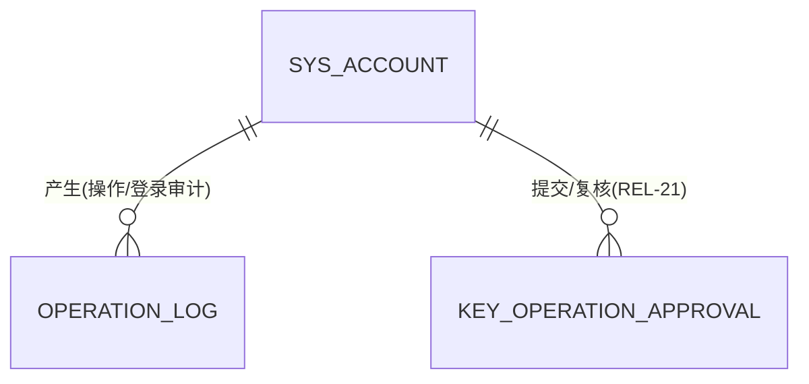
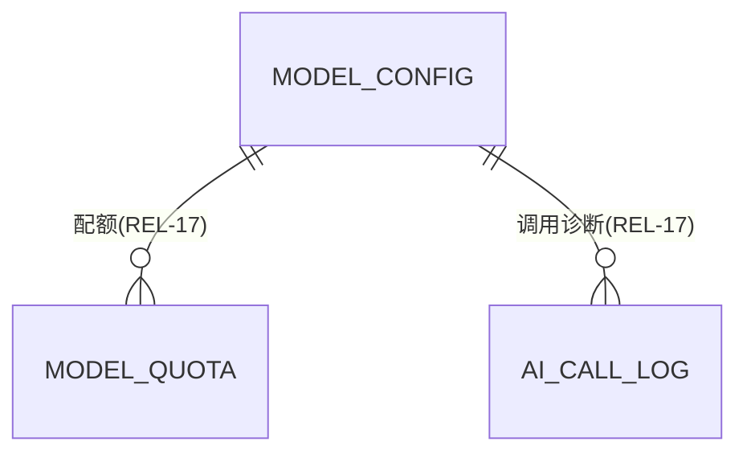
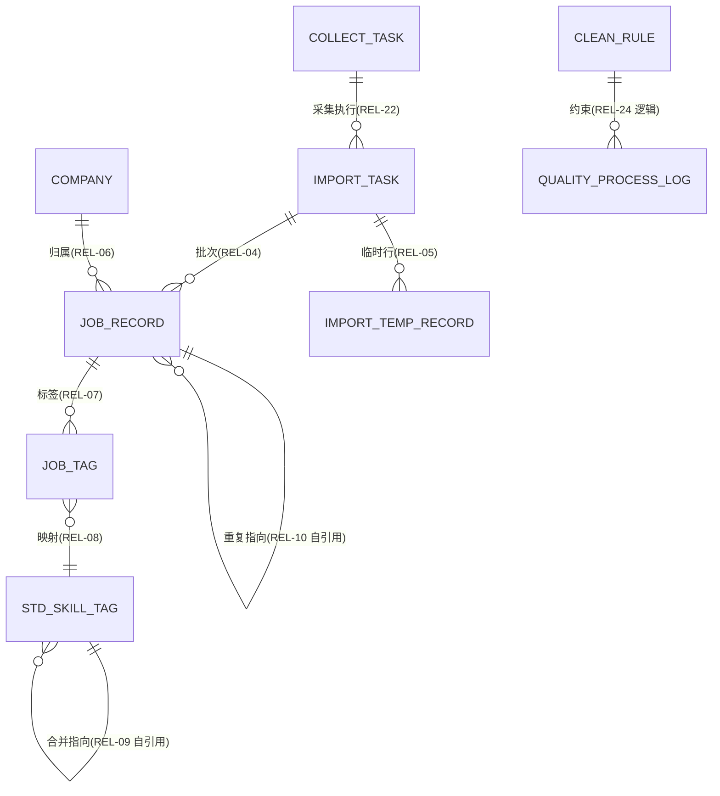
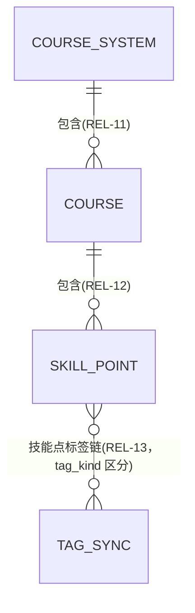

# 人才智库系统 数据库设计文档 (db-design.md)

> 依据：`spec.md` v2.24.0（confirmed）> `plan.md` v3.21.0（技术架构）> 用户交互裁决（Q1~Q7 + 草案确认，2026-11-24；收尾口径冻结 2026-11-26；导入字段口径、冗余表清理与标准提示词对齐 2026-11-27）。
> 阶段边界：本阶段仅做数据建模与数据库设计；不含 ORM 选型、代码实现、性能优化实现、部署运维、备份恢复实施方案。
> 来源标注约定：`REQ-*`/`INV-*`/`AC-*`/`NFR-*` = 需求文档明确表述；`归纳` = 对需求的建模归纳；`假设 H-*` = 暂时性假设（见 §11）；`待确认` = 信息缺失（见 §11）；`用户裁决 Qx` = 交互轮裁决结论。

---

## 1. 文档元信息

| 项目 | 内容 |
| --- | --- |
| 状态 | 已确认（结构化设计总结草案经用户确认后生成正式版） |
| 作者 | 数据库架构师（AI）产出，用户逐轮交互裁决确认（Q1~Q7 与草案确认均有交互记录） |
| 日期 | 2026-11-24 |
| 关联需求文档版本 | `spec.md` v2.24.0（confirmed，2026-11-27）；`plan.md` v3.21.0（架构上下文） |
| 收敛过程 | 3 轮交互：R1 前置确认与候选实体识别；R2 判重/对齐/生命周期/索引依据裁决（Q5~Q7）；R3 结构化设计总结草案确认 |
| 变更记录 | v1.16.0（2026-11-27）：**表数量三次压缩（C2~C5，用户裁决）**——①`job_family_correction` 并入 `quality_process_log`（issue_type=CORRECTION + ref_job_id + payload_json；删 TABLE-17/ENTITY-29/FK-09/REL-18）；②`review_opinion` 并入 `report.review_opinions_json`（删 TABLE-28/ENTITY-25/FK-19/REL-16），并补 `report.review_progress_json` 承载四级流程/专家人数/意见截止/查看情况；③`annual_key_conclusion` 并入 `achievement_ledger`（item_kind=ACHIEVEMENT/CONCLUSION；删 TABLE-30/ENTITY-27）；④`tag_pending_item` 并入 `tag_change_log`（change_type=SUGGESTION/SUGGESTION_IGNORED + item_status；删 TABLE-23/ENTITY-20）。计数：33→**29 实体**、19→**17 关系**、34→**30 表**；验收行为不变（AC-13/63/61/64/07），编号留空不重排。v1.15.0（2026-11-27）：**表数量二次压缩（C1，用户裁决）**——`model_route_policy` 并入 `model_config`（新增 `route_role`/`route_trigger_json`/`route_enabled`，CK-27；删 TABLE-09/ENTITY-07/FK-14/15）；主备唯一性与启停由应用层校验，回落/切回留痕仍写操作日志（AC-70）；REQ-68 业务行为不变。计数：34→**33 实体**、关系保持 **19**（REL-17 仍覆盖配额/调用诊断）、35→**34 表**；编号留空不重排。v1.14.0（2026-11-27）：**表数量压缩（方案 B，用户裁决）**——①`role` 改代码常量（删 TABLE-02/ENTITY-02/FK-01/REL-01，新增 CK-23）；②`login_audit` 并入 `operation_log`（新增 log_type/account_name/login_result/client_info，account_id/employee_no 放宽可空；删 TABLE-07/ENTITY-05，INDEX-25 改指 operation_log）；③`std_tag_sync`+`industry_tag_sync` → `tag_sync(tag_kind)`（ENTITY-33 扩展，删 TABLE-36/ENTITY-34）；④两张技能点标签链 → `skill_point_tag_link`（TABLE-37 吸收 TABLE-38，删 REL-14/FK-24/25）；⑤`collect_run` 并入 `import_task`（新增 collect_task_id/fetched_bytes/collect_status，删 TABLE-42/ENTITY-38/REL-23/LR-07）；⑥`field_mapping` 并入 `import_task.mapping_json`（+version 乐观锁，删 TABLE-14/ENTITY-12/FK-06/INDEX-10）；⑦`review_progress` 并入 `adjustment_window.review_stages_json`（删 TABLE-26/ENTITY-23/FK-18）。计数：42→**35 表**、40→**34 实体**、22→**19 关系**；表/实体编号留空不重排。v1.13.0（2026-11-27）：**按标准 AI 提示词对齐（spec v2.24）**——①job_record 新增标准字典原文保留字段：age_requirement/language_requirement/job_type/major_requirement/gender_requirement/recruitment_req（均 NULL）；②标准字段别名：industry→industry_category、salary→salary_raw、workLocation→work_city、jd→job_text；③建议类型 COURSE_ADJUST→**COURSE_CONTENT（课程内容）**；④H-19 更新（行业文件优先、技能不映射），新增 H-21（标准提示词契约适配），计数不变。v1.12.0（2026-11-27）：**冗余表清理与口径收敛（spec v2.23）**——①删除 `field_mapping_cache`（ENTITY-13/TABLE-15/UQ-03/INDEX-11）：映射缓存统一走 Redis；②删除 `account_data_scope`（TABLE-05/REL-03/FK-04）：数据范围收敛为全校/只读汇总/全系统，取消“指定专业数据”；③删除 `permission`/`role_permission`（ENTITY-03/TABLE-03/04/REL-02/FK-02/03）：权限点与角色授权改为代码常量、矩阵只读；④计数 42 实体/24 关系/46 表 → **40 实体/22 关系/42 表（含 2 张关联表）**；⑤CK-03/DataScope 去 MAJOR，新增 H-20/R-DB-07。v1.11.1（2026-11-27）：**导入来源字段口径（spec v2.22.1）**——①job_record.skill_requirement 改为可空（无则由 AI 从岗位描述抽取）；②job_record.industry_category 改为可空并按 `company.industry` 回填（企业行业未确认不入正式表）；③新增 H-19（行业来源/技能可选）；④修正 INDEX-02 字段名 city→work_city。v1.11（2026-11-26）：**收尾口径冻结同步 spec v2.22 / plan v3.19**——①**删除 sys_param**（ENTITY-28/TABLE-31/UQ-08/H-07 废止）：参数配置改为系统内页面经 Nacos OpenAPI 读写（AD-17），不建通用参数表；②新增**人才需求预测结果表** prediction_result（ENTITY-43/TABLE-46、INDEX-41，REQ-72/AC-98）：预测值/趋势方向/增长提示/MAPE/模型版本/生成时间/筛选与周期；③补枚举 PredictionModelType/PredictionPeriodType/TrendDirection；④质量评分分母更新为正式表全部记录（H-11）；⑤目标企业清单改为全量替换、历史版本不留存（H-15）；⑥OPEN-DB-02/03/04 关闭、OPEN-03 冻结关闭；⑦计数保持 42 实体/24 关系/46 表（删 1 加 1）；⑧H-12 手工补录批次按日聚合（OPEN-DB-05 关闭）；⑨任务调度/备份恢复为占位权限点（17 项不变、无功能入口）。v1.10（2026-11-26）：**全量对齐 spec v2.21**——①**软数智云标记改为企业级**：从 job_record 移至 company（REQ-56/术语表），新增 CK-16；②新增**目标企业清单表** target_company（TABLE-45，REQ-31/GAP-03）；③采集/清洗表编号冲突修正并纳入实体清单：collect_task/collect_run/clean_rule/quality_process_log → TABLE-41~44、ENTITY-37~40；④复核单补 ENTITY-42/CK-17/FK-26~27；⑤新增 UQ-12、INDEX-37~40、CK-18；⑥枚举补 RoleCode/AiCollabType/Approval*/Collect*/IssueType/ReportFormat；⑦更新 H-03/H-07/H-11/H-12，新增 H-14~H-16、OPEN-DB-02~04、CF-06~07；⑧计数修正为 42 实体/24 关系/46 表；⑨分库命名 curriculum-service。v1.9（2026-11-26）：看板岗位需求明细口径同步（spec v2.20）——改名「岗位需求明细」、全部聚合岗位按需求量降序、不做紧缺指数/状态（仅看板范围）；INDEX-06/P-06 索引说明同步（无表结构变更）。v1.8（2026-11-26）：AI 协同岗位结构卡口径同步（spec v2.19）——job_record 新增 `ai_collab_type`（AI 应用开发/AI 辅助测试·运维；AI_COLLAB 打标同时输出，非协同为 NULL，INV-04 禁人工修正）；新增 CK-15；BR-02 补子类。v1.2（2026-11-24）：job_record 扩展岗位属性（用户裁决）——新增所在区域 district、工作地址 work_address、学历要求 education_requirement、工作年限 work_experience、福利 benefits（均非必填可空，导入原文保留）；salary_raw/job_text 说明文案对齐"待遇/岗位描述"。v1.1（2026-11-24）：系统账号表修订（用户裁决）——表名 account→sys_account；新增 account_name 为登录凭证（唯一）；工号/统一认证账号仅展示（撤销唯一约束）；密码字段=password_hash；login_audit 增记登录尝试账号名（未知账号登录失败 account_id 为 NULL）；新增 H-13、CF-05 |

---

## 2. 设计背景与目标

### 2.1 业务背景概述

系统导入长三角软件与信息技术产业的招聘数据（企业/岗位/招聘需求/技能要求，约 124 万条记录量级，NFR-01 口径待复核），经异步 AI 打标后支撑产业数据看板统计、岗位与技能分析、专业调整建议生成与课程体系维护，形成"外部岗位数据 → 导入与智能标注 → 多维统计 → 专业调整建议 → 课程优化"的业务闭环（spec §1）。

### 2.2 设计目标与原则

1. **需求一致性**：全部实体/关系/约束可追溯至 `spec.md` 的 REQ/INV/AC/NFR 编号；不发明业务规则（constitution §7）。
2. **分域自治**：按微服务边界拆分为 4 个独立数据库（用户裁决 Q1），跨库不建外键、不 Join，一致性经 RocketMQ 事件与 OpenFeign 读取保障（plan.md AD-09）。
3. **完整性优先**：单库内启用主键/唯一/检查/外键全套约束（用户裁决 Q2）；业务不变量（INV-01~10）以约束 + 写入口隔离 + 审计三层落实。
4. **极简**：仅建模本期 In Scope（spec §4.1）；后续迭代裁剪项（JSON 导入、审批流、导出、数据源配置等）不建表（YAGNI）。
5. **诚实标注**：所有推断项显式标注 `归纳` / `假设` / `待确认`，不伪确定。

---

## 3. 术语表 (Glossary)

### 3.1 数据模型通用术语

| 术语 | 定义 |
| --- | --- |
| 实体 (ENTITY) | 业务概念在数据模型中的抽象，分配 `ENTITY-*` 唯一编号 |
| 表 (TABLE) | 实体在关系型存储中的物理承载；关联表可仅实现关系而不独立对应实体 |
| 关系 (REL) | 实体间业务关联（1:1 / 1:N / N:N / 自引用 / 跨库同步），分配 `REL-*` 编号 |
| 代理主键 | `id BIGINT AUTO_INCREMENT`，无业务含义，仅作行标识与外键目标 |
| 业务键 | 承载业务唯一性的列或列组合（如任务编码、工号、标签编码），以唯一约束强制 |
| 自然键 | 来自业务现实的标识（如企业公司名称），非系统生成 |
| 逻辑外键 | 跨库/多态引用，数据库层不建 FK，以应用层校验 + 事件同步维护（`LR-*` 编号） |
| 同步副本 | 跨库数据一致性方案：目标库存放源数据副本，由变更事件（RocketMQ）维护（如 `tag_sync`） |
| 只增表 | 仅允许 INSERT、禁止 UPDATE/DELETE 的表（INV-03），以写入口隔离实现 |
| 标记字段 | 承载业务标记的布尔/枚举列（如 duplicate_flag）；部分标记禁止人工修正（INV-04） |
| 口径 | 统计计算规则（去重、时间归属、有效性判定），随索引与查询设计一并追溯 |
| 脱敏 | 导入入库时仅保留岗位与技能分析所需字段，禁止个人联系方式与简历原文（REQ-03/70） |

### 3.2 业务术语与表/字段映射（统一语言，spec §2 为准）

| spec 术语 | 映射 |
| --- | --- |
| 临时任务记录 / 导入任务（IMP-*） | `import_task`（TABLE-12），五态状态机 |
| 临时表 / 正式表 | `import_temp_record`（TABLE-13）/ `job_record`（TABLE-16） |
| 废弃 | `import_temp_record.discard_flag=1`（INV-08，行级标记） |
| 重复标记 | `job_record.duplicate_flag` + `duplicate_of_id`（INV-01，全局跨批次先到有效，Q3） |
| 岗位 / 招聘需求（1:1 等同，OPEN-04） | 单实体 `job_record`（H-01） |
| 有效职位 | `job_record` 中 `duplicate_flag=0 AND job_family IS NOT NULL`（INV-02） |
| 岗位族 | `job_record.job_family`（3 类枚举可空，CK-04） |
| AI 协同岗位 | `job_record.ai_collab_flag` + `ai_collab_type`（子类：AI 应用开发/AI 辅助测试·运维，INV-04 无人工修正入口） |
| 软数智云 | **企业级标记** `company.soft_digital_cloud_flag`（REQ-56/术语表，v1.10 由 job_record 迁入；INV-04 无人工修正入口） |
| 采集任务 / 增量更新 | `collect_task`（TABLE-41）/ `import_task` 采集执行字段（TABLE-12，v1.14 合并原 collect_run）；仅模板与文件拉取，无爬虫（REQ-75） |
| 处理台账 | `quality_process_log`（TABLE-44，REQ-76） |
| 【软数智云】目标企业清单 | `target_company`（TABLE-45；目标企业覆盖率分母，Excel 导入维护，REQ-31/GAP-03） |
| 原始标签 / 抽取标签 | `job_tag.tag_source` = IMPORTED / EXTRACTED（INV-03 只增） |
| 标准技能标签 | `std_skill_tag`（TABLE-20，归属 data_db，用户裁决） |
| 产业技能标签 | 岗位侧技能标签（`job_tag` 派生口径），课程侧经 `tag_sync`（TABLE-35，tag_kind=INDUSTRY）同步副本对齐（REQ-53、Q4） |
| 知识图谱 / 覆盖率 | `skill_point_industry_tag_link`（TABLE-38）单向口径：被技能点关联的产业技能标签数 ÷ 产业技能标签总数（OPEN-07） |
| 字段映射 | `import_task.mapping_json`（TABLE-12，v1.14 合并原 field_mapping）；映射缓存走 **Redis**（不建 `field_mapping_cache` 表，v1.12） |
| 专业调整建议（ADJ-*） | `adjustment_suggestion`（TABLE-24） |
| 报告（RPT-*） | `report`（TABLE-27，文件存本地磁盘） |
| 系统账号 / 登录账号 | `sys_account`（TABLE-01）；登录凭证=account_name（唯一），工号/统一认证账号仅做展示（用户裁决，CF-05） |

---

## 4. 数据库选型说明

> 按角色规则：数据库类型、引擎/版本由上游明确指定，仅说明采用前提、适配约束与已知影响；不事后臆造选型理由。

| 项 | 内容 | 来源 |
| --- | --- | --- |
| 数据库类型 | 关系型 | 用户裁决 Q1（plan.md"用户指定"） |
| 引擎/方言 | MySQL（InnoDB） | 用户裁决 Q1 |
| 版本 | MySQL 8.0.x（minor 版本待确认，见 OPEN-DB-01） | 用户裁决 Q1 |
| 分库边界 | 4 个独立库：user_db（账号审计域）/ ai_db（模型调用域）/ data_db（导入分析域）/ curriculum_db（课程对齐域），一一对应 user/ai/data/curriculum 四服务（curriculum-service） | 用户裁决 Q1、plan.md |
| 适配约束 | ①跨库禁 Join、禁跨库 FK，跨库仅 RocketMQ 事件 / OpenFeign / 网关三通道；②CHECK 约束需 MySQL ≥ 8.0.16（OPEN-DB-01 与此关联）；③统一 utf8mb4 字符集；④统计口径统一出口在 data-service | plan.md AD-09、Q1 |
| 已知影响 | 跨库引用（如建议→课程体系）只能以逻辑外键 + 应用层校验保障，存在最终一致窗口（详见 §7.3、§11） | 归纳 |

---

## 5. 概念数据模型 (CDM)

### 5.1 ERD 描述

系统共 29 个实体、17 条关系、30 张有效表（含 1 张关联表）。按四个数据库分域（v1.12：删除 field_mapping_cache/account_data_scope/permission/role_permission，sys_param 废止不计入；v1.14：角色常量化，login_audit/field_mapping/collect_run/review_progress 分别并入 operation_log/import_task/import_task/adjustment_window，两张标签同步表与两张技能点标签链各合并为一张；v1.15：model_route_policy 并入 model_config；v1.16：岗位族校正/评审意见/年度结论/标签待处理分别并入质量台账/报告/年度台账/标签变更流水）：

**user_db（账号与审计域）**

**ai_db（模型与调用域）**

**data_db（导入与分析域，统计口径统一出口）**

**curriculum_db（课程与对齐域）**

**跨库关系（无 FK）**：`std_skill_tag → tag_sync(tag_kind=STD)`（REL-19 事件同步）、`产业技能标签 → tag_sync(tag_kind=INDUSTRY)`（REL-20，REQ-53 同步）、`adjustment_suggestion → course_system`（REL-15 逻辑引用）。  
**清单匹配关系（无 FK）**：`target_company.company_name` 与 `company.company_name` 按名称匹配计算目标企业覆盖率（名称归一规则同判重 Q3；v1.10）。

### 5.2 核心实体清单（ENTITY-*）

| 编号 | 实体 | 表 | 库 | 来源 |
| --- | --- | --- | --- | --- |
| ENTITY-01 | 系统账号 | sys_account | user_db | REQ-01/02、用户裁决（CF-05） |
| ~~ENTITY-02~~ | ~~角色~~（**已废止，v1.14**） | ~~role~~（角色改代码常量，CK-23 校验） | — | REQ-63 |
| ENTITY-03 | ~~权限点~~（**已废止，v1.12**） | ~~permission~~ | —（权限点为代码常量） | 原 REQ-63；v2.23 裁决改为内置固定配置 |
| ENTITY-04 | 操作日志 | operation_log | user_db | REQ-24/64 |
| ~~ENTITY-05~~ | ~~登录审计~~（**已废止，v1.14**） | ~~login_audit~~（并入 ENTITY-04 operation_log，log_type=LOGIN） | — | REQ-24 |
| ENTITY-06 | AI 大模型配置 | model_config | ai_db | REQ-67 |
| ~~ENTITY-07~~ | ~~模型路由策略~~（**已废止，v1.15**） | ~~model_route_policy~~（并入 ENTITY-06 model_config 路由字段） | — | REQ-68 |
| ENTITY-08 | 模型用量配额 | model_quota | ai_db | REQ-69 |
| ENTITY-09 | AI 调用诊断 | ai_call_log | ai_db | INV-07/REQ-10 |
| ENTITY-10 | 导入任务 | import_task | data_db | REQ-03/06/55 |
| ENTITY-11 | 导入临时数据 | import_temp_record | data_db | REQ-05、INV-08 |
| ~~ENTITY-12~~ | ~~字段映射~~（**已废止，v1.14**） | ~~field_mapping~~（并入 ENTITY-10 import_task.mapping_json） | — | REQ-04 |
| ENTITY-13 | ~~字段映射缓存~~（**已废止，v1.12**） | ~~field_mapping_cache~~ | —（缓存走 Redis） | 原 REQ-04；v2.23 裁决 |
| ENTITY-14 | 岗位/招聘需求 | job_record | data_db | REQ-05/06、OPEN-04、H-01 |
| ENTITY-15 | 企业 | company | data_db | REQ-28/31/56、H-04 |
| ENTITY-16 | 岗位标签（原始/抽取） | job_tag | data_db | REQ-08/09、INV-03 |
| ENTITY-17 | 标准技能标签 | std_skill_tag | data_db | REQ-07 |
| ENTITY-18 | 标签映射与校正 | tag_mapping | data_db | REQ-08 |
| ENTITY-19 | 标签变更/合并记录 | tag_change_log | data_db | REQ-07、AC-67 |
| ~~ENTITY-20~~ | ~~标签待处理事项~~（**已废止，v1.16**） | ~~tag_pending_item~~（并入 ENTITY-19 tag_change_log，change_type=SUGGESTION） | — | REQ-07 |
| ENTITY-21 | 专业调整建议 | adjustment_suggestion | data_db | REQ-19~21、INV-05 |
| ENTITY-22 | 调整窗口 | adjustment_window | data_db | REQ-49 |
| ~~ENTITY-23~~ | ~~评审进度~~（**已废止，v1.14**） | ~~review_progress~~（并入 ENTITY-22 adjustment_window.review_stages_json） | — | REQ-49、C-11 |
| ENTITY-24 | 报告 | report | data_db | REQ-26/58 |
| ~~ENTITY-25~~ | ~~外部评审意见~~（**已废止，v1.16**） | ~~review_opinion~~（并入 ENTITY-24 report.review_opinions_json） | — | REQ-61、T-21 |
| ENTITY-26 | 年度建设成果台账 | achievement_ledger | data_db | REQ-62 |
| ~~ENTITY-27~~ | ~~年度关键结论~~（**已废止，v1.16**） | ~~annual_key_conclusion~~（并入 ENTITY-26 achievement_ledger，item_kind=CONCLUSION） | — | REQ-59 |
| ENTITY-28 | ~~系统参数~~（**已废止，v1.11**） | ~~sys_param~~ | —（参数走 Nacos，不建表） | 原 plan.md GAP-01、H-07（废止）；v2.22 裁决改 Nacos（AD-17） |
| ~~ENTITY-29~~ | ~~岗位族人工校正留痕~~（**已废止，v1.16**） | ~~job_family_correction~~（并入 ENTITY-40 quality_process_log，issue_type=CORRECTION） | — | REQ-11、AC-13、H-03 |
| ENTITY-30 | 课程体系 | course_system | curriculum_db | REQ-16 |
| ENTITY-31 | 课程 | course | curriculum_db | REQ-17 |
| ENTITY-32 | 知识技能点 | skill_point | curriculum_db | REQ-18 |
| ENTITY-33 | 技能标签同步副本（tag_kind 区分标准/产业） | tag_sync | curriculum_db | Q4、AC-67、REQ-53、H-09（v1.14 合并） |
| ~~ENTITY-34~~ | ~~产业技能标签同步副本~~（**已废止，v1.14**） | ~~industry_tag_sync~~（并入 ENTITY-33 tag_sync，tag_kind=INDUSTRY） | — | REQ-53、Q4 |
| ENTITY-35 | 课程变更记录 | course_change_log | curriculum_db | REQ-16/17 |
| ENTITY-36 | 技能变化更新提示 | update_hint | curriculum_db | REQ-54、ASM-16 |
| ENTITY-37 | 采集任务 | collect_task（TABLE-41） | data_db | REQ-75、AC-93 |
| ~~ENTITY-38~~ | ~~采集执行记录~~（**已废止，v1.14**） | ~~collect_run~~（并入 ENTITY-10 import_task 采集执行字段） | — | REQ-75、AC-93 |
| ENTITY-39 | 清洗规则 | clean_rule（TABLE-43） | data_db | REQ-76、AC-94 |
| ENTITY-40 | 质量处理台账 | quality_process_log（TABLE-44） | data_db | REQ-76、AC-94 |
| ENTITY-41 | 【软数智云】目标企业清单 | target_company（TABLE-45） | data_db | REQ-31、GAP-03 |
| ENTITY-42 | 关键操作复核单 | key_operation_approval（TABLE-05A） | user_db | REQ-74、AC-92 |
| ENTITY-43 | 人才需求预测结果 | prediction_result（TABLE-46） | data_db | REQ-72、AC-98（v1.11） |

### 5.3 实体关系清单（REL-*）

| 编号 | 关系 | 基数 | 实现 | 来源 |
| --- | --- | --- | --- | --- |
| ~~REL-01~~ | ~~系统账号 → 角色~~（**已废止，v1.14**） | — | 角色改代码常量，sys_account.role_code 由 CK-23 校验 | REQ-02/63 |
| ~~REL-02~~ | ~~角色 ↔ 权限点~~（**已废止，v1.12**） | — | 权限点与角色授权为代码常量（无关联表） | REQ-63（v2.23） |
| ~~REL-03~~ | ~~系统账号 → 指定专业数据范围~~（**已废止，v1.12**） | — | 数据范围收敛为全校/只读/全系统（无关联表） | REQ-63（v2.23） |
| REL-04 | 导入任务 → 岗位数据 | 1:N | FK（job_record.task_id，可空=手工补录无批次） | REQ-06/75、ASM-09 |
| REL-05 | 导入任务 → 导入临时数据 | 1:N | FK（import_temp_record.task_id） | REQ-05、INV-08 |
| REL-06 | 岗位 → 企业 | N:1 | FK（job_record.company_id） | REQ-31、H-04 |
| REL-07 | 岗位 → 岗位标签 | 1:N | FK（job_tag.job_id） | REQ-08/09 |
| REL-08 | 岗位标签 → 标准技能标签（映射） | N:1 | 关联表 tag_mapping（TABLE-21） | REQ-08、INV-03 |
| REL-09 | 标准技能标签合并（被合并 → 保留） | 自引用 | tag_change_log + 映射重指向 | REQ-07、AC-67 |
| REL-10 | 岗位重复指向（后到 → 先到有效） | 自引用 N:1 | FK（job_record.duplicate_of_id） | INV-01、Q3 |
| REL-11 | 课程体系 → 课程 | 1:N | FK（course.course_system_id） | REQ-16/17 |
| REL-12 | 课程 → 知识技能点 | 1:N | FK（skill_point.course_id） | REQ-17/18 |
| REL-13 | 技能点 ↔ 技能标签（标准/产业由 tag_sync.tag_kind 区分） | N:N | 关联表 skill_point_tag_link（TABLE-37）→ tag_sync | REQ-18/52/53、Q4（v1.14 合并） |
| ~~REL-14~~ | ~~技能点 ↔ 产业技能标签（独立关联表）~~（**已废止，v1.14**） | — | 并入 REL-13（tag_kind=INDUSTRY） | REQ-52/53、Q4 |
| REL-15 | 建议 → 目标课程体系（跨库） | N:1 | 逻辑外键 LR-01（存业务键，无 FK） | REQ-19 |
| ~~REL-16~~ | ~~报告 → 外部评审意见~~（**已废止，v1.16**） | — | 意见并入 report.review_opinions_json | REQ-61 |
| REL-17 | 模型配置 → 配额 / 调用诊断（主备路由并入主表字段，v1.15） | 1:N | FK（model_quota/ai_call_log.model_id） | REQ-67/68/69（v1.15） |
| ~~REL-18~~ | ~~岗位 → 岗位族校正留痕~~（**已废止，v1.16**） | — | 校正留痕并入 quality_process_log（ref_job_id，FK-29） | REQ-11、AC-13 |
| REL-19 | 标准技能标签 ↔ 标准同步副本（跨库） | 同步 | 逻辑外键 LR-03（TagChanged 事件） | REQ-07、AC-67、H-09 |
| REL-20 | 产业技能标签 ↔ 产业同步副本（跨库） | 同步 | 逻辑外键 LR-04（REQ-53 同步动作） | REQ-53、Q4 |
| REL-21 | 系统账号 → 关键操作复核单（提交人/复核人） | 1:N | FK-26/27（两个 N:1 角色引用） | REQ-74、AC-92 |
| REL-22 | 采集任务 → 导入任务（采集执行记录并入任务行） | 1:N | FK-28（import_task.collect_task_id，可空） | REQ-75、AC-93（v1.14） |
| ~~REL-23~~ | ~~采集执行记录 → 导入任务~~（**已废止，v1.14**） | — | 执行记录已并入 import_task，无需逻辑外键 | REQ-75、AC-93 |
| REL-24 | 清洗规则 → 质量处理台账 | 1:N | 逻辑外键 LR-08（存 rule_code 快照，台账只读留存） | REQ-76、AC-94 |

---

## 6. 逻辑数据模型 (LDM)

> 约定：每表主键为 `id BIGINT UNSIGNED AUTO_INCREMENT`（"主键约束"汇总见 §7.1，逐表不重复声明）；`created_at`/`updated_at` 为 `DATETIME NOT NULL DEFAULT CURRENT_TIMESTAMP` / `ON UPDATE CURRENT_TIMESTAMP` 通用审计列（"来源=归纳"，下表不再逐行标注）；字符集 utf8mb4。字段级"来源"列即字段追溯（§13 约定引用，不重复列出）。

### 6.1 user_db

#### TABLE-01 sys_account（系统账号，ENTITY-01）

| 字段 | 类型 | 约束 | 默认 | 说明 | 来源 |
| --- | --- | --- | --- | --- | --- |
| id | BIGINT UNSIGNED | PK | auto | 代理主键 | 归纳 |
| account_name | VARCHAR(64) | NOT NULL, UNIQUE(UQ-01) | — | 登录账号（登录凭证，REQ-01 登录使用） | 用户裁决 |
| name | VARCHAR(64) | NOT NULL | — | 姓名（创建字段） | REQ-02 |
| employee_no | VARCHAR(64) | NOT NULL | — | 工号/统一认证账号（仅展示，非登录凭证，不设唯一约束，H-13） | REQ-02、用户裁决 |
| department | VARCHAR(128) | NOT NULL | — | 所属部门 | REQ-02 |
| city | VARCHAR(64) | NOT NULL | — | 所在城市（看板区域对比【本地】标签判定依据） | REQ-02/33、AC-73 |
| role_code | VARCHAR(32) | NOT NULL, CK-23 | — | 角色（六类，代码常量，v1.14 常量化） | REQ-02/63 |
| data_scope | VARCHAR(32) | NOT NULL, CK-03 | — | 数据范围枚举（见 §8） | REQ-63 |
| permission_note | VARCHAR(255) | NULL | NULL | 权限说明 | REQ-02 |
| status | VARCHAR(16) | NOT NULL, CK-02 | 'ACTIVE' | 启用/停用（维护期操作字段，非创建字段） | REQ-02 |
| password_hash | VARCHAR(255) | NOT NULL | — | 密码字段（哈希存储；8 位以上含字母数字，应用层校验；修改后重新登录） | REQ-01/02 |
| last_login_at | DATETIME | NULL | NULL | 最近登录时间 | REQ-64 |

#### ~~TABLE-02 role（角色，ENTITY-02）~~ —— 已废止（v1.14）

> **废止说明（2026-11-27 用户裁决，方案 B 表压缩）**：六类角色为固定字典，改**代码常量**；`sys_account.role_code` 由 CK-23 枚举校验，角色名称/职责由常量输出，不建角色表、不提供维护入口。

#### ~~TABLE-03 permission（权限点，ENTITY-03）~~ —— 已废止（v1.12）

> **废止说明（2026-11-27 用户裁决，spec v2.23）**：17 项权限点与六类角色授权改为**系统内置固定配置（代码常量）**，权限矩阵只读计算；**不建 permission / role_permission 表**，不提供授权维护入口。任务调度、备份恢复仍为占位权限点（无功能入口）。

#### ~~TABLE-04 role_permission（角色权限授权，REL-02 关联表）~~ —— 已废止（v1.12）

> 随 TABLE-03 一并废止（角色授权常量化）。

#### ~~TABLE-05 account_data_scope（账号指定专业范围，REL-03 关联表）~~ —— 已废止（v1.12）

> **废止说明（spec v2.23）**：数据范围收敛为**全校/只读汇总/全系统**三项，取消“指定专业数据”，不建本表；`sys_account.data_scope` 字段保留。

#### TABLE-05A key_operation_approval（关键操作复核单，v1.6 新增）

| 字段 | 类型 | 约束 | 默认 | 说明 | 来源 |
| --- | --- | --- | --- | --- | --- |
| approval_id | BIGINT UNSIGNED | PK, AUTO_INCREMENT | — | 复核单 ID | REQ-74 |
| operation_type | VARCHAR(64) | NOT NULL | — | 操作类型（账号创建/停用/密码重置/角色权限变更/模型Key配置/参数配置/备份恢复） | REQ-74 |
| payload | JSON | NOT NULL | — | 待生效操作的参数快照 | REQ-74 |
| submitter_id | BIGINT UNSIGNED | NOT NULL, FK-26 → sys_account | — | 提交人 | REQ-74 |
| reviewer_id | BIGINT UNSIGNED | NULL, FK-27 → sys_account | NULL | 复核人（**不得等于提交人，应用层强制**） | REQ-74 |
| status | VARCHAR(16) | NOT NULL, CK-17 | PENDING | 状态（PENDING 待复核/APPROVED 已复核/REJECTED 已驳回） | REQ-74 |
| review_comment | VARCHAR(255) | NULL | NULL | 复核意见 | REQ-74 |
| created_at | DATETIME | NOT NULL | — | 提交时间 | REQ-74 |
| reviewed_at | DATETIME | NULL | NULL | 复核时间 | REQ-74 |

> 索引：`idx_approval_status (status, created_at)`（待复核列表倒序）；复核通过/驳回均写入 operation_log。

#### TABLE-06 operation_log（操作日志，ENTITY-04）

| 字段 | 类型 | 约束 | 默认 | 说明 | 来源 |
| --- | --- | --- | --- | --- | --- |
| log_type | VARCHAR(16) | NOT NULL, CK-24 | 'OPERATION' | 审计类型：OPERATION 操作日志 / LOGIN 登录审计（v1.14 合并 TABLE-07） | REQ-24/64 |
| account_id | BIGINT UNSIGNED | NULL | NULL | 操作账号（登录审计未知账号失败时为 NULL） | REQ-24/64、plan.md |
| employee_no | VARCHAR(64) | NULL | NULL | 工号（展示冗余；未知账号登录失败时 NULL） | 归纳、用户裁决 |
| account_name | VARCHAR(64) | NULL | NULL | 登录尝试账号（仅 log_type=LOGIN，未知账号也记录） | REQ-24（v1.14） |
| login_result | VARCHAR(16) | NULL, CK-25 | NULL | 登录结果 SUCCESS/FAILED（仅 log_type=LOGIN） | REQ-24（v1.14） |
| client_info | VARCHAR(255) | NULL | NULL | 客户端标识（仅登录审计） | 归纳（v1.14） |
| operate_time | DATETIME | NOT NULL | — | 操作/登录时间（倒序展示） | REQ-24/64 |
| operate_content | VARCHAR(500) | NOT NULL | — | 操作内容（网关按请求路径映射）；登录审计固定为“登录成功/登录失败” | REQ-24/64、plan.md |
| request_path | VARCHAR(255) | NULL | NULL | 请求路径 | 归纳 |
| trace_id | VARCHAR(64) | NULL | NULL | 链路追踪 ID | 归纳 |

> 无 UPDATE/DELETE 应用入口（REQ-64 不可编辑删除）；仅定时任务 90 天清理可删（§10）。查询接口按 `log_type` 固化过滤：`/audit/logs`=OPERATION、`/audit/login-records`=LOGIN。

#### ~~TABLE-07 login_audit（登录审计，ENTITY-05）~~ —— 已废止（v1.14）

> **废止说明（2026-11-27 用户裁决，方案 B 表压缩）**：登录审计并入 TABLE-06 operation_log（`log_type=LOGIN`，account_name/login_result/client_info 字段已补入该表）；接口 `/api/v1/audit/login-records` 与 90 天清理策略不变。

### 6.2 ai_db

#### TABLE-08 model_config（AI 大模型配置，ENTITY-06）

| 字段 | 类型 | 约束 | 默认 | 说明 | 来源 |
| --- | --- | --- | --- | --- | --- |
| model_name | VARCHAR(128) | NOT NULL | — | 模型名称 | REQ-67 |
| provider | VARCHAR(64) | NOT NULL | — | 服务商 | REQ-67 |
| access_type | VARCHAR(16) | NOT NULL | — | 接入方式：API / LOCAL（§8） | REQ-67 |
| base_url | VARCHAR(255) | NOT NULL | — | API Base URL | REQ-67 |
| api_key_cipher | VARCHAR(512) | NOT NULL | — | API Key AES 密文，保存后不可查看 | REQ-67、AC-69 |
| status | VARCHAR(16) | NOT NULL | — | 状态（启用/停用/灰度验证） | REQ-67 |
| route_role | VARCHAR(16) | NULL, CK-27 | NULL | 路由角色：PRIMARY 主 / BACKUP 备（NULL=未参与主备路由，v1.15 由 model_route_policy 并入） | REQ-68 |
| route_trigger_json | JSON | NULL | NULL | 路由触发条件（连续失败 N 次/超时/错误率） | REQ-68（v1.15） |
| route_enabled | TINYINT(1) | NOT NULL | 0 | 路由策略启停 | REQ-68（v1.15） |
| remark | VARCHAR(255) | NULL | NULL | 备注 | REQ-67 |

> 主备路由为**全局单策略**：`route_role` 非空的行构成主备两方（PRIMARY/BACKUP 各至多 1 个），由应用层校验；回落/切回留痕写入操作日志（AC-70），不另建切换记录表（极简）。

#### ~~TABLE-09 model_route_policy（模型路由策略，ENTITY-07）~~ —— 已废止（v1.15）

> **废止说明（2026-11-27 用户裁决，C1 二次压缩）**：主备路由并入 TABLE-08 `model_config`（route_role / route_trigger_json / route_enabled）；REQ-68 主/备、触发条件、启停能力与 AC-70 留痕不变。

#### TABLE-10 model_quota（模型用量配额，ENTITY-08）

| 字段 | 类型 | 约束 | 默认 | 说明 | 来源 |
| --- | --- | --- | --- | --- | --- |
| model_id | BIGINT UNSIGNED | NOT NULL, FK-16 → model_config | — | 模型 | REQ-69 |
| quota_month | CHAR(7) | NOT NULL | — | 配额月份（YYYY-MM） | REQ-69 |
| monthly_token_quota | BIGINT | NOT NULL | — | 月度 token 配额 | REQ-69 |
| used_tokens | BIGINT | NOT NULL | 0 | 已用量 | REQ-69 |
| alert_threshold_pct | DECIMAL(5,2) | NOT NULL | 80.00 | 预警阈值（%） | REQ-69 |
| notify_method | VARCHAR(16) | NOT NULL | — | 通知方式：IN_APP / EMAIL | REQ-69 |

#### TABLE-11 ai_call_log（AI 调用诊断，ENTITY-09）

| 字段 | 类型 | 约束 | 默认 | 说明 | 来源 |
| --- | --- | --- | --- | --- | --- |
| task_type | VARCHAR(32) | NOT NULL | — | 调用场景枚举（§8） | INV-07 |
| biz_ref | VARCHAR(64) | NULL | NULL | 关联业务引用（任务编码/批次 ID） | 归纳 |
| model_id | BIGINT UNSIGNED | NULL, FK-17 → model_config | NULL | 实际调用模型（含回落） | REQ-68 |
| request_digest | VARCHAR(500) | NOT NULL | — | 请求摘要 | INV-07 |
| duration_ms | INT | NULL | NULL | 耗时 | 归纳 |
| call_status | VARCHAR(16) | NOT NULL | — | 成功/失败 | INV-07 |
| error_code | VARCHAR(64) | NULL | NULL | 错误码 | INV-07 |
| error_message | VARCHAR(1000) | NULL | NULL | 诊断信息（失败必填） | INV-07、REQ-10 |

### 6.3 data_db

#### TABLE-12 import_task（导入任务，ENTITY-10）

| 字段 | 类型 | 约束 | 默认 | 说明 | 来源 |
| --- | --- | --- | --- | --- | --- |
| task_code | VARCHAR(32) | NOT NULL, UNIQUE(UQ-02) | — | 任务编码 IMP-YYYYMMDD-NNN（§8） | REQ-06 |
| file_name | VARCHAR(255) | NULL | NULL | 源文件名（采集失败未产出文件时 NULL） | REQ-55（v1.14） |
| file_object_key | VARCHAR(255) | NULL | NULL | 本地磁盘文件路径（分片上传产物；采集失败为 NULL） | REQ-03、NFR-08（v1.14） |
| file_size_bytes | BIGINT | NULL | NULL | 文件大小（≤3GB 校验，NFR-07；采集失败为 NULL） | NFR-07（v1.14） |
| source_channel | VARCHAR(64) | NULL | NULL | 导入渠道标签（人工导入/采集任务/手工补录；REQ-36 覆盖区统计依据） | REQ-36/75、C-06 修订、H-12 |
| collect_task_id | BIGINT UNSIGNED | NULL, FK-28 → collect_task | NULL | 来源采集任务（非采集为 NULL；原 collect_run 并入，v1.14） | REQ-75、AC-93 |
| collect_status | VARCHAR(16) | NULL, CK-18 | NULL | 采集执行状态 RUNNING/SUCCESS/FAILED（非采集为 NULL） | REQ-75、AC-93（v1.14） |
| fetched_bytes | BIGINT | NULL | NULL | 采集拉取字节数 | REQ-75（v1.14） |
| total_records | INT | NOT NULL | 0 | 总记录数 | REQ-06 |
| status | VARCHAR(16) | NOT NULL, CK-01 | 'PENDING' | 五态状态机（§8） | REQ-06、v2.3 裁决 |
| confirmed_at | DATETIME | NULL | NULL | 人工确认完成时间（→已处理） | REQ-04 |
| validated_at | DATETIME | NULL | NULL | 校验入库完成时间 | REQ-05 |
| analyzed_at | DATETIME | NULL | NULL | 异步打标完成时间 | REQ-56 |
| finished_at | DATETIME | NULL | NULL | 结束时间 | 归纳 |
| analysis_duration_ms | INT | NULL | NULL | 自动分析耗时 | REQ-55 |
| model_version | VARCHAR(64) | NULL | NULL | 分析模型版本 | REQ-55 |
| queue_priority | VARCHAR(16) | NULL | NULL | 队列优先级 | REQ-55 |
| mapping_json | JSON | NULL | NULL | 字段映射明细（fileHeader/targetField/confidencePct/aiSuggestionText/isConfirmed/mapSource；原 field_mapping 并入，v1.14） | REQ-04、AC-78 |
| version | INT | NOT NULL | 1 | 乐观锁版本（映射确认等并发更新防护） | 归纳（v1.14） |
| error_message | VARCHAR(1000) | NULL | NULL | 失败诊断（INV-07 显式；含采集/解析/入库失败） | INV-07、REQ-06 |

#### TABLE-13 import_temp_record（导入临时数据，ENTITY-11）

| 字段 | 类型 | 约束 | 默认 | 说明 | 来源 |
| --- | --- | --- | --- | --- | --- |
| task_id | BIGINT UNSIGNED | NOT NULL, FK-05 → import_task | — | 所属任务 | REQ-05 |
| row_no | INT | NOT NULL | — | 文件行号 | 归纳 |
| raw_payload_json | JSON | NOT NULL | — | 原始列值（映射后 JSON） | REQ-05 |
| validation_status | VARCHAR(8) | NOT NULL, CK-12 | 'FAIL' | 校验结果 PASS/FAIL | REQ-05 |
| discard_flag | TINYINT(1) | NOT NULL, CK-12 | 0 | 废弃标记（INV-08，行级） | INV-08、v2.3 裁决 |
| error_detail | VARCHAR(500) | NULL | NULL | 校验失败原因 | INV-07 |

#### ~~TABLE-14 field_mapping（字段映射，ENTITY-12）~~ —— 已废止（v1.14）

> **废止说明（2026-11-27 用户裁决，方案 B 表压缩）**：字段映射明细并入 TABLE-12 `import_task.mapping_json`（数组元素字段不变：fileHeader/targetField/confidencePct/aiSuggestionText/isConfirmed/mapSource）；映射确认整列更新并以 `import_task.version` 乐观锁防并发。

#### ~~TABLE-15 field_mapping_cache（字段映射缓存，ENTITY-13）~~ —— 已废止（v1.12）

> **废止说明（2026-11-27 用户裁决）**：字段映射缓存统一走 **Redis**（plan §3.2/§4.4、tasks T072/T073），不建本表，避免双写；原 UQ-03、INDEX-11 随之废止。

#### TABLE-16 job_record（岗位/招聘需求，ENTITY-14）

> 标准导入映射提示词字段别名（v1.13）：`workLocation → work_city`（`province` 派生）、`industry → industry_category`、`salary → salary_raw`（`salary_std` 派生）、`jd → job_text`；`skill_requirement` 不在标准字典中，由 AI 从 `job_text` 抽取。

| 字段 | 类型 | 约束 | 默认 | 说明 | 来源 |
| --- | --- | --- | --- | --- | --- |
| task_id | BIGINT UNSIGNED | NULL, FK-07 → import_task | NULL | 导入批次（ASM-09 口径；**NULL=手工补录无批次**，v1.10） | REQ-06/75 |
| company_id | BIGINT UNSIGNED | NOT NULL, FK → company | — | 企业（导入 upsert 获取） | REQ-31、H-04 |
| company_name | VARCHAR(255) | NOT NULL | — | 公司名称（判重键，冗余快照） | REQ-05、Q3 |
| job_name | VARCHAR(255) | NOT NULL | — | 岗位名称（判重键；必填） | REQ-05 |
| work_city | VARCHAR(64) | NOT NULL | — | 工作地点/城市（标准 workLocation 映射；必填） | REQ-05、v1.13 |
| province | VARCHAR(64) | NOT NULL | — | 所在省份（城市标准化，REQ-12 省级筛选） | REQ-12、H-10 |
| district | VARCHAR(64) | NULL | NULL | 所在区域（按区/县理解，导入原文保留） | 用户裁决 |
| work_address | VARCHAR(255) | NULL | NULL | 工作地址（导入原文保留） | 用户裁决 |
| industry_category | VARCHAR(128) | NULL | NULL | 行业分类（**文件有则用；缺省按企业已有行业匹配/人工确认后回填；未回填不得进入正式表**，v2.24） | REQ-05/70、H-19 |
| skill_requirement | TEXT | NULL | NULL | 技能要求（**非映射字段；由 AI 从岗位描述抽取**，v2.24） | REQ-05/09、H-19 |
| publish_date | DATE | NOT NULL | — | 发布日期（必填；时间归属依据） | REQ-05、REQ-12 |
| salary_raw | VARCHAR(64) | NULL | NULL | 待遇/月薪原文（标准 salary 映射） | REQ-06、H-05 |
| salary_std | DECIMAL(10,2) | NULL | NULL | 月薪标准化数值（元/月，非数值为 NULL） | REQ-06、H-05 |
| job_text | TEXT | NULL | NULL | 岗位描述（标准 jd 映射；AI 抽取输入） | REQ-09、术语表 |
| education_requirement | VARCHAR(64) | NULL | NULL | 学历要求（导入原文保留） | 用户裁决 |
| work_experience | VARCHAR(64) | NULL | NULL | 工作年限（导入原文保留，如"3-5 年"） | 用户裁决 |
| age_requirement | VARCHAR(64) | NULL | NULL | 年龄要求（标准字典原文保留，非必填） | REQ-70（v1.13） |
| language_requirement | VARCHAR(128) | NULL | NULL | 语言要求（标准字典原文保留，非必填） | REQ-70（v1.13） |
| job_type | VARCHAR(64) | NULL | NULL | 职位类型（标准字典原文保留，非必填） | REQ-70（v1.13） |
| major_requirement | VARCHAR(128) | NULL | NULL | 专业要求（标准字典原文保留，非必填） | REQ-70（v1.13） |
| gender_requirement | VARCHAR(32) | NULL | NULL | 性别要求（标准字典原文保留，非必填） | REQ-70（v1.13） |
| recruitment_req | TEXT | NULL | NULL | 招聘需求（标准字典原文保留，非必填） | REQ-70（v1.13） |
| benefits | VARCHAR(500) | NULL | NULL | 福利（导入原文保留，多值逗号分隔；标准字典未列，可空） | 用户裁决 |
| duplicate_flag | TINYINT(1) | NOT NULL, CK-05 | 0 | 重复标记（INV-01 不进统计） | INV-01、Q3 |
| duplicate_of_id | BIGINT UNSIGNED | NULL, FK-08 → job_record(id), CK-06 | NULL | 指向先到有效记录 | Q3、H-02 |
| job_family | VARCHAR(16) | NULL, CK-04 | NULL | 岗位族（3 类；NULL=未打标不计有效职位） | INV-02、REQ-11 |
| ai_collab_flag | TINYINT(1) | NOT NULL, CK-07 | 0 | AI 协同岗位标记（INV-04 禁人工修正） | INV-04、REQ-30 |
| ai_collab_type | VARCHAR(16) | NULL, CK-15 | NULL | AI 协同子类（AI_APP_DEV=AI 应用开发[含 AI 算法研发岗] / AI_TEST_OPS=AI 辅助测试·运维；AI 打标输出，非协同为 NULL，INV-04 禁人工修正） | REQ-30（v2.19） |
| labeling_status | VARCHAR(16) | NOT NULL | 'PENDING' | 标注状态（INV-09 统计口径依赖） | INV-09 |
| source_channel | VARCHAR(64) | NULL | NULL | **来源渠道（v2.11 溯源：导入来源/采集任务来源/手工补录）** | REQ-75、AC-95 |
| collected_at | DATETIME | NULL | NULL | **采集/导入时间（溯源）** | REQ-75、AC-95 |
| source_url | VARCHAR(1000) | NULL | NULL | **原始链接或出处（溯源，可空但推荐）** | REQ-03、AC-95 |

#### ~~TABLE-17 job_family_correction（岗位族人工校正留痕，ENTITY-29）~~ —— 已废止（v1.16）

> **废止说明（2026-11-27 用户裁决，C2 表压缩）**：校正留痕并入 TABLE-44 `quality_process_log`（issue_type=CORRECTION，ref_job_id + payload_json 存校正前/后岗位族与校正人）；AC-13“以校正后岗位族为准 + 留痕可查”不变。

#### TABLE-18 company（企业，ENTITY-15）

| 字段 | 类型 | 约束 | 默认 | 说明 | 来源 |
| --- | --- | --- | --- | --- | --- |
| company_name | VARCHAR(255) | NOT NULL, UNIQUE(UQ-04) | — | 公司名称（自然键，去重口径） | REQ-31、H-04 |
| soft_digital_cloud_flag | TINYINT(1) | NOT NULL, CK-16 | 0 | 软数智云企业标记（**企业级打标**，AI 判定，INV-04 禁人工修正） | REQ-56、术语表（v1.10） |
| industry | VARCHAR(128) | NULL | NULL | 行业 | REQ-31 |
| city | VARCHAR(64) | NULL | NULL | 城市 | REQ-31 |
| first_task_id | BIGINT UNSIGNED | NULL | NULL | 首见批次 | 归纳 |
| last_seen_at | DATETIME | NULL | NULL | 最近导入时间 | 归纳 |

> 软数智云标准提示词输入：`id=company.id`、`companyName=company_name`；输出 `aiFlag`（0/1）回写 `soft_digital_cloud_flag`（v1.13）。

#### TABLE-19 job_tag（岗位标签：原始/抽取，ENTITY-16，只增表）

| 字段 | 类型 | 约束 | 默认 | 说明 | 来源 |
| --- | --- | --- | --- | --- | --- |
| job_id | BIGINT UNSIGNED | NOT NULL, FK-10 → job_record | — | 岗位 | REQ-08 |
| tag_name | VARCHAR(128) | NOT NULL | — | 标签名（原始保留原文） | INV-03 |
| tag_type | VARCHAR(16) | NOT NULL, CK-08 | — | 技能/工具/工程能力 | REQ-09 |
| tag_source | VARCHAR(16) | NOT NULL, CK-08 | — | IMPORTED 原始 / EXTRACTED 抽取 | REQ-08/09、INV-03 |

#### TABLE-20 std_skill_tag（标准技能标签，ENTITY-17）

| 字段 | 类型 | 约束 | 默认 | 说明 | 来源 |
| --- | --- | --- | --- | --- | --- |
| tag_code | VARCHAR(32) | NOT NULL, UNIQUE(UQ-05) | — | 标签编码 | REQ-07 |
| tag_name | VARCHAR(128) | NOT NULL | — | 标签名称 | REQ-07 |
| tag_type | VARCHAR(16) | NOT NULL, CK-08 | — | 类型：技能/工具/工程能力 | REQ-07、C-16 |
| category | VARCHAR(64) | NOT NULL | — | 独立分类字段（与类型两维度并存） | REQ-07、C-16 |
| status | VARCHAR(16) | NOT NULL | 'ACTIVE' | 启用/停用（保存即生效） | REQ-07 |

#### TABLE-21 tag_mapping（标签映射与校正，ENTITY-18）

| 字段 | 类型 | 约束 | 默认 | 说明 | 来源 |
| --- | --- | --- | --- | --- | --- |
| job_tag_id | BIGINT UNSIGNED | NOT NULL, FK-11 → job_tag | — | 原始/抽取标签 | REQ-08 |
| std_tag_id | BIGINT UNSIGNED | NULL, FK-12 → std_skill_tag | NULL | 映射到的标准标签（NULL=未映射） | REQ-08 |
| map_status | VARCHAR(16) | NOT NULL | — | MAPPED / UNMAPPED（未映射显式标记） | REQ-08 |
| map_method | VARCHAR(16) | NOT NULL | — | CACHE / AI / MANUAL（校正后为准） | REQ-04/08 |
| corrected_by | VARCHAR(64) | NULL | NULL | 校正人 | REQ-08、AC-10 |
| corrected_at | DATETIME | NULL | NULL | 校正时间（保留校正记录） | REQ-08 |

#### TABLE-22 tag_change_log（标签变更/合并记录，ENTITY-19）

| 字段 | 类型 | 约束 | 默认 | 说明 | 来源 |
| --- | --- | --- | --- | --- | --- |
| change_type | VARCHAR(16) | NOT NULL | — | 新增/修改/合并；待处理建议行用 SUGGESTION / SUGGESTION_IGNORED（v1.16） | REQ-07 |
| tag_id | BIGINT UNSIGNED | NULL, FK-13 → std_skill_tag | NULL | 变更标签（建议行可为空，v1.16） | REQ-07 |
| merged_from_tag_id | BIGINT UNSIGNED | NULL | NULL | 被合并标签 | REQ-07、AC-67 |
| merged_to_tag_id | BIGINT UNSIGNED | NULL | NULL | 保留标签（映射统一指向） | REQ-07、AC-67 |
| payload_json | JSON | NULL | NULL | 建议内容（itemType SYNONYM_MERGE/LOW_HEAT_CLEAN、同义词组/低热标签清单；原 tag_pending_item 并入，v1.16） | REQ-07 |
| item_status | VARCHAR(16) | NULL, CK-28 | NULL | 待处理状态 PENDING/PROCESSED/IGNORED（仅建议行） | REQ-07（v1.16） |
| operator | VARCHAR(64) | NOT NULL | — | 操作人 | 归纳 |

#### ~~TABLE-23 tag_pending_item（标签待处理事项，ENTITY-20）~~ —— 已废止（v1.16）

> **废止说明（2026-11-27 用户裁决，C5 表压缩）**：并入 TABLE-22 `tag_change_log`（change_type=SUGGESTION / SUGGESTION_IGNORED，payload_json 存建议内容，item_status 存待处理/已处理/已忽略）；REQ-07 待处理事项与忽略动作可追溯。

#### TABLE-24 adjustment_suggestion（专业调整建议，ENTITY-21）

| 字段 | 类型 | 约束 | 默认 | 说明 | 来源 |
| --- | --- | --- | --- | --- | --- |
| suggestion_code | VARCHAR(32) | NOT NULL, UNIQUE(UQ-06) | — | 建议编号 ADJ-* | REQ-20 |
| suggestion_type | VARCHAR(16) | NOT NULL, CK-09 | — | 专业方向/课程内容/知识技能点 | REQ-20、C-17（v2.24） |
| priority | VARCHAR(16) | NOT NULL | — | 优先级 | REQ-20 |
| description | TEXT | NOT NULL | — | 描述 | REQ-20 |
| data_tags_json | JSON | NULL | NULL | 数据标签（可选补充） | REQ-20（v2.24） |
| evidence_source | VARCHAR(500) | NULL | NULL | 依据说明（标准提示词 accordingTo 拼接） | REQ-20/48（v2.24） |
| confidence_pct | DECIMAL(5,2) | NULL, CK-14 | NULL | 模型置信度 %（可选补充） | REQ-20（v2.24） |
| status | VARCHAR(16) | NOT NULL, CK-09 | 'PENDING' | 待确认/已确认/归档参考（INV-05 仅改状态） | REQ-21/47、INV-05 |
| target_course_system_key | VARCHAR(255) | NULL | NULL | 目标课程体系业务键（跨库逻辑引用 LR-01） | REQ-19、LR-01 |
| responsible_org | VARCHAR(128) | NULL | NULL | 责任单位 | REQ-47 |
| target_grade | VARCHAR(64) | NULL | NULL | 目标年级 | REQ-47 |
| impact_scope | VARCHAR(500) | NULL | NULL | 影响范围 | REQ-47 |
| source_type | VARCHAR(16) | NOT NULL | 'MANUAL' | MANUAL 手动触发 / INSIGHT 关联洞察转建议 | REQ-19/44 |
| version | INT | NOT NULL | 1 | 乐观锁版本（INV-05 防并发误改） | INV-05（归纳） |

#### TABLE-25 adjustment_window（调整窗口，ENTITY-22）

| 字段 | 类型 | 约束 | 默认 | 说明 | 来源 |
| --- | --- | --- | --- | --- | --- |
| window_name | VARCHAR(128) | NOT NULL | — | 窗口名称 | REQ-49 |
| start_date | DATE | NOT NULL | — | 起始时间 | REQ-49 |
| end_date | DATE | NOT NULL | — | 截止时间 | REQ-49 |
| current_stage | VARCHAR(32) | NULL | NULL | 当前评审阶段 | REQ-49 |
| review_stages_json | JSON | NULL | NULL | 各级评审进度（reviewLevel/reviewStatus/reviewTime/owner/pendingCount；原 review_progress 并入，v1.14） | REQ-49、C-11 |

#### ~~TABLE-26 review_progress（评审进度，ENTITY-23，展示性）~~ —— 已废止（v1.14）

> **废止说明（2026-11-27 用户裁决，方案 B 表压缩）**：评审进度为纯展示数据，并入 TABLE-25 `adjustment_window.review_stages_json`（元素字段：reviewLevel/reviewStatus/reviewTime/owner/pendingCount）；REQ-49 展示能力不变。

#### TABLE-27 report（报告，ENTITY-24）

| 字段 | 类型 | 约束 | 默认 | 说明 | 来源 |
| --- | --- | --- | --- | --- | --- |
| report_code | VARCHAR(32) | NOT NULL, UNIQUE(UQ-07) | — | 报告编号 RPT-* | REQ-26 |
| report_name | VARCHAR(255) | NOT NULL | — | 名称 | REQ-58 |
| format | VARCHAR(16) | NOT NULL | — | 格式 | REQ-58 |
| file_size | BIGINT | NULL | NULL | 大小 | REQ-58 |
| report_status | VARCHAR(16) | NOT NULL, CK-10 | — | 已发布/评审中/已存档 | REQ-58 |
| version_tag | VARCHAR(16) | NOT NULL, CK-10 | — | 汇报版/脱敏公开版 | REQ-26 |
| summary | TEXT | NULL | NULL | 简介/摘要 | REQ-26/58 |
| cover_period | VARCHAR(64) | NULL | NULL | 覆盖周期 | REQ-26 |
| page_count | INT | NULL | NULL | 页数 | REQ-26 |
| object_key | VARCHAR(255) | NULL | NULL | 本地磁盘文件路径（文件） | 归纳 |
| review_progress_json | JSON | NULL | NULL | 报告四级评审流程进度（reportReviewStage/reviewStatus/reviewTime/reviewer/expertCount/opinionDeadline/viewed；展示性，v1.16） | REQ-61、AC-63 |
| review_opinions_json | JSON | NULL | NULL | 外部专家评审意见（expertName/opinionText/recordedAt；原 review_opinion 并入，v1.16） | REQ-61、AC-63 |

#### ~~TABLE-28 review_opinion（外部评审意见，ENTITY-25）~~ —— 已废止（v1.16）

> **废止说明（2026-11-27 用户裁决，C3 表压缩）**：专家评审意见并入 TABLE-27 `report.review_opinions_json`，四级流程进度由 `report.review_progress_json` 承载；REQ-61/AC-63 的只读查看、意见录入与进度展示不变（流程仍为展示性、不做流转引擎）；失去按专家跨报告检索（本期无此需求）。

#### TABLE-29 achievement_ledger（年度成果台账与关键结论，ENTITY-26，v1.16 合并年度关键结论）

| 字段 | 类型 | 约束 | 默认 | 说明 | 来源 |
| --- | --- | --- | --- | --- | --- |
| item_kind | VARCHAR(16) | NOT NULL, CK-29 | 'ACHIEVEMENT' | 行项类型：ACHIEVEMENT 成果 / CONCLUSION 年度关键结论 | REQ-59/62（v1.16） |
| year | SMALLINT | NOT NULL | — | 年度 | REQ-59/62 |
| category | VARCHAR(32) | NULL | NULL | 五类成果（§8）；ACHIEVEMENT 行非空 | REQ-62（v1.16） |
| achievement_name | VARCHAR(255) | NULL | NULL | 成果名称；ACHIEVEMENT 行非空 | REQ-62（v1.16） |
| yearly_completed | INT | NULL | NULL | 本年完成（ACHIEVEMENT 行） | REQ-62 |
| cumulative | INT | NULL | NULL | 累计成果（ACHIEVEMENT 行） | REQ-62 |
| responsible_org | VARCHAR(128) | NULL | NULL | 责任单位 | REQ-59/62 |
| progress_pct | DECIMAL(5,2) | NULL | NULL | 完成进度 %（ACHIEVEMENT 行） | REQ-62 |
| ach_status | VARCHAR(16) | NULL | NULL | 状态（ACHIEVEMENT 行） | REQ-62 |
| conclusion_text | VARCHAR(500) | NULL | NULL | 关键结论（CONCLUSION 行必填） | REQ-59（v1.16） |
| support_metric | VARCHAR(255) | NULL | NULL | 支撑指标（CONCLUSION 行） | REQ-59（v1.16） |
| jump_ref | VARCHAR(255) | NULL | NULL | 分析依据跳转引用（CONCLUSION 行） | REQ-59（v1.16） |

#### ~~TABLE-30 annual_key_conclusion（年度关键结论，ENTITY-27）~~ —— 已废止（v1.16）

> **废止说明（2026-11-27 用户裁决，C4 表压缩）**：并入 TABLE-29 `achievement_ledger`（item_kind=CONCLUSION）；REQ-59/AC-61 的关键结论列表与“查看分析依据”跳转不变，按类别直查需带 item_kind 过滤。

#### ~~TABLE-31 sys_param（系统参数，ENTITY-28）~~ —— 已废止（v1.11）

> **废止说明（2026-11-26 用户裁决，spec v2.22 / plan v3.19 AD-17）**：参数配置改为系统内页面经 **Nacos OpenAPI** 读写指定 namespace/group/DataId（发布即生效），**不建 sys_param 通用表**，不做 DB 双写。原 UQ-08、H-07 随之废止；不保留字段定义。

### 6.4 curriculum_db

#### TABLE-32 course_system（课程体系，ENTITY-30）

| 字段 | 类型 | 约束 | 默认 | 说明 | 来源 |
| --- | --- | --- | --- | --- | --- |
| major_name | VARCHAR(128) | NOT NULL | — | 专业名称（必填） | REQ-16 |
| academic_year | VARCHAR(16) | NOT NULL | — | 学年 | REQ-16 |
| version_no | VARCHAR(16) | NOT NULL | — | 版本号（必填） | REQ-16 |
| remark | VARCHAR(255) | NULL | NULL | 备注 | REQ-16 |

> 唯一约束 UQ-09 =（major_name, academic_year, version_no）。新建体系默认空目录（REQ-16；与项目记忆"支持从现有版本复制"不一致，见 CF-04，以 spec 为准，复制能力不建模）。

#### TABLE-33 course（课程，ENTITY-31）

| 字段 | 类型 | 约束 | 默认 | 说明 | 来源 |
| --- | --- | --- | --- | --- | --- |
| course_system_id | BIGINT UNSIGNED | NOT NULL, FK-20 → course_system | — | 所属课程体系 | REQ-16 |
| course_name | VARCHAR(128) | NOT NULL | — | 课程名称（必填） | REQ-17 |
| course_code | VARCHAR(64) | NOT NULL | — | 课程编码（必填） | REQ-17 |
| catalog | VARCHAR(32) | NOT NULL, CK-11 | — | 课程目录：专业核心课/专业方向课/实践课 | REQ-17 |
| semester | VARCHAR(32) | NULL | NULL | 开课学期 | REQ-17 |
| credits | DECIMAL(3,1) | NULL | NULL | 学分 | REQ-17 |
| hours | SMALLINT | NULL | NULL | 学时 | REQ-17 |
| owner | VARCHAR(64) | NULL | NULL | 课程负责人 | REQ-17 |
| positioning_goal | TEXT | NULL | NULL | 课程定位与能力目标 | REQ-17 |
| syllabus_json | JSON | NULL | NULL | 课程大纲（按教学单元组织） | REQ-17 |

> 唯一约束 UQ-10 =（course_system_id, course_code）。

#### TABLE-34 skill_point（知识技能点，ENTITY-32）

| 字段 | 类型 | 约束 | 默认 | 说明 | 来源 |
| --- | --- | --- | --- | --- | --- |
| course_id | BIGINT UNSIGNED | NOT NULL, FK-21 → course | — | 所属课程 | REQ-18 |
| skill_point_code | VARCHAR(64) | NOT NULL | — | 技能点编码（必填） | REQ-18 |
| module_name | VARCHAR(128) | NULL | NULL | 所属模块 | REQ-18 |
| point_name | VARCHAR(128) | NOT NULL | — | 名称（必填） | REQ-18 |
| ability_goal | VARCHAR(500) | NULL | NULL | 能力目标 | REQ-18 |
| bloom_level | VARCHAR(16) | NULL, CK-13 | NULL | 布鲁姆认知层级 | REQ-18 |

> 唯一约束 UQ-11 =（course_id, skill_point_code）。

#### TABLE-35 tag_sync（技能标签同步副本，ENTITY-33，v1.14 合并标准/产业两类）

| 字段 | 类型 | 约束 | 默认 | 说明 | 来源 |
| --- | --- | --- | --- | --- | --- |
| tag_kind | VARCHAR(16) | NOT NULL, CK-26 | — | STD 标准技能标签 / INDUSTRY 产业技能标签 | Q4、REQ-53（v1.14） |
| source_tag_ref | VARCHAR(128) | NOT NULL | — | 源标签引用（STD=data_db.std_skill_tag.id，LR-03；INDUSTRY=源标签引用，LR-04） | H-09、REQ-53 |
| tag_code | VARCHAR(32) | NULL | NULL | 标签编码（STD 冗余；INDUSTRY 可空） | H-09（v1.14） |
| tag_name | VARCHAR(128) | NOT NULL | — | 标签名称（冗余） | H-09、REQ-53 |
| tag_type | VARCHAR(16) | NOT NULL | — | 类型（冗余） | H-09、REQ-53 |
| synced_at | DATETIME | NOT NULL | — | 同步时间 | H-09、REQ-53 |

> 由 TagChanged 事件（RocketMQ）维护：新增/修改/合并（合并时重指向保留标签）同步至此，保障 REL-13 与 AC-67"课程对齐同步更新"；产业标签按 REQ-53 同步动作写入同一表（tag_kind=INDUSTRY）。唯一约束 UQ-13=(tag_kind, source_tag_ref)。

#### ~~TABLE-36 industry_tag_sync（产业技能标签同步副本，ENTITY-34）~~ —— 已废止（v1.14）

> **废止说明（2026-11-27 用户裁决，方案 B 表压缩）**：并入 TABLE-35 `tag_sync`（`tag_kind=INDUSTRY`）；REQ-53 同步与覆盖率分子口径不变。

#### TABLE-37 skill_point_tag_link（技能点↔技能标签链，REL-13 关联表，v1.14 合并标准/产业两链）

| 字段 | 类型 | 约束 | 默认 | 说明 | 来源 |
| --- | --- | --- | --- | --- | --- |
| skill_point_id | BIGINT UNSIGNED | PK(组合), FK-22 → skill_point | — | 技能点 | REQ-18、Q4 |
| tag_sync_id | BIGINT UNSIGNED | PK(组合), FK-23 → tag_sync | — | 技能标签副本（标准/产业由 tag_sync.tag_kind 区分） | REQ-52/53、Q4（v1.14） |

> 覆盖率分子口径不变：被技能点关联且 `tag_sync.tag_kind='INDUSTRY'` 的去重标签数（OPEN-07）；分母仍由 data-service 统计出口提供（plan.md）。

#### ~~TABLE-38 skill_point_industry_tag_link（技能点↔产业标签链，REL-14 关联表）~~ —— 已废止（v1.14）

> **废止说明（2026-11-27 用户裁决，方案 B 表压缩）**：并入 TABLE-37 `skill_point_tag_link`（关联 tag_sync，按 tag_kind=INDUSTRY 过滤）。

#### TABLE-39 course_change_log（课程变更记录，ENTITY-35）

| 字段 | 类型 | 约束 | 默认 | 说明 | 来源 |
| --- | --- | --- | --- | --- | --- |
| ref_type | VARCHAR(16) | NOT NULL | — | SYSTEM 体系 / COURSE 课程 | REQ-16/17 |
| ref_id | BIGINT UNSIGNED | NOT NULL | — | 引用对象 ID（多态，逻辑外键 LR-05） | 归纳 |
| change_type | VARCHAR(32) | NOT NULL | — | 变更类型 | REQ-16/17 |
| change_summary | VARCHAR(500) | NULL | NULL | 变更摘要 | REQ-16/17 |
| operator | VARCHAR(64) | NOT NULL | — | 操作人 | 归纳 |

#### TABLE-40 update_hint（技能变化更新提示，ENTITY-36）

| 字段 | 类型 | 约束 | 默认 | 说明 | 来源 |
| --- | --- | --- | --- | --- | --- |
| std_tag_ref | VARCHAR(128) | NULL | NULL | 关联标签引用（跨库，逻辑外键 LR-02） | REQ-54 |
| skill_name | VARCHAR(128) | NOT NULL | — | 技能名称 | REQ-54 |
| growth_rate | DECIMAL(5,2) | NULL | NULL | 技能增长率 % | REQ-54 |
| course_coverage | VARCHAR(32) | NULL | NULL | 课程覆盖情况 | REQ-54 |
| suggestion_text | VARCHAR(500) | NULL | NULL | 具体更新建议 | REQ-54 |
| is_pending_update | TINYINT(1) | NOT NULL | 0 | 待更新技能点标记 | REQ-54、ASM-16 |
| high_priority_flag | TINYINT(1) | NOT NULL | 0 | 高优先级标记 | ASM-16 |

### 6.5 索引设计（INDEX-*，依据 P-01~P-12，用户裁决 Q7）

| 编号 | 索引名 | 表 | 字段 | 类型 | 创建依据 | 来源 |
| --- | --- | --- | --- | --- | --- | --- |
| INDEX-01 | idx_job_pub_family | job_record | (publish_date, job_family) | 普通 | P-01 周期×岗位族统计、REQ-29 趋势 | REQ-12/29 |
| INDEX-02 | idx_job_pub_region | job_record | (publish_date, province, work_city) | 普通 | P-01 区域筛选、REQ-33 城市对比 | REQ-12/33 |
| INDEX-03 | idx_job_pub_industry | job_record | (publish_date, industry_category) | 普通 | P-01 行业筛选 | REQ-12 |
| INDEX-04 | idx_job_dedup | job_record | (company_name, job_name) | 普通（非唯一，Q3 允许重复行） | P-02 判重匹配 | REQ-05、Q3 |
| INDEX-05 | idx_job_task | job_record | (task_id) | 普通 | P-03 批次分页（兼 FK-07） | REQ-06、ASM-09 |
| INDEX-06 | idx_job_name | job_record | (job_name) | 普通 | P-06 需求量聚合/岗位需求明细排序 | REQ-35 |
| INDEX-07 | idx_task_status_created | import_task | (status, created_at) | 普通 | P-04 任务列表/状态分组、30 分钟超时清理 | REQ-55/04 |
| INDEX-08 | uq_task_code | import_task | (task_code) | 唯一（UQ-02） | 任务编码唯一 | REQ-06 |
| INDEX-09 | idx_temp_task_row | import_temp_record | (task_id, row_no) | 普通 | P-03 临时行分页/校验遍历 | REQ-05 |
| ~~INDEX-10~~ | ~~idx_field_mapping_task~~ | ~~field_mapping~~ | — | **已废止（v1.14）**：映射并入 import_task.mapping_json，按任务主键读取 | REQ-04 |
| ~~INDEX-11~~ | ~~uq_field_cache_signature~~ | ~~field_mapping_cache~~ | — | **已废止（v1.12）**：缓存走 Redis | REQ-04、H-06 |
| INDEX-12 | uq_std_tag_code | std_skill_tag | (tag_code) | 唯一（UQ-05） | 标签编码唯一 | REQ-07 |
| INDEX-13 | idx_std_tag_name | std_skill_tag | (tag_name) | 普通 | P-05 名称搜索 | REQ-07 |
| INDEX-14 | idx_std_tag_cat_status | std_skill_tag | (category, status) | 普通 | P-05 分类/状态筛选、概览统计 | REQ-07 |
| INDEX-15 | idx_tag_mapping_std | tag_mapping | (std_tag_id) | 普通 | P-05 关联岗位数/热度聚合 | REQ-07、ASM-10 |
| INDEX-16 | idx_job_tag_name | job_tag | (tag_name) | 普通 | P-07 热度按月聚合、REQ-14 频次 | REQ-14/32 |
| INDEX-17 | idx_job_tag_job | job_tag | (job_id) | 普通 | P-07 岗位标签展开（兼 FK-10） | REQ-08 |
| INDEX-18 | idx_company_name | company | (company_name) | 唯一（UQ-04） | P-12 企业去重/upsert | REQ-31、H-04 |
| INDEX-19 | uq_adj_code | adjustment_suggestion | (suggestion_code) | 唯一（UQ-06） | 建议编号唯一 | REQ-20 |
| INDEX-20 | idx_adj_type_status | adjustment_suggestion | (suggestion_type, status) | 普通 | P-10 Tab 筛选/统计卡 | REQ-47 |
| INDEX-21 | uq_report_code | report | (report_code) | 唯一（UQ-07） | 报告编号唯一 | REQ-26 |
| INDEX-22 | idx_report_status | report | (report_status) | 普通 | P-11 状态筛选 | REQ-58 |
| INDEX-23 | idx_oplog_time | operation_log | (operate_time) | 普通 | P-08 时间倒序、90 天清理 | REQ-64 |
| INDEX-24 | idx_oplog_account | operation_log | (account_id, operate_time) | 普通 | P-08 按账号查询 | REQ-64 |
| INDEX-25 | idx_audit_login | operation_log | (log_type, account_name, operate_time) | 普通 | P-08 登录审计查询/清理（v1.14 合并后按类型过滤） | REQ-24、用户裁决 |
| INDEX-26 | uq_sys_account_name | sys_account | (account_name) | 唯一（UQ-01） | 登录账号唯一 | 用户裁决 |
| INDEX-27 | uq_course_system_key | course_system | (major_name, academic_year, version_no) | 唯一（UQ-09） | P-09 学年+版本切换 | REQ-16 |
| INDEX-28 | idx_course_sys_catalog | course | (course_system_id, catalog) | 普通 | P-09 目录分组展示 | REQ-17 |
| INDEX-29 | uq_course_code | course | (course_system_id, course_code) | 唯一（UQ-10） | 课程编码唯一（体系内） | REQ-17 |
| INDEX-30 | idx_course_name | course | (course_name) | 普通 | P-09 名称搜索 | REQ-17 |
| INDEX-31 | idx_skill_point_course | skill_point | (course_id) | 普通 | 技能点维护（兼 FK-21） | REQ-18 |
| INDEX-32 | idx_update_hint | update_hint | (is_pending_update, high_priority_flag) | 普通 | REQ-54 待更新/高优先级列表 | REQ-54、ASM-16 |
| INDEX-33 | idx_tag_change_suggestion | tag_change_log | (change_type, item_status) | 普通 | REQ-07 待处理建议列表（v1.16 原 tag_pending_item 索引迁移至本表） | REQ-07 |
| INDEX-34 | idx_ai_call_created | ai_call_log | (created_at) | 普通 | 90 天清理、诊断检索 | INV-07 |
| INDEX-35 | idx_ach_year | achievement_ledger | (year, category) | 普通 | REQ-62 台账分组 | REQ-62 |
| INDEX-36 | idx_course_change_ref | course_change_log | (ref_type, ref_id) | 普通 | REQ-16/17 变更留痕查询 | REQ-16/17 |
| INDEX-37 | idx_approval_status | key_operation_approval | (status, created_at) | 普通 | 待复核列表倒序 | REQ-74、AC-92 |
| INDEX-38 | idx_collect_task | import_task | (collect_task_id, created_at) | 普通 | 采集执行记录查询（v1.14 执行记录并入任务表） | REQ-75、AC-93 |
| INDEX-39 | idx_ledger_task | quality_process_log | (import_task_code, handled_at) | 普通 | 台账按批次/时间查询 | REQ-76、AC-94 |
| INDEX-40 | uq_target_company_name | target_company | (company_name) | 唯一（UQ-12） | 目标企业清单去重与覆盖率分母 | REQ-31、GAP-03 |
| INDEX-41 | idx_prediction_lookup | prediction_result | (period_type, target_period, generated_at) | 普通 | 预测结果按周期查询与最新结果取用 | REQ-72、AC-98（v1.11） |
| INDEX-42 | idx_tag_sync_kind_name | tag_sync | (tag_kind, tag_name) | 普通 | 课程侧标签匹配与覆盖率过滤（v1.14） | REQ-53、AC-67 |
| INDEX-43 | idx_ledger_job | quality_process_log | (ref_job_id, handled_at) | 普通 | 岗位族人工校正历史查询（v1.16） | REQ-11、AC-13 |

> 聚合重查询（P-06 岗位需求量聚合与排序、P-07 大范围热度趋势）先以实时 SQL + 上述索引承载；若 ≤3s 不达标，按 plan.md 启用汇总物化表兜底（H-08，非本期必建）。除上述索引与约束隐含索引（PK/FK 自动索引）外不建冗余索引（Q7：未覆盖查询路径不建索引）。

### 6.8 采集与质量治理表（v1.7 新增；v1.10 重编号避让 TABLE-40，REQ-75/76）

#### TABLE-41 collect_task（采集任务，ENTITY-37）

| 字段 | 类型 | 约束 | 默认 | 说明 | 来源 |
| --- | --- | --- | --- | --- | --- |
| task_name | VARCHAR(128) | NOT NULL | — | 任务名称 | REQ-75 |
| source_channel | VARCHAR(64) | NOT NULL | — | 来源渠道（溯源用） | REQ-75、AC-95 |
| source_type | VARCHAR(16) | NOT NULL, CK-18 | — | 来源类型（TEMPLATE 模板/FILE 文件拉取，**无爬虫**） | REQ-75 |
| target_url | VARCHAR(1000) | NULL | NULL | 目标地址（文件下载 URL 或服务器目录） | REQ-75 |
| frequency | VARCHAR(16) | NOT NULL | — | 执行频率（DAILY/WEEKLY/MONTHLY） | REQ-75 |
| incremental | TINYINT(1) | NOT NULL | 1 | 增量策略（1=增量判重，0=全量） | REQ-75 |
| enabled | TINYINT(1) | NOT NULL | 1 | 启用状态 | REQ-75 |
| created_by | VARCHAR(64) | NOT NULL | — | 创建人 | 归纳 |

#### ~~TABLE-42 collect_run（采集执行记录，ENTITY-38）~~ —— 已废止（v1.14）

> **废止说明（2026-11-27 用户裁决，方案 B 表压缩）**：执行记录并入 TABLE-12 `import_task`（collect_task_id / collect_status / fetched_bytes；采集失败建 FAILED 任务并记 error_message）；执行记录查询改为按 `collect_task_id` 过滤 import_task（INDEX-38）。

#### TABLE-43 clean_rule（清洗规则，ENTITY-39）

| 字段 | 类型 | 约束 | 默认 | 说明 | 来源 |
| --- | --- | --- | --- | --- | --- |
| rule_code | VARCHAR(32) | PK | — | 规则编码（TRIM/DEDUP/OUTLIER/NORMALIZE 等内置） | REQ-76 |
| rule_name | VARCHAR(64) | NOT NULL | — | 规则名称 | REQ-76 |
| enabled | TINYINT(1) | NOT NULL | 1 | 启用状态 | REQ-76 |
| params | JSON | NULL | NULL | 规则参数（阈值/字段范围等） | REQ-76 |
| updated_by / updated_at | VARCHAR(64) / DATETIME | NULL | NULL | 变更留痕 | REQ-76 |

#### TABLE-44 quality_process_log（质量处理台账，ENTITY-40）

| 字段 | 类型 | 约束 | 默认 | 说明 | 来源 |
| --- | --- | --- | --- | --- | --- |
| import_task_code | VARCHAR(32) | NOT NULL | — | 批次（IMP-*） | REQ-76 |
| issue_type | VARCHAR(32) | NOT NULL | — | 问题类型（MISSING/DUPLICATE/ABNORMAL/FORMAT/CORRECTION；CORRECTION=岗位族人工校正，v1.16） | REQ-11/76 |
| ref_job_id | BIGINT UNSIGNED | NULL, FK-29 → job_record | NULL | 关联岗位（issue_type=CORRECTION 时必填；原 job_family_correction 并入，v1.16） | REQ-11、AC-13 |
| payload_json | JSON | NULL | NULL | 留痕明细（校正前/后岗位族、校正人等；v1.16） | AC-13 |
| record_count | INT | NOT NULL | — | 涉及数据量（校正行为 1） | REQ-76 |
| action | VARCHAR(64) | NOT NULL | — | 处理动作（删除/标记/补全/归一/校正岗位族） | REQ-76 |
| rule_code | VARCHAR(32) | NULL | NULL | 触发的规则（逻辑引用 LR-08，存编码快照） | REQ-76 |
| handled_by | VARCHAR(64) | NOT NULL | — | 处理人（系统任务记 SYSTEM；校正人为操作者） | REQ-76 |
| handled_at | DATETIME | NOT NULL | — | 处理时间 | REQ-76 |

> 索引：`idx_ledger_task (import_task_code, handled_at)`；`idx_ledger_job (ref_job_id, handled_at)`（INDEX-43，岗位族校正历史查询，v1.16）。

### 6.9 目标企业清单表（v1.10 新增，REQ-31/GAP-03）

#### TABLE-45 target_company（【软数智云】目标企业清单，ENTITY-41）

| 字段 | 类型 | 约束 | 默认 | 说明 | 来源 |
| --- | --- | --- | --- | --- | --- |
| company_name | VARCHAR(255) | NOT NULL, UNIQUE(UQ-12) | — | 目标企业名称（与 company.company_name 匹配，覆盖率分子判定依据） | REQ-31、GAP-03 |
| source_file | VARCHAR(255) | NULL | NULL | 导入来源文件名（Excel） | REQ-31、归纳 |
| imported_at | DATETIME | NOT NULL | — | 导入时间 | REQ-31、归纳 |
| imported_by | VARCHAR(64) | NULL | NULL | 导入人（数据分析员） | REQ-31、归纳 |

> 覆盖率分母=本表去重企业数；分子=本表企业名称在 `company` 中已有导入数据的企业数；清单更新方式=**全量替换**（先清空再写入，单事务；历史版本不留存，v2.22 裁决，OPEN-DB-04 关闭）。

### 6.10 人才需求预测结果表（v1.11 新增，REQ-72/AC-98）

#### TABLE-46 prediction_result（人才需求预测结果，ENTITY-43）

| 字段 | 类型 | 约束 | 默认 | 说明 | 来源 |
| --- | --- | --- | --- | --- | --- |
| model_type | VARCHAR(24) | NOT NULL, CK-19 | — | 模型类型（MOVING_AVERAGE/EXP_SMOOTHING/LINEAR_REGRESSION/COMBINED） | REQ-72（v2.22） |
| model_version | VARCHAR(32) | NOT NULL | — | 模型版本（结果可追溯） | REQ-72、AC-98 |
| period_type | VARCHAR(16) | NOT NULL, CK-20 | — | 预测周期类型（QUARTER 下一季度 / YEAR 下一年） | REQ-72、AC-98 |
| target_period | VARCHAR(16) | NOT NULL | — | 目标周期（如 2027Q1 / 2027） | REQ-72、AC-98 |
| region | VARCHAR(64) | NULL | NULL | 筛选：区域（空=全部） | REQ-72 |
| industry | VARCHAR(128) | NULL | NULL | 筛选：行业（空=全部） | REQ-72 |
| job_family | VARCHAR(32) | NULL | NULL | 筛选：岗位族（CK-04 同枚举；空=全部） | REQ-72 |
| predicted_value | DECIMAL(12,2) | NOT NULL | — | 预测岗位需求值 | REQ-72、AC-98 |
| trend_direction | VARCHAR(8) | NOT NULL, CK-21 | — | 趋势方向（UP 升 / DOWN 降 / FLAT 平） | REQ-72、AC-98 |
| growth_hint | VARCHAR(255) | NULL | NULL | 增长提示文案 | REQ-72、AC-98 |
| mape | DECIMAL(5,2) | NOT NULL, CK-22 | — | 回测 MAPE（%）；>20 表示未达标，仍如实存储并由界面显式标注 | REQ-72、AC-98 |
| sample_periods | SMALLINT | NOT NULL | — | 参与建模的历史月度期数（数据不足判定依据） | REQ-72、AC-98 |
| generated_at | DATETIME | NOT NULL | — | 生成时间 | REQ-72、AC-98 |

> 预测为统计时序计算（ai-service，不调大模型）；本表只存结果与元数据，历史月度序列回查 job_record（有效职位口径）。数据不足时不写记录，由接口显式返回"数据不足"（AC-98）。

---

## 7. 数据完整性约束

### 7.1 主键约束

全部 30 张有效表均有主键：业务字典表以业务编码列为主键（clean_rule）；其余以 `id BIGINT UNSIGNED AUTO_INCREMENT` 代理主键（来源：归纳）；关联表（TABLE-37）以组合列为主键。

### 7.2 唯一约束（UQ-*）

| 编号 | 表 | 列 | 来源 |
| --- | --- | --- | --- |
| UQ-01 | sys_account | account_name | 用户裁决（登录凭证；employee_no 撤销唯一、仅展示，H-13） |
| UQ-02 | import_task | task_code | REQ-06 |
| ~~UQ-03~~ | ~~field_mapping_cache~~ | ~~header_signature~~ | **已废止（v1.12）**：缓存走 Redis |
| UQ-04 | company | company_name | REQ-31、H-04 |
| UQ-05 | std_skill_tag | tag_code | REQ-07 |
| UQ-06 | adjustment_suggestion | suggestion_code | REQ-20 |
| UQ-07 | report | report_code | REQ-26 |
| ~~UQ-08~~ | ~~sys_param~~ | ~~param_key~~ | **已废止（v1.11）**：参数走 Nacos，不建表（AD-17） |
| UQ-09 | course_system | (major_name, academic_year, version_no) | REQ-16 |
| UQ-10 | course | (course_system_id, course_code) | REQ-17 |
| UQ-11 | skill_point | (course_id, skill_point_code) | REQ-18 |
| UQ-12 | target_company | company_name | REQ-31、GAP-03 |
| UQ-13 | tag_sync | (tag_kind, source_tag_ref) | Q4、REQ-53（v1.14） |

> 注：job_record 的（company_name, job_name）**刻意不设唯一约束**——INV-01 要求重复数据正常入库并标记，唯一性由"先到有效 + duplicate_flag"语义保障（Q3、H-02）。

### 7.3 外键约束（FK-*，库内）与逻辑外键（LR-*，跨库/多态）

**库内 FK（用户裁决 Q2：库内启用外键；批量导入通道入库时会话级延迟校验）**

| 编号 | 子表.列 → 父表 | 来源 |
| --- | --- | --- |
| ~~FK-01~~ | ~~sys_account.role_code → role~~（**已废止，v1.14**） | 角色常量化，改 CK-23 枚举校验（REQ-63） |
| ~~FK-02/03~~ | ~~role_permission → role / permission~~（**已废止，v1.12**） | REQ-63（v2.23 常量化） |
| ~~FK-04~~ | ~~account_data_scope.account_id → sys_account~~（**已废止，v1.12**） | REQ-63（v2.23 范围收敛） |
| FK-05 | import_temp_record.task_id → import_task | REQ-05 |
| ~~FK-06~~ | ~~field_mapping.task_id → import_task~~（**已废止，v1.14**） | 映射并入 import_task.mapping_json（REQ-04） |
| FK-07 | job_record.task_id → import_task（NULL=手工补录） | REQ-06/75 |
| FK-08 | job_record.duplicate_of_id → job_record(id) | Q3、INV-01 |
| ~~FK-09~~ | ~~job_family_correction.job_id → job_record~~（**已废止，v1.16**） | 校正留痕并入 quality_process_log.ref_job_id（FK-29） |
| FK-10 | job_tag.job_id → job_record | REQ-08 |
| FK-11/12 | tag_mapping.job_tag_id → job_tag；std_tag_id → std_skill_tag | REQ-08 |
| FK-13 | tag_change_log.tag_id → std_skill_tag（建议行可空，v1.16） | REQ-07 |
| ~~FK-14/15~~ | ~~model_route_policy.primary/backup_model_id → model_config~~（**已废止，v1.15**） | 路由并入 model_config 字段，主备唯一性由应用层校验（REQ-68） |
| FK-16 | model_quota.model_id → model_config | REQ-69 |
| FK-17 | ai_call_log.model_id → model_config | INV-07 |
| ~~FK-18~~ | ~~review_progress.window_id → adjustment_window~~（**已废止，v1.14**） | 评审进度并入 adjustment_window.review_stages_json（REQ-49） |
| ~~FK-19~~ | ~~review_opinion.report_id → report~~（**已废止，v1.16**） | 评审意见并入 report.review_opinions_json |
| FK-20 | course.course_system_id → course_system | REQ-16 |
| FK-21 | skill_point.course_id → course | REQ-18 |
| FK-22/23 | skill_point_tag_link.skill_point_id / tag_sync_id → skill_point / tag_sync（v1.14 合并） | Q4、REQ-53 |
| ~~FK-24/25~~ | ~~skill_point_industry_tag_link → skill_point / industry_tag_sync~~（**已废止，v1.14**） | 并入 FK-22/23 |
| FK-26/27 | key_operation_approval.submitter_id / reviewer_id → sys_account | REQ-74、AC-92 |
| FK-28 | import_task.collect_task_id → collect_task（可空；原 collect_run 并入，v1.14） | REQ-75、AC-93 |
| FK-29 | quality_process_log.ref_job_id → job_record（可空；岗位族校正留痕，v1.16） | REQ-11、AC-13 |

**逻辑外键（跨库禁 FK，替代机制与一致性风险）**

| 编号 | 引用 | 替代机制 | 一致性风险与影响 | 来源 |
| --- | --- | --- | --- | --- |
| LR-01 | adjustment_suggestion.target_course_system_key → curriculum_db.course_system | 存业务键（专业+学年+版本）；应用层 Feign 校验存在性 | 体系被删除后建议引用悬空 → 建议仅存快照键，展示时显式提示"目标体系不存在"（INV-07 精神） | REQ-19、Q1 |
| LR-02 | update_hint.std_tag_ref → data_db.std_skill_tag | 事件同步 + 展示冗余 skill_name | 标签删除后提示残留 → 标签本期无删除（仅停用），风险低 | REQ-54、Q1 |
| LR-03 | tag_sync(tag_kind=STD).source_tag_ref → data_db.std_skill_tag | TagChanged 事件（RocketMQ）维护副本 | 事件丢失导致副本滞后 → 合并类变更有 tag_change_log 可对账巡检 | AC-67、H-09（v1.14） |
| LR-04 | tag_sync(tag_kind=INDUSTRY).source_tag_ref → data_db 产业技能标签 | REQ-53 同步动作 | 同步窗口内覆盖率口径滞后 → 界面展示最近同步时间（REQ-40 风格） | REQ-53、Q4（v1.14） |
| LR-05 | course_change_log.ref_id 多态引用 | 应用层按 ref_type 校验 | 无 FK 保护，删除课程后留痕保留（符合留痕语义） | 归纳 |
| LR-06 | operation_log 由网关拦截映射生成、经 MQ 推送 user_db | 网关+MQ 通道（plan.md 裁决） | MQ 堆积导致审计延迟 → 日志按时间查询容忍分钟级延迟 | REQ-64、plan.md |
| ~~LR-07~~ | ~~collect_run.import_task_code → import_task.task_code~~（**已废止，v1.14**） | 执行记录已并入 import_task，无需逻辑外键 | — | REQ-75、AC-93 |
| LR-08 | quality_process_log.rule_code → clean_rule.rule_code | 台账存规则编码快照；规则停用不删除（配置类） | 规则调整后历史台账保持当时编码，审计语义不丢失 | REQ-76、AC-94 |

### 7.4 检查约束（CK-*）

| 编号 | 表.列 | 规则 | 来源 |
| --- | --- | --- | --- |
| CK-01 | import_task.status | IN ('PENDING','PROCESSED','ANALYZING','COMPLETED','FAILED') | REQ-06 五态（v2.3） |
| CK-02 | sys_account.status | IN ('ACTIVE','DISABLED') | REQ-02 |
| CK-03 | sys_account.data_scope | IN ('SCHOOL','READONLY','ALL') | REQ-63（v2.23 取消 MAJOR） |
| CK-04 | job_record.job_family | IS NULL OR IN ('SOFTWARE_RD','DATA_AI','TEST_OPS') | INV-02、REQ-11 |
| CK-05 | job_record.duplicate_flag | IN (0,1)；且 duplicate_flag=1 时 duplicate_of_id IS NOT NULL | INV-01、Q3 |
| CK-06 | job_record.duplicate_of_id | IS NULL OR <> id | Q3 |
| CK-07 | job_record.ai_collab_flag | IN (0,1) | INV-04 |
| CK-08 | job_tag.tag_type / tag_source、std_skill_tag.tag_type | tag_type IN（技能/工具/工程能力）；tag_source IN（IMPORTED/EXTRACTED） | REQ-07/08/09 |
| CK-09 | adjustment_suggestion.suggestion_type / status | type IN（DIRECTION/COURSE_CONTENT/SKILL_POINT）；status IN（PENDING/CONFIRMED/ARCHIVED） | REQ-20/21/47（v2.24） |
| CK-10 | report.report_status / version_tag | status IN（PUBLISHED/REVIEWING/ARCHIVED）；version_tag IN（BRIEFING/PUBLIC） | REQ-26/58 |
| CK-11 | course.catalog | IN ('CORE','DIRECTION','PRACTICE') | REQ-17 |
| CK-12 | import_temp_record.validation_status / discard_flag | status IN ('PASS','FAIL')；flag IN (0,1) | REQ-05、INV-08 |
| CK-13 | skill_point.bloom_level | IN（六级，见 §8） | REQ-18 |
| CK-14 | confidence_pct 各表 | BETWEEN 0 AND 100 | REQ-04/20 |
| CK-15 | job_record.ai_collab_type | IS NULL OR IN ('AI_APP_DEV','AI_TEST_OPS')；ai_collab_flag=0 时 IS NULL | REQ-30（v2.19） |
| CK-16 | company.soft_digital_cloud_flag | IN (0,1) | REQ-56、INV-04（v1.10） |
| CK-17 | key_operation_approval.status | IN ('PENDING','APPROVED','REJECTED') | REQ-74、AC-92 |
| CK-18 | collect_task.source_type / import_task.collect_status | source_type IN ('TEMPLATE','FILE')；collect_status IN ('RUNNING','SUCCESS','FAILED')；collect_status 非空时 collect_task_id 非空 | REQ-75、AC-93（v1.14） |
| CK-19 | prediction_result.model_type | IN ('MOVING_AVERAGE','EXP_SMOOTHING','LINEAR_REGRESSION','COMBINED') | REQ-72、AC-98（v1.11） |
| CK-20 | prediction_result.period_type | IN ('QUARTER','YEAR') | REQ-72、AC-98（v1.11） |
| CK-21 | prediction_result.trend_direction | IN ('UP','DOWN','FLAT') | REQ-72、AC-98（v1.11） |
| CK-22 | prediction_result.mape | BETWEEN 0 AND 100 | REQ-72、AC-98（v1.11） |
| CK-23 | sys_account.role_code | IN（SYS_ADMIN/SEC_ADMIN/AUDITOR/MAJOR_LEADER/TEACHER/DATA_ANALYST，§8 RoleCode） | REQ-63（v1.14） |
| CK-24 | operation_log.log_type | IN ('OPERATION','LOGIN') | REQ-24/64（v1.14） |
| CK-25 | operation_log.login_result | IS NULL OR IN ('SUCCESS','FAILED')；log_type=LOGIN 时非空 | REQ-24（v1.14） |
| CK-26 | tag_sync.tag_kind | IN ('STD','INDUSTRY') | Q4、REQ-53（v1.14） |
| CK-27 | model_config.route_role / route_enabled | route_role IS NULL OR IN ('PRIMARY','BACKUP')；route_enabled IN (0,1)；全局 PRIMARY/BACKUP 各至多 1 个（应用层校验） | REQ-68（v1.15） |
| CK-28 | tag_change_log.item_status | IS NULL OR IN ('PENDING','PROCESSED','IGNORED')；change_type 以 SUGGESTION 开头时非空 | REQ-07（v1.16） |
| CK-29 | achievement_ledger.item_kind 与行字段 | item_kind IN ('ACHIEVEMENT','CONCLUSION')；ACHIEVEMENT 行 category/achievement_name 非空；CONCLUSION 行 conclusion_text 非空 | REQ-59/62（v1.16） |

### 7.5 业务规则约束（写入口隔离 + 流程约束，非 DDL 可表达）

| 编号 | 约束 | 实现方式 | 来源 |
| --- | --- | --- | --- |
| BR-01 | 原始标签只增、映射自动生效 | job_tag/tag_mapping 无 DELETE 入口；映射仅"校正"可 UPDATE（记录 corrected_by/at） | INV-03、REQ-08 |
| BR-02 | AI 协同（含子类 ai_collab_type）/软数智云标记不可人工修正 | 两标记（含子类）无任何 UPDATE 入口（接口层不存在写路径），仅 AI 批量回写一次 | INV-04 |
| BR-03 | 采纳建议仅改状态 | 仅允许 UPDATE status/confirmed_by/at/version（乐观锁），服务层禁触碰课程侧数据 | INV-05、REQ-21 |
| BR-04 | 操作日志/登录审计不可编辑删除 | 无 UPDATE/DELETE API；仅 90 天清理任务 | REQ-64 |
| BR-05 | "待处理"超 30 分钟直接删除 | XXL-Job 扫描清理任务+临时文件 | REQ-04、OPEN-05 |
| BR-06 | 校验不通过数据不入正式表 | 校验写入路径分流：PASS→job_record，FAIL→temp 标废弃 | INV-08、REQ-05 |
| BR-07 | 重复数据入库但不进统计 | 统计 SQL 统一过滤 duplicate_flag=0（Mapper XML 附 INV-01 口径注释） | INV-01/06 |
| BR-08 | 标注完成前不计入标注依赖统计 | 统计过滤 labeling_status=COMPLETED（INV-09 口径注释） | INV-09 |
| BR-09 | 脱敏入库 | 导入字段白名单（仅岗位与技能分析字段），禁个人联系方式/简历原文 | REQ-03/70 |
| BR-10 | 导入任务串行 | Redis 锁 + 消费并发=1（plan.md） | NFR-11 |
| BR-11 | 密码策略 8 位以上含字母数字 | 应用层边界校验 | REQ-02 |

### 7.6 触发器说明

**不使用数据库触发器**（极简原则）。上述不变量以三层落实：①DDL 约束（主键/唯一/检查/外键）；②应用层写入口隔离（BR-01~04）；③审计留痕 + 统计口径注释可审计（plan.md：统计 SQL 附 INV 口径注释）。触发器会隐式改变写入行为、与批量导入通道冲突，本期不引入。

---

## 8. 数据字典

> 所有表及字段的详细说明（类型/约束/默认值/说明/来源）见 §6 各表定义（逐字段标注，即字段级数据字典），本章不重复；本章集中定义**枚举值**与**数据格式规范**。

### 8.1 枚举值定义

| 枚举 | 取值 | 适用列 | 来源 |
| --- | --- | --- | --- |
| TaskStatus 任务状态（五态） | PENDING 待处理 / PROCESSED 已处理 / ANALYZING 分析中 / COMPLETED 已完成 / FAILED 失败 | import_task.status | REQ-06、v2.3 裁决 |
| JobFamily 岗位族 | SOFTWARE_RD 软件研发 / DATA_AI 数据与 AI / TEST_OPS 测试运维 / NULL 未打标 | job_record.job_family | INV-02、REQ-11 |
| AiCollabType AI 协同子类 | AI_APP_DEV AI 应用开发（含 AI 算法研发岗）/ AI_TEST_OPS AI 辅助测试·运维 | job_record.ai_collab_type | REQ-30（v2.19） |
| TagType 标签类型 | SKILL 技能 / TOOL 工具 / ENGINEERING 工程能力 | job_tag.tag_type、std_skill_tag.tag_type | REQ-07/09、C-16 |
| TagSource 标签来源 | IMPORTED 原始 / EXTRACTED 抽取 | job_tag.tag_source | REQ-08/09 |
| SourceChannel 来源渠道 | IMPORT 人工导入 / COLLECT 采集任务 / MANUAL 手工补录 | import_task.source_channel、job_record.source_channel | REQ-03/75、C-06（v2.21） |
| MapMethod 映射方式 | CACHE 缓存 / AI 预映射 / MANUAL 人工校正 | import_task.mapping_json(mapSource)、tag_mapping.map_method | REQ-04/08（v1.14） |
| MapStatus 映射状态 | MAPPED / UNMAPPED 未映射（显式标记） | tag_mapping.map_status | REQ-08 |
| SuggestionType 建议类型 | DIRECTION 专业方向 / COURSE_CONTENT 课程内容 / SKILL_POINT 知识技能点 | adjustment_suggestion.suggestion_type | REQ-20、C-17（v2.24） |
| SuggestionStatus 建议状态 | PENDING 待确认 / CONFIRMED 已确认 / ARCHIVED 归档参考 | adjustment_suggestion.status | REQ-21/47 |
| ReportStatus 报告状态 | PUBLISHED 已发布 / REVIEWING 评审中 / ARCHIVED 已存档 | report.report_status | REQ-58 |
| ReportVersion 报告版本 | BRIEFING 汇报版 / PUBLIC 脱敏公开版 | report.version_tag | REQ-26 |
| CourseCatalog 课程分类 | CORE 专业核心课 / DIRECTION 专业方向课 / PRACTICE 实践课 | course.catalog | REQ-17 |
| DataScope 数据范围 | SCHOOL 全校产业/专业数据 / READONLY 只读汇总/报告 / ALL 全系统（v2.23 取消 MAJOR） | sys_account.data_scope | REQ-63 |
| AccountStatus 账号状态 | ACTIVE 启用 / DISABLED 停用 | sys_account.status | REQ-02 |
| RoleCode 角色编码 | SYS_ADMIN 系统管理员 / SEC_ADMIN 安全管理员 / AUDITOR 审计员 / MAJOR_LEADER 专业负责人 / TEACHER 教师 / DATA_ANALYST 数据分析员 | sys_account.role_code（代码常量） | REQ-63（编码为归纳，v1.14 常量化） |
| AuditLogType 审计类型 | OPERATION 操作日志 / LOGIN 登录审计 | operation_log.log_type | REQ-24/64（v1.14） |
| LoginResult 登录结果 | SUCCESS 成功 / FAILED 失败 | operation_log.login_result | REQ-24（v1.14） |
| TagKind 技能标签副本类型 | STD 标准技能标签 / INDUSTRY 产业技能标签 | tag_sync.tag_kind | Q4、REQ-53（v1.14） |
| ApprovalStatus 复核状态 | PENDING 待复核 / APPROVED 已复核 / REJECTED 已驳回 | key_operation_approval.status | REQ-74、AC-92 |
| ApprovalOperationType 复核操作类型 | ACCOUNT_CREATE 账号创建 / ACCOUNT_DISABLE 账号停用 / PASSWORD_RESET 密码重置 / ROLE_PERM_CHANGE 角色权限变更 / MODEL_KEY_CONFIG 模型 Key 配置 / PARAM_CONFIG 参数配置 / BACKUP_RESTORE 备份恢复 | key_operation_approval.operation_type | REQ-74（枚举为归纳，清单可扩展） |
| ReviewLevel 评审级别 | DEPT 系初审 / COURSE_COMMITTEE 课程委员会 / ACADEMIC 院学术委员会 / PRESIDENT 校长办公会 | adjustment_window.review_stages_json(reviewLevel) | REQ-49、C-11（v1.14） |
| AccessType 接入方式 | API / LOCAL 本地推理 | model_config.access_type | REQ-67 |
| RouteRole 路由角色 | PRIMARY 主模型 / BACKUP 备用模型 / NULL 未参与路由 | model_config.route_role | REQ-68（v1.15） |
| NotifyMethod 通知方式 | IN_APP 站内消息 / EMAIL 邮件 | model_quota.notify_method | REQ-69 |
| BloomLevel 布鲁姆层级 | REMEMBER 识记 / UNDERSTAND 理解 / APPLY 应用 / ANALYZE 分析 / EVALUATE 评价 / CREATE 创造 | skill_point.bloom_level | REQ-18 |
| LabelingStatus 标注状态 | PENDING 待标注 / COMPLETED 标注完成 / FAILED 标注失败 | job_record.labeling_status | INV-09 |
| ValidateStatus 校验结果 | PASS 通过 / FAIL 不通过 | import_temp_record.validation_status | REQ-05 |
| PendingItemType 待处理事项类型 | SYNONYM_MERGE AI 同义词合并建议 / LOW_HEAT_CLEAN 低热度标签清理提醒 | tag_change_log.payload_json(itemType) | REQ-07（v1.16） |
| PendingItemStatus 待处理状态 | PENDING 待处理 / PROCESSED 已处理 / IGNORED 已忽略 | tag_change_log.item_status | REQ-07（v1.16） |
| AITaskType 调用场景 | PRE_MAPPING 字段预映射 / SKILL_EXTRACT 技能抽取 / FAMILY_CLASSIFY 岗位族归类 / AI_COLLAB 协同判定 / SOFT_CLOUD 软数智云判定 / SYNONYM 同义词分析 / SUGGESTION 建议生成 / TREND_FORECAST 趋势年份推断 | ai_call_log.task_type | REQ-09/56、INV-07 |
| CollectSourceType 采集来源类型 | TEMPLATE 模板 / FILE 文件拉取（无爬虫） | collect_task.source_type | REQ-75 |
| CollectFrequency 采集频率 | DAILY 每日 / WEEKLY 每周 / MONTHLY 每月 | collect_task.frequency | REQ-75 |
| CollectRunStatus 采集执行状态 | RUNNING 执行中 / SUCCESS 成功 / FAILED 失败 | import_task.collect_status | REQ-75、AC-93（v1.14） |
| CleanRuleType 清洗规则类型 | TRIM 去空 / DEDUP 去重 / OUTLIER 异常值处理 / NORMALIZE 格式归一 | clean_rule.rule_code | REQ-76 |
| IssueType 质量问题类型 | MISSING 缺失 / DUPLICATE 重复 / ABNORMAL 异常值 / FORMAT 格式不规范 / **CORRECTION 岗位族人工校正**（v1.16） | quality_process_log.issue_type | REQ-11/76、AC-94 |
| ReportFormat 报告/导出格式 | PDF / EXCEL（Word 不实现） | report.format、导出文件 | REQ-73 |
| PredictionModelType 预测模型类型 | MOVING_AVERAGE 移动平均 / EXP_SMOOTHING 指数平滑 / LINEAR_REGRESSION 线性回归 / COMBINED 组合 | prediction_result.model_type | REQ-72（v2.22） |
| PredictionPeriodType 预测周期类型 | QUARTER 下一季度 / YEAR 下一年 | prediction_result.period_type | REQ-72、AC-98 |
| TrendDirection 趋势方向 | UP 升 / DOWN 降 / FLAT 平 | prediction_result.trend_direction | REQ-72、AC-98 |
| AchievementCategory 成果类别 | PROFESSION 专业方向 / COURSE_CONTENT 课程内容 / SKILL_POINT 知识技能点 / PRACTICE_PROJECT 实践项目 / TEACHING_RESOURCE 教学资源 | achievement_ledger.category（item_kind=ACHIEVEMENT） | REQ-62 |
| AchievementItemKind 年度行项类型 | ACHIEVEMENT 年度成果 / CONCLUSION 年度关键结论 | achievement_ledger.item_kind | REQ-59/62（v1.16） |
| ReportReviewStage 报告评审阶段 | INTERNAL_REVIEW 院内初审 / SCHOOL_LEADER 校领导审阅 / EXTERNAL_EXPERT 外部专家评审 / PUBLISHED 发布归档（展示性） | report.review_progress_json(reportReviewStage) | REQ-61、AC-63、C-11（v1.16） |

### 8.2 数据格式规范

| 项 | 规范 | 来源 |
| --- | --- | --- |
| 任务编码 | `IMP-YYYYMMDD-NNN`（日序号） | REQ-06 |
| 建议编号 | `ADJ-*` | REQ-20 |
| 报告编号 | `RPT-*` | REQ-26 |
| 日期/时间 | 发布日期用 `DATE`（时间归属按发布日期，REQ-12）；其余时间戳 `DATETIME` | REQ-12 |
| 金额 | 月薪 `DECIMAL(10,2)` 元/月，标准化失败为 NULL（原文存 salary_raw） | REQ-06、H-05 |
| 百分比/指数 | 置信度、热度、紧缺指数、进度均 0-100（`DECIMAL(5,2)` 或整数） | REQ-20/04 |
| JSON 列 | raw_payload_json / syllabus_json / trigger_condition_json / payload_json / mapping_payload_json / data_tags_json / **import_task.mapping_json / adjustment_window.review_stages_json / model_config.route_trigger_json / report.review_progress_json / report.review_opinions_json / tag_change_log.payload_json / quality_process_log.payload_json**：UTF-8 JSON | 归纳、v1.14~v1.16 新增 |
| 字符集 | utf8mb4（排序规则 utf8mb4_0900_ai_ci 或等价，随 minor 版本确认，OPEN-DB-01） | 归纳 |
| 脱敏规范 | 入库字段白名单：岗位名称、公司名称、城市/省份、行业、技能要求、发布日期、薪资、JD 文本；禁止个人联系方式、简历原文（REQ-70） | REQ-03/70 |
| 岗位扩展属性 | job_record 的所在区域/工作地址/学历要求/工作年限/福利：可空、非必填，导入原文保留，暂不做枚举标准化（学历/年限后续如需统计再议标准化） | 用户裁决 |
| 表命名 | 全小写蛇形，域内自解释（如 job_record、std_skill_tag）；关联表用 `A_B_link` 或语义命名 | 归纳 |

---

## 9. 非功能需求

| 项 | 要求 | 数据设计响应 | 来源 |
| --- | --- | --- | --- |
| 性能 | 看板筛选与图表加载 ≤3 秒 | P-01~P-12 索引；统计过滤统一口径（BR-07/08）；聚合重查询汇总物化兜底（H-08） | NFR-03 |
| 性能 | 并发 ≤50 | 连接池容量与并发匹配（plan.md）；索引覆盖主查询避免全表扫描 | NFR-02 |
| 数据量 | 招聘记录约 124 万、企业约 2.8 万（待复核） | 单表量级 MySQL 可承载；无需分区（极简） | NFR-01 |
| 导入 | 3GB 上限/500MB 分批/分片上传/断点续传/不限时效/串行 | 文件存本地磁盘，DB 仅存元数据与批次状态（task 级，不建分片级表——极简） | NFR-06~11 |
| 扩展性 | 标签分类可扩展 | category 独立字段（C-16 两维度），新增分类无需改表 | REQ-07 |
| 扩展性 | 参数可维护 | 参数配置经 **Nacos OpenAPI** 在系统内维护（指定 namespace/group/DataId，发布即生效）；**不建 sys_param 表、不做 DB 双写**（AD-17） | REQ-63、AD-17（v2.22） |
| 安全性 | 凭据安全 | 密码哈希存储；API Key AES 密文、保存后不可读 | REQ-01/67 |
| 安全性 | 最小授权 | RBAC（**代码常量角色/权限点/角色授权**）+ 数据范围（`sys_account.data_scope`）+ 关键操作双人复核（key_operation_approval，REQ-74）；不建 role/permission/role_permission/account_data_scope（v1.12/v1.14） | REQ-63/74（v1.14） |
| 安全性 | 可审计 | 审计流水（操作+登录，统一 operation_log）90 天；权限变更立即生效并留痕（REQ-63） | REQ-24/64 |
| 可用性/容错 | OPEN-03 已冻结关闭（v2.22）：按 INV-07 显式失败与重试、不承诺 SLA；AI 失败显式暴露可重试 | ai_call_log 诊断留痕（INV-07） | NFR-05、INV-07 |

---

## 10. 数据生命周期管理

| 数据 | 保留/归档/删除策略 | 来源 |
| --- | --- | --- |
| "待处理"超时任务 | 生成后 30 分钟无人处理直接删除（含对应临时文件） | REQ-04、OPEN-05 |
| 临时表数据（含废弃行） | 批次结束后保留 30 天供排查，之后清理 | 用户裁决 Q6 |
| 导入原文件（本地磁盘） | 任务完成后保留 30 天删除 | 用户裁决 Q6 |
| 操作日志 | 仅保留最近 90 天；不可编辑删除；定时任务周期清理 | REQ-64 |
| 登录审计 | 并入 operation_log（log_type=LOGIN），保留 90 天，周期清理（v1.14） | 用户裁决 Q6 |
| AI 调用诊断记录 | 保留 90 天，周期清理 | 用户裁决 Q6 |
| 正式业务数据（岗位/标签/企业/课程/建议/报告/成果） | 长期保留；本期无归档/删除需求（重复标记仅排除统计、不删行；标签仅停用不删） | 归纳（spec 无删数要求） |
| 关键操作复核单 | 长期保留（审计留痕），不设自动清理 | REQ-74（OPEN-DB-03 关闭，v1.11） |
| 采集执行记录（import_task 采集字段）/ 质量处理台账 | 长期保留（采集与质量追溯），不设自动清理 | REQ-75/76（OPEN-DB-03 关闭，v1.11；v1.14 执行记录并入任务表） |
| 【软数智云】目标企业清单 | 随 Excel 导入**全量替换**（先清空再写入）；历史版本不留存 | REQ-31、GAP-03（v2.22，OPEN-DB-04 关闭） |
| 人才需求预测结果 | 长期保留（可重算；同筛选条件以最新 generated_at 结果为准） | REQ-72、AC-98（v1.11） |
| 备份与恢复 | 需求边界：每日凌晨全量备份四库、保留 7 天、恢复演练纳入检查单（spec v2.8、plan §4.2.1）；**备份恢复本期由运维执行、系统内不建发起入口**（v2.22）；具体备份/恢复/高可用实施方案不在本阶段范围；OPEN-03 已冻结（不承诺 SLA） | REQ-01、NFR-05、spec v2.8（v2.22） |

---

## 11. 外部依赖与集成

| 外部对象 | 数据交互 | 同步/一致性策略 | 来源 |
| --- | --- | --- | --- |
| AI 大模型服务 | 入：岗位文本、技能列表、分析参数；出：抽取标签、归类/标记结果、建议清单、预测年份 | 异步批量（MQ）+ 结果回写 data_db；失败显式记录 ai_call_log 并可重试（INV-07）；主备路由回落（REQ-68） | spec §9、INV-07/09 |
| 人才需求预测（统计时序，ai-service 本地计算） | 入：历史月度岗位需求序列（有效职位）+ 区域/行业/岗位族筛选；出：预测值/趋势方向/增长提示/MAPE/模型版本/生成时间 | 同步 OpenFeign（data-service→ai-service `/internal/ai/predict-demand`）；结果落 data_db `prediction_result`，可重算；**不调用大模型** | REQ-72、AC-98、AD-18（v1.11） |
| 本地磁盘文件存储 | 导入文件（≤3GB、分片上传）、报告文件、数据质量报告 | DB 仅存文件路径；临时文件 30 天清理（§10） | REQ-03、NFR-08 |
| RocketMQ | ①审计流水（操作+登录）：网关拦截→user_db（LR-06）；②TagChanged：data_db→curriculum_db `tag_sync` 副本（LR-03/04）；③AI 打标任务与结果 | 最终一致；副本滞后以 tag_change_log 对账巡检 | plan.md、REQ-53（v1.14） |
| OpenFeign（跨服务读取） | 看板/建议生成跨服务取数（如覆盖率分母来自 data-service） | 只读调用 + 缓存；跨库禁 Join | plan.md AD-09 |
| Redis Stack / Nacos | 串行锁、缓存、配额计数、**向量索引（RediSearch，语义相似检索，非权威数据，可重建）**；超时清理/日志清理/重试扫描/配额统计由 XXL-Job 调度（plan AD-05 v3.3 恢复） | 运行中间件边界，不在本阶段展开 | plan.md、v3.5 选型 |
| Elasticsearch | 全局搜索只读索引（岗位/企业/技能标签） | **非权威数据源**：MySQL 为唯一事实源，ES 可由 MySQL 重建，不承担溯源职责 | plan.md AD-13、REQ-40 |
| ELK（Filebeat→ES→Kibana） | 集中日志检索与看板 | 日志不落业务库，不进 db-design 表结构；保留期由 ES ILM 配置 | plan.md AD-13、INV-07 |
| Prometheus / Grafana | 指标抓取与监控告警 | 不存业务数据 | plan.md AD-13 |
| 数据同步（季度更新口径） | "最近更新时间、季度更新标签"展示 | 由导入任务派生，不建独立同步状态表（YAGNI） | REQ-40、C-06 |

---

## 12. 风险、假设与待确认项

### 12.1 假设（H-*，全部经草案确认）

| 编号 | 假设 | 依据 | 影响 |
| --- | --- | --- | --- |
| H-01 | 岗位与招聘需求合模为单实体 job_record | OPEN-04（1:1 等同）+ plan.md JobRecord | ENTITY-14 |
| H-02 | 重复标记字段化（duplicate_flag + duplicate_of_id），不设唯一约束 | Q3、INV-01 归纳 | TABLE-16、INDEX-04 |
| H-03 | 岗位族/AI 协同标记字段化于 job_record；**软数智云为企业级标记字段化于 company**（v1.10 修正）；岗位族校正留痕并入质量处理台账（v1.16） | INV-02/04、REQ-11/56 归纳 | TABLE-16/18/44 |
| H-04 | 企业独立建表，company_name 自然键，导入时自动 upsert | REQ-31/28 归纳 | TABLE-18、REL-06 |
| H-05 | 月薪双列（原文 + 标准化数值） | REQ-06"月薪缺失或非数值"归纳 | TABLE-16 |
| H-06 | 字段映射缓存键 = 文件表头签名 | REQ-04"同格式文件"归纳 | TABLE-15 |
| ~~H-07~~ | **已废止（v1.11）**：参数配置改为 Nacos OpenAPI 维护（不建 sys_param 表）；原"供给数"随 GAP-01 取消 | spec v2.22 REQ-63/74、plan AD-17 | 无表（TABLE-31 废止） |
| H-08 | 汇总物化表仅作 ≤3s 性能兜底，非本期必建 | NFR-03 + plan.md | §6.5 |
| H-09 | curriculum_db.tag_sync（tag_kind=STD）副本由 TagChanged 事件维护 | Q4 + AC-67"课程对齐同步更新" + 跨库禁 FK 归纳 | TABLE-35、REL-19（v1.14） |
| H-10 | job_record.province 字段（城市→省份标准化）支撑 REQ-12 省级筛选 | REQ-12 归纳 | TABLE-16 |
| H-11 | 数据质量报告按需生成、不落表（文件落本地磁盘）；质量评分=软件相关岗位数÷**正式表 job_record 全部记录数**×100%（分母不含校验失败/废弃，含重复标记与未打标；1 位小数），数据来源仅导入（v2.22） | REQ-36、C-06 归纳 | 无表 |
| H-12 | import_task.source_channel 承接导入渠道统计（人工导入/采集任务/手工补录）；不做外部数据源分类（v2.21）；手工补录为单条录入（plan `/records/manual`），**批次数按日聚合**（同一天计 1 个批次、记录数按条数，v2.22 裁决，OPEN-DB-05 关闭） | REQ-36、C-06 归纳 | TABLE-12 |
| H-13 | sys_account.employee_no 不设唯一约束（工号/统一认证账号仅展示，登录凭证为 account_name） | 用户裁决推论 | TABLE-01、UQ-01 |
| H-14 | 采集为文件拉取式（TEMPLATE/FILE），无爬虫；采集执行生成导入任务并复用导入链路（执行记录并入 import_task，v1.14） | REQ-75 归纳 | TABLE-41/12 |
| H-15 | 【软数智云】目标企业清单独立建表 target_company，按 company_name 与导入企业匹配计算覆盖率；**清单更新=全量替换，历史版本不留存**（v2.22） | REQ-31、GAP-03 归纳 | TABLE-45 |
| H-16 | 质量处理台账以业务编码快照记录（不建跨流程 FK），保障审计可读；采集执行记录已并入 import_task（v1.14） | REQ-75/76 归纳 | TABLE-44、LR-08 |
| H-17 | 手工补录记录无导入批次：job_record.task_id 允许 NULL，按 source_channel=MANUAL 标识；批次统计（ASM-09）不含手工补录 | REQ-75、plan `/records/manual` 归纳 | TABLE-16、FK-07 |
| H-18 | 人才需求预测采用**统计时序模型**（移动平均/指数平滑/线性回归，可组合），结果与元数据落 prediction_result；数据不足不写记录、接口显式"数据不足"；同筛选条件以最新生成时间结果为准 | REQ-72、AC-98 归纳（v1.11） | TABLE-46 |
| H-19 | **行业分类文件优先**：文件提供则使用；未提供按公司名称匹配 company.industry，匹配不到时在映射确认环节人工确认一次并回写企业；本批 job_record.industry_category 校验时回填。**技能要求不在标准导入字典中**，由 AI 从岗位描述抽取（job_tag 抽取标签）；年龄/语言/职位类型/专业/性别/招聘需求按标准字典原文保留、可空 | REQ-04/05/70 归纳（v2.24） | TABLE-16/18 |
| H-20 | **权限点与角色授权为代码常量**（不建 permission/role_permission）；**数据范围仅全校/只读汇总/全系统**（不建 account_data_scope，取消“指定专业数据”）；字段映射缓存走 Redis（不建 field_mapping_cache） | REQ-63/04 归纳（v1.12） | TABLE-03/04/05/15（废止） |
| H-21 | **标准 AI 提示词契约适配**：导入映射输出 `mappingField/databseFieldKey/databseFieldValue/matchType/level/status`（`databse` 为提示词固定拼写），服务端转换为 `MappingViewVO`；建议输出 `recommendedType/level/title/desc/accordingTo`，服务端生成 ADJ-*/状态并映射为 type/priority/description/evidence_source；dataTags/confidence 可选补充 | REQ-04/20 归纳（v1.13） | TABLE-16、TABLE-24 |
| H-22 | **表数量压缩（方案 B，v1.14）**：role 常量化；login_audit/field_mapping/collect_run/review_progress 分别并入 operation_log/import_task/import_task/adjustment_window；两张标签同步表合并为 tag_sync、两张技能点标签链合并为 skill_point_tag_link | 用户裁决（2026-11-27） | 42→35 表、40→34 实体、22→19 关系；编号留空不重排 |
| H-23 | **路由策略字段化（C1，v1.15）**：model_route_policy 并入 model_config（route_role/route_trigger_json/route_enabled）；主备唯一性与启停由应用层校验，不改 REQ-68 行为 | 用户裁决（2026-11-27） | 35→34 表、34→33 实体；关系保持 19（REL-17 仍覆盖配额/调用诊断） |
| H-24 | **表数量三次压缩（C2~C5，v1.16）**：job_family_correction→quality_process_log（CORRECTION 行）；review_opinion→report.review_opinions_json（另补 review_progress_json 承载展示性进度）；annual_key_conclusion→achievement_ledger（item_kind）；tag_pending_item→tag_change_log（SUGGESTION 行） | 用户裁决（2026-11-27） | 34→30 表、33→29 实体、19→17 关系 |

### 12.2 待确认（OPEN-DB-* 及沿用）

| 编号 | 内容 | 影响 | 后续条件 |
| --- | --- | --- | --- |
| OPEN-DB-01 | MySQL 8.x minor 版本（CHECK 约束需 ≥8.0.16） | CK-* 可执行性、字符集排序规则 | 部署环境确定后补录；若 <8.0.16，CHECK 退化为应用层校验 |
| OPEN-DB-02 | ~~人才需求预测模型细则（REQ-72）待业务方补充~~ | **已关闭（v1.11）**：REQ-72 已细化为统计时序模型（移动平均/指数平滑/线性回归），结果表 prediction_result、验收 AC-98 | 已补充数据模型与追溯（TABLE-46） |
| OPEN-DB-03 | ~~关键操作复核单/采集执行记录/质量处理台账的保留与清理周期 spec 未规定~~ | **已关闭（v1.11）**：均长期保留、不设自动清理（§10） | 已修订 §10 |
| OPEN-DB-04 | ~~目标企业清单更新方式与历史版本留存未定~~ | **已关闭（v1.11）**：全量替换、历史版本不留存（v2.22 裁决） | 已修订 §10 与 TABLE-45 说明 |
| OPEN-DB-05 | ~~手工补录为单条录入（plan `/records/manual`），无批次实体；REQ-36 覆盖区"手工补录批次数"口径未定~~ | **已关闭（v1.11）**：手工补录批次按日聚合（同一天计 1 个批次，记录数按条数）；不需新增表/字段 | 已同步 REQ-36/AC-38 与 T172 |
| OPEN-03 | ~~可用性/容错 NFR（spec 原文待补充）~~ | **已冻结关闭（v2.22）**：按 INV-07 显式失败与重试、不承诺 SLA | 不再作为待补项 |
| NFR-01 | 宣传口径数据量（124 万/2.8 万/27 城）待复核 | 性能验证基线 | 实时复核后校准 |

### 12.3 冲突（CF-*，保留双方说法）

| 编号 | 冲突 | 说法 A | 说法 B | 处理 |
| --- | --- | --- | --- | --- |
| CF-02 | 技能点关联对象口径 | spec 术语表："技能点关联标准技能标签" | REQ-52/OPEN-07：覆盖率分子为"产业技能标签" | **已裁决（Q4）**：双链并存（REL-13/14）。残余建议：spec 术语表补一句双链澄清（改 spec 需业务方批准，本文档不动 spec） |
| CF-03 | 文档元信息不一致 | spec 头注"plan.md（尚未编写）" | plan.md v2.6.0 已存在 | **已关闭（2026-11-26）**：spec 头注已修订（§14 建议 2 已完成） |
| CF-04 | 课程体系新建语义 | 项目记忆："新建版本默认支持从现有版本复制或从零创建" | spec REQ-16："新课程体系默认从空目录开始" | **以 spec 为准**（constitution §1.2 业务事实优先级）：本期仅空目录创建，"复制创建"不建模；如需支持须先修订 spec |
| CF-05 | 账号登录凭证 | spec REQ-02 v2.4："账号标识=工号/统一认证账号，创建时不含独立账号字段" | 用户裁决（2026-11-24）："sys_account 登录使用 account_name，工号/统一认证账号仅做展示，需含密码字段"；用户裁决（2026-11-26）："密码创建入口=系统设置→新建系统账户" | **已关闭**：spec REQ-02 已同步至 v2.5（用户批准 2026-11-26）——登录凭证=account_name+密码，密码创建入口=系统设置→新建系统账户，工号/统一认证账号仅展示（§14 建议 4 已完成） |
| CF-06 | 软数智云标记层级 | spec REQ-56/术语表：**软数智云企业打标**（企业级） | 本文档 v1.x（至 v1.9）：`job_record.soft_digital_cloud_flag`（岗位级） | **已修正（v1.10）**：标记迁至 `company.soft_digital_cloud_flag`（CK-16），job_record 字段删除 |
| CF-07 | 表编号冲突 | `update_hint` = TABLE-40 | 采集/清洗表 v1.7 亦用 TABLE-40（collect_task），编号重复 | **已修正（v1.10）**：update_hint 保持 TABLE-40；采集/清洗表重编号为 TABLE-41~44 |

### 12.4 风险

| 编号 | 风险 | 缓解 | 来源 |
| --- | --- | --- | --- |
| R-DB-01 | 跨库引用悬空（LR-01/02） | 存业务键快照 + 展示层显式提示不存在（INV-07 精神） | 归纳 |
| R-DB-02 | 事件丢失导致副本滞后（LR-03/04） | tag_change_log 对账巡检 + 展示最近同步时间 | 归纳 |
| R-DB-03 | 判重与目标企业覆盖率均为文本匹配，名称写法差异导致漏判/误判 | spec 口径即文本匹配（REQ-05）；数据质量指标显式暴露（REQ-06）；目标企业清单匹配同规则（REQ-31） | R-03（spec） |
| R-DB-04 | 异步标注时间窗口内统计口径波动 | labeling_status 过滤 + 界面"标注进行中"显式提示 | R-05（spec）、INV-09 |
| R-DB-05 | 批量导入与 FK 校验的性能冲突 | 导入通道会话级延迟校验 + 入库后恢复（Q2 附带条件） | 归纳 |
| R-DB-06 | 历史序列随导入更新导致旧预测结果过时 | 结果标注模型版本与生成时间；同筛选条件取最新 generated_at；支持重算 | REQ-72、AC-98（v1.11） |
| R-DB-07 | 权限点/角色授权常量化后，调整授权需改代码发版；数据范围不支持“指定专业”细粒度 | 本期角色与授权固定、数据范围为校级/只读/全系统，满足最小授权；后续如需细粒度再先修订 spec 再建模 | REQ-63（v1.12） |

---

## 13. 追溯关系矩阵

> 字段级追溯：见 §6 各表"来源"列（逐字段标注 `REQ-* / 归纳 / 假设 H-* / 待确认`），即 `FIELD-* -> 来源` 映射，本节不重复 300+ 字段行。下表覆盖 `ENTITY-*/TABLE-* -> REQ-*`、`REL-* -> REQ-*`、`CONSTRAINT-* -> 来源`、`INDEX-* -> 来源`、`ENTITY-*/REL-* -> 风险/假设/待确认`。

### 13.1 ENTITY-* / TABLE-* → REQ-*

| ENTITY / TABLE | REQ（或依据） |
| --- | --- |
| ENTITY-01 / TABLE-01 sys_account | REQ-01/02/63/64、用户裁决（CF-05） |
| ~~ENTITY-02 / TABLE-02 role~~ | **已废止（v1.14）**：角色改代码常量，role_code 由 CK-23 校验（REQ-63） |
| ~~ENTITY-03 / TABLE-03 permission~~ | **已废止（v1.12）**：权限点为代码常量（v2.23） |
| ~~TABLE-04 role_permission~~ | **已废止（v1.12）**：角色授权常量化 |
| ~~TABLE-05 account_data_scope~~ | **已废止（v1.12）**：数据范围收敛为全校/只读/全系统 |
| ENTITY-04 / TABLE-06 operation_log | REQ-24/64 |
| ~~ENTITY-05 / TABLE-07 login_audit~~ | **已废止（v1.14）**：并入 TABLE-06 operation_log（log_type=LOGIN，REQ-24） |
| ENTITY-06 / TABLE-08 model_config | REQ-67 |
| ~~ENTITY-07 / TABLE-09 model_route_policy~~ | **已废止（v1.15）**：并入 TABLE-08 model_config 路由字段（REQ-68） |
| ENTITY-08 / TABLE-10 model_quota | REQ-69 |
| ENTITY-09 / TABLE-11 ai_call_log | INV-07、REQ-10 |
| ENTITY-10 / TABLE-12 import_task | REQ-03/06/55 |
| ENTITY-11 / TABLE-13 import_temp_record | REQ-05、INV-08 |
| ~~ENTITY-12 / TABLE-14 field_mapping~~ | **已废止（v1.14）**：并入 TABLE-12 import_task.mapping_json（REQ-04） |
| ~~ENTITY-13 / TABLE-15 field_mapping_cache~~ | **已废止（v1.12）**：映射缓存走 Redis（REQ-04） |
| ENTITY-14 / TABLE-16 job_record | REQ-05/06/09/11/30/56/75、INV-01/02/04/09、用户裁决（岗位属性扩展） |
| ~~ENTITY-29 / TABLE-17 job_family_correction~~ | **已废止（v1.16）**：并入 TABLE-44 quality_process_log（CORRECTION 行，REQ-11、AC-13） |
| ENTITY-15 / TABLE-18 company | REQ-28/31/56 |
| ENTITY-16 / TABLE-19 job_tag | REQ-08/09、INV-03 |
| ENTITY-17 / TABLE-20 std_skill_tag | REQ-07 |
| ENTITY-18 / TABLE-21 tag_mapping | REQ-08 |
| ENTITY-19 / TABLE-22 tag_change_log | REQ-07、AC-67 |
| ~~ENTITY-20 / TABLE-23 tag_pending_item~~ | **已废止（v1.16）**：并入 TABLE-22 tag_change_log（SUGGESTION 行，REQ-07） |
| ENTITY-21 / TABLE-24 adjustment_suggestion | REQ-19/20/21/44/47/48、INV-05 |
| ENTITY-22 / TABLE-25 adjustment_window | REQ-49 |
| ~~ENTITY-23 / TABLE-26 review_progress~~ | **已废止（v1.14）**：并入 TABLE-25 adjustment_window.review_stages_json（REQ-49） |
| ENTITY-24 / TABLE-27 report | REQ-26/58 |
| ~~ENTITY-25 / TABLE-28 review_opinion~~ | **已废止（v1.16）**：并入 TABLE-27 report.review_opinions_json（REQ-61、AC-63） |
| ENTITY-26 / TABLE-29 achievement_ledger | REQ-62 |
| ~~ENTITY-27 / TABLE-30 annual_key_conclusion~~ | **已废止（v1.16）**：并入 TABLE-29 achievement_ledger（item_kind=CONCLUSION，REQ-59） |
| ~~ENTITY-28 / TABLE-31 sys_param~~ | **已废止（v1.11）**：参数走 Nacos，不建表（AD-17） |
| ENTITY-30 / TABLE-32 course_system | REQ-16 |
| ENTITY-31 / TABLE-33 course | REQ-17 |
| ENTITY-32 / TABLE-34 skill_point | REQ-18 |
| ENTITY-33 / TABLE-35 tag_sync（标准/产业副本） | REQ-07/18/53（H-09、AC-67，v1.14 合并） |
| ~~ENTITY-34 / TABLE-36 industry_tag_sync~~ | **已废止（v1.14）**：并入 TABLE-35（tag_kind=INDUSTRY） |
| TABLE-37 skill_point_tag_link（标准/产业链） | REQ-18/52/53、Q4（v1.14 合并） |
| ~~TABLE-38 skill_point_industry_tag_link~~ | **已废止（v1.14）**：并入 TABLE-37 |
| ENTITY-35 / TABLE-39 course_change_log | REQ-16/17 |
| ENTITY-36 / TABLE-40 update_hint | REQ-54、ASM-16 |
| ENTITY-37 / TABLE-41 collect_task | REQ-75、AC-93 |
| ~~ENTITY-38 / TABLE-42 collect_run~~ | **已废止（v1.14）**：执行记录并入 TABLE-12（REQ-75、AC-93） |
| ENTITY-39 / TABLE-43 clean_rule | REQ-76、AC-94 |
| ENTITY-40 / TABLE-44 quality_process_log | REQ-76、AC-94 |
| ENTITY-41 / TABLE-45 target_company | REQ-31、GAP-03 |
| ENTITY-42 / TABLE-05A key_operation_approval | REQ-74、AC-92 |
| ENTITY-43 / TABLE-46 prediction_result | REQ-72、AC-98（v1.11） |

### 13.2 REL-* → REQ-*

| REL | REQ（或依据） |
| --- | --- |
| ~~REL-01~~ | **已废止（v1.14）**：角色常量化，改 CK-23 校验 |
| REL-02 | REQ-63 |
| REL-03 | REQ-63（归纳） |
| REL-04 | REQ-06、ASM-09 |
| REL-05 | REQ-05、INV-08 |
| REL-06 | REQ-31（H-04） |
| REL-07 | REQ-08/09 |
| REL-08 | REQ-08、INV-03 |
| REL-09 | REQ-07、AC-67 |
| REL-10 | INV-01、Q3 |
| REL-11 | REQ-16/17 |
| REL-12 | REQ-17/18 |
| REL-13 | REQ-18/52/53、Q4（v1.14 合并标准/产业链） |
| ~~REL-14~~ | **已废止（v1.14）**：并入 REL-13（tag_kind=INDUSTRY） |
| REL-15 | REQ-19 |
| ~~REL-16~~ | **已废止（v1.16）**：评审意见并入 report.review_opinions_json |
| REL-17 | REQ-67/68/69（v1.15 路由字段并入主表） |
| ~~REL-18~~ | **已废止（v1.16）**：校正留痕并入 quality_process_log（FK-29） |
| REL-19 | REQ-07、AC-67（H-09） |
| REL-20 | REQ-53 |
| REL-21 | REQ-74、AC-92 |
| REL-22 | REQ-75、AC-93（v1.14 执行记录并入任务表） |
| ~~REL-23~~ | **已废止（v1.14）**：执行记录已并入 import_task |
| REL-24 | REQ-76、AC-94（LR-08） |

### 13.3 CONSTRAINT-* → 来源

约束映射见 §7 全表（UQ-01~13（UQ-03/UQ-08 已废止）、FK-01~29（FK-01/02/03/04/06/09/14/15/18/19/24/25 已废止）、LR-01~08（LR-07 已废止）、CK-01~29、BR-01~11），每项均已标注来源（REQ/INV/Q 裁决/归纳/假设）。主键约束：§7.1（归纳）。

### 13.4 INDEX-* → 来源

索引映射见 §6.5 全表（INDEX-01~43，INDEX-10 已废止），每条标注查询路径编号（P-01~P-12，用户裁决 Q7）与 REQ 来源；未覆盖查询路径不建索引（Q7 约束）。

### 13.5 ENTITY-* / REL-* → 风险 / 假设 / 待确认

| ENTITY / REL | 风险 / 假设 / 待确认 |
| --- | --- |
| ENTITY-14 job_record | H-01/02/03/05/10/17/19/21、R-DB-03、R-DB-04 |
| ENTITY-15 company | H-04、H-19、CK-16（软数智云企业级标记，v1.10） |
| ~~ENTITY-12 字段映射~~ | **已废止（v1.14）**：并入 ENTITY-10 import_task.mapping_json；ENTITY-13 字段映射缓存已废止（v1.12，走 Redis） |
| ~~ENTITY-28 sys_param~~ | **已废止（v1.11）**：参数走 Nacos（AD-17），无表 |
| ENTITY-33 tag_sync | H-09、R-DB-02（v1.14 合并标准/产业副本；原 ENTITY-34 已废止） |
| ENTITY-21 adjustment_suggestion | LR-01、R-DB-01、R-06（spec）、H-21 |
| ENTITY-36 update_hint | R-DB-01（LR-02） |
| ENTITY-37 采集任务 / ENTITY-10 导入任务（采集字段） | H-14、H-16（v1.14 执行记录并入任务表） |
| ENTITY-39/40 清洗规则/质量处理台账 | H-16、LR-08 |
| ENTITY-41 target_company | H-15（全量替换，v2.22） |
| ENTITY-42 key_operation_approval | REQ-74（复核人≠提交人应用层强制） |
| ENTITY-43 prediction_result | H-18、R-DB-06（数据不足/口径波动以显式提示缓解） |
| REL-15 | R-DB-01、LR-01 |
| REL-19/REL-20 | R-DB-02、LR-03/04 |
| REL-21~24 | LR-07/08 |
| 全局 | OPEN-DB-01（CHECK 需 ≥8.0.16）、NFR-01 宣传口径待复核（不阻塞）、CF-02/03/04/05/06/07 |

---

## 14. 附：与 spec/plan 的同步建议（均不改动权威文档，待业务方批准）

1. spec 术语表"技能点"条目补一句：技能点同时关联标准技能标签（维护链）与产业技能标签（知识图谱对齐链）（CF-02 残余）。
2. ~~spec §1 头注"技术方案见 plan.md（尚未编写）"更新为现行 plan.md v2.6（CF-03）。~~ **已完成（2026-11-26）**：spec 头注已修订（CF-03 随之关闭）。
3. 若需"课程体系从现有版本复制创建"，先修订 spec REQ-16 再扩展建模（CF-04）。
4. ~~spec REQ-02"账号标识=工号/统一认证账号"及"创建时不含独立账号字段"需同步为：登录凭证=account_name（唯一，含密码字段），工号/统一认证账号仅做展示（CF-05，用户裁决 2026-11-24）。~~ **已完成（2026-11-26）**：spec REQ-02 已同步至 v2.5（含密码创建入口=系统设置→新建系统账户，用户裁决 2026-11-26）。
5. 本次 v1.13 已按 spec v2.24 / plan v3.21 完成标准提示词对齐核对（job_record 新增 6 个标准附加字段、字段别名适配、建议类型 COURSE_CONTENT、H-21）；剩余 OPEN-DB-01（MySQL minor 版本）待部署环境确定，NFR-01 宣传口径保留待复核（不阻塞）。
6. 本次 v1.14 的表数量压缩（方案 B，42→35）为**用户裁决**，仅调整物理承载（合并/常量化），不改变 REQ/AC 的业务行为；spec/plan 无需修订，编码前以本版 db-design 为准。
7. 本次 v1.15 的二次压缩（C1，35→34，`model_route_policy` 并入 `model_config`）同为**用户裁决**；REQ-68/AC-70 行为不变，spec/plan 无需修订。
8. 本次 v1.16 的三次压缩（C2~C5，34→30）同为**用户裁决**；AC-13/63/61/64/07 行为不变（专家评审仍为展示性、不做流程引擎），spec/plan 无需修订。
