# 人才智库系统 技术实施方案 (plan.md)

> 依据：`spec.md` v2.24.0（confirmed）> `constitution.md` v3.2 > `AGENTS.md` v3.2 > 用户架构指令（2026-11-24）。
> 阶段边界：本阶段仅做技术实施方案设计；不做代码实现、详细表设计、完整 OpenAPI、原子任务拆分、详细测试用例与 UI 视觉设计。
> 标注约定：`spec`/`constitution`/`AGENTS`/`用户指定`/`假设` 表示决策来源；`[需项目定制]` 表示信息不足、落地时需项目组补充。
> v3.21.0 变更：**按标准 AI 提示词对齐（用户 2026-11-27）**——①导入映射采用标准 15 字段字典与标准输出（`mappingField/databseFieldKey/databseFieldValue/matchType/level/status`），data-service 适配为 `MappingViewVO`；②必填字段改为公司名称/岗位名称/工作地点/发布日期，行业文件优先、缺省企业匹配/确认，技能要求改由 AI 从 JD 抽取；③建议类型统一“课程内容”，AI 输出采用 `recommendedType/level/title/desc/accordingTo`，其余由系统补充；④新增 `age/language/jobType/major/gender/recruitmentReq` 原文保留字段。
> v3.20.0 变更：**冗余表清理与口径收敛（用户 2026-11-27）**——①字段映射缓存统一走 Redis，不建 `field_mapping_cache` 表；②取消“指定专业数据”范围，数据范围收敛为**全校/只读汇总/全系统**三项，不建 `account_data_scope` 表；③权限点与角色授权改为**代码常量内置配置**，不建 `permission`/`role_permission` 表，权限矩阵只读由常量计算；④user_db 资产清单与 RBAC 描述同步。
> v3.19.1 变更：**导入来源字段口径（用户 2026-11-27）**——①必填字段收敛为**公司名称/岗位名称/工作城市/发布日期**；②**行业分类不由文件提供**：按企业已有行业匹配，匹配不到时人工确认一次并回写 `company.industry`，本批岗位按该行业入库；③**技能要求可选**，无则由 AI 从岗位描述抽取；④`MappingViewVO`/`PUT .../mapping`/导入规范接口/AC-05/AC-81 同步。
> v3.19 变更：**收尾口径冻结（用户 2026-11-26）**——①质量评分分母=**正式表全部记录数**（不含校验失败/废弃，含重复/未打标）；②**参数配置=Nacos 配置可视化维护（Nacos OpenAPI，不建 sys_param）**，任务调度预留、备份恢复仅运维；③模型 Key 复核通过后由 **user-service 编排 ai-service** 生效，失败记日志+告警、复核单不回退；④**REQ-72 预测模型细化**：统计时序（移动平均/指数平滑/线性回归）、总量+区域/行业/岗位族筛选、下一季度+下一年、MAPE≤20%，新增 AC-98；⑤**OPEN-03 冻结**；⑥目标企业清单**全量替换**。⑦手工补录批次按日聚合（OPEN-DB-05 关闭）；⑧任务调度/备份恢复保留为占位权限点（17 项不变、无功能入口）；⑨NFR-01 宣传口径保留待复核、不阻塞。
> v3.18 变更：**按 plan-prompt-web-java.md 与 spec v2.21 全量对齐**——①修正陈旧口径：课程服务命名 curriculum、采集改为部分实现（REQ-75）、XXL-Job 6 类（补采集）、OPEN-03 仍待补充；②软数智云标记明确**企业级（company）**，AI 协同含子类；③新增**【软数智云】目标企业清单导入接口**（2 个）；④新增 **§2.5 事务边界与并发控制**表；⑤补齐 **AC-92~97** 验收映射与 §5.1 事务/并发测试；⑥M1 补复核中心、M4 补 AC-96/97；⑦附录 GAP-01/02/06/07/08 关闭、spec 同步至 v2.21；⑧去除"校领导"角色表述，技术栈补 jjwt/OpenPDF/Lombok/Redis Stack。
> v3.17 变更：**数据覆盖与质量卡口径（用户 2026-11-26，需求文档最后一段）**——**数据来源仅有导入**：覆盖区=**导入渠道统计**（人工导入/采集任务/手工补录的批次与记录数），**不展示外部数据源分类与覆盖率百分比**；副标题=数据来源：导入+最近导入时间；**质量评分=软件相关岗位数÷导入全部数据条数×100%，展示为 1 位小数百分比**；最近导入任务与质量报告下载保留；`/dashboard/data-quality` 接口描述同步（spec v2.21）。
> v3.16 变更：**看板岗位需求明细口径（用户 2026-11-26）**——模块改名**「岗位需求明细」**（原重点岗位需求明细），**全部聚合岗位按需求量降序分页**；同比=该岗位需求量同比增速；**不做紧缺指数与状态列（不保留占位，仅看板范围；分析页 REQ-41 保留）**；接口改名 `/dashboard/job-details`（VO=JobDetailVO），`KeyJob*` 命名同步退役（spec v2.20）。
> v3.15 变更：**AI 协同岗位结构卡口径（用户 2026-11-26）**——卡片改名**「AI 协同岗位结构」**；**占比=当期 AI 协同岗位数÷当期软件相关岗位数**（三个岗位族全部有效职位，取代 v3.10"岗位需求总量"分母）；环形图中心=总占比，**子类固定 2 类**（AI 应用开发[含 AI 算法研发岗] / AI 辅助测试·运维），图例=各子类占全部软件岗位比例；**子类由 AI_COLLAB 打标同时输出并落库 `job_record.ai_collab_type`（AI_APP_DEV/AI_TEST_OPS，非协同为 NULL，INV-04 禁人工修正）**；同比提升=PP（本期−上年同期）；**取消进度条与协同岗位绝对数**；`/dashboard/ai-collab` 接口描述同步（spec v2.19）。
> v3.14 变更：**区域岗位需求对比口径（用户 2026-11-26）**——展示**岗位数 TOP6 城市动态取前**（非固定六城）横向条形；当前账号所在城市在榜时显示**【本地】标签**（高亮）；底部结论=**"极差 X 倍 · 最大城市为需求核心"**（**倍数=最大值÷最小值**，不单独展示差值）；需求核心城市随数据动态生成；`/dashboard/region-comparison` 接口描述同步（spec v2.18）。
> v3.13 变更：**技能热度排行口径（用户 2026-11-26）**——热度=f(需求频次+薪资溢价+需求增速) 三项加权，**权重 Nacos 可配**；薪资溢价基准=全岗位平均薪资；进度条满分 100；"新晋"=本期首次出现且入榜；`/dashboard/skill-ranking` 接口与权重配置行同步（spec v2.17）。
> v3.12 变更：**岗位需求趋势图口径（用户 2026-11-26）**——折线=月度有效职位数（存量，非增量）；悬浮=对比上月新增岗位数+环比%；底部分类统计=各族当期总量+同比增速；保留 AI 推断预测年份（C-07）；岗位族三类定义（软件研发/数据与 AI/测试运维 + 岗位举例，岗位标题+JD 语义自动归类）；`/dashboard/job-trend` 接口描述同步（spec v2.16）。
> v3.11 变更：**数据覆盖企业卡口径（用户 2026-11-26）**——去重企业主体数/本季度新增（首次入库）/覆盖城市数（范围内企业分布城市去重）；**目标企业覆盖率分母=Excel 导入的【软数智云】目标企业清单**（分子=清单中已有数据企业数，取代 T-11 行业全量）；软数智云=软件/数据/智能/云计算类企业；`/dashboard/enterprise-coverage` 接口描述同步（spec v2.15）。
> v3.10 变更：**AI 协同岗位占比卡口径（用户 2026-11-26）**——占比=当期协同岗位数÷当期岗位需求总量；**PP=本期占比−上年同期占比（百分点差值）**；进度条=占比并展示协同岗位数；判定口径=使用 AI 工具/AI 辅助能力（不限 AI 算法研发岗）；`/dashboard/ai-collab` 接口描述同步（spec v2.14）。
> v3.9 变更：**技能标签热度卡口径（用户 2026-11-26）**——柱状图改为**按月去重技能标签数量**（取代提及次数）；**新增数=标签首次出现时间落在本期**（季度比上季度、年度比上一年度）；紧缺=课程维护技能标签未出现在筛选范围岗位数据中的数量；`/dashboard/skill-heat` 接口描述同步（spec v2.13）。
> v3.8 变更：**分析页 KPI 卡口径（用户 2026-11-26）**——4 张 KPI 卡重定义：岗位需求总量（所有去重后岗位数量+同比/环比+微型折线）/技能标签热度/AI 协同岗位占比/数据覆盖企业；**KPI 卡微型折线粒度=季度按天/年度按月**（仅限 KPI 卡，REQ-29 趋势图维持 C-05）；`/analysis/kpi` 接口描述同步（spec v2.12）。
> v3.7 变更：**指标2 产业数据库实质性要求裁决（用户 2026-11-26）**——①**数据采集部分拉回**（AD-15，spec REQ-75/AC-93）：采集任务配置 + 定时/增量文件拉取 + 手工补录，**不含爬虫与第三方接口接入**；新增采集接口 5 个、XXL-Job 第 6 类任务；②**溯源字段**（source_channel/collected_at/source_url，AC-95）；③**清洗规则可配置 + 质量处理台账**（AD-16，REQ-76/AC-94）；④企业作为查询条件（C-04 三维全局筛选不变）。
> v3.6 变更：**用户角色与权限裁决（用户 2026-11-26）**——①**六类角色**（新增安全管理员：系统管理员/安全管理员/审计员/专业负责人/教师/数据分析员），全局统一命名；②**三员分立 + 关键操作双人复核**（AD-14，spec REQ-74/AC-92）：账号/权限/密钥/参数/备份类高危操作走复核单状态机（待复核→已复核/已驳回），复核人≠提交人；新增复核单接口 3 个；③权限矩阵 17 观点 × 6 角色（裁剪课程更新审批/建议提交）；④表 7-7 四项裁剪功能维持裁剪。
> v3.5 变更：**技术选型表裁决（用户 2026-11-26，对应需求文档表 7-4）**——§1.1 新增"技术选型建议"（原则=成熟稳定/主流可控/便于校内运维/可国产化适配/不限定品牌/优先复用校内已有中间件）；**向量检索复用 Redis Stack（RediSearch 向量索引），不引入独立向量库**；**不引入独立大模型 API 网关**（模型路由在 ai-service，REQ-67/68）；图表库**仅 ECharts**（不引入 AntV G2）；RocketMQ + XXL-Job、Docker + Nginx 维持。
> v3.4 变更：**后端微服务架构图裁决（用户 2026-11-26）**——①**课程服务改名 curriculum-service / curriculum_db**（原名 course-service / course_db，全局替换 plan/tasks/db-design）；②data-service 职责按图表述为"采集（本期不实现，仅预留）、治理、主题库、分析、预测（结果存储与查询；模型在 ai-service）、报告"；③课程服务职责含"项目"=REQ-62 成果台账的实践项目类（仅成果登记展示，项目资源仍系统外交付物）；④文件存储维持本地磁盘（图中"对象存储"不采纳）；⑤XXL-Job 维持 v3.3 恢复裁定。
> v3.3 变更：**技术架构图组件裁决（用户 2026-11-26，推翻 v3.0 部分裁决）**——①**按图全引入**：Elasticsearch 全文检索（只读索引，MySQL 权威）、ELK 集中日志、Prometheus+Grafana 监控、GitLab CI/CD（AD-13）；②**恢复 XXL-Job**（AD-05，v2.8"移除"废止），本机容器 2.4.x；③数据采集仍不实现（采集模块/外部数据源仅未来扩展）；④浏览器仍仅 Chrome/Edge（不含 Safari）；⑤"向量/语义检索"仍为大模型 API 语义，不引向量库。
> v3.2 变更：**部署与网络架构（用户裁决 2026-11-26）**——§4.2.1 新增部署与网络架构表：校内本地化部署、**本期集中式单实例（主备预留不实现）**、校园网浏览器访问、数据采集本期不实现（代理/白名单仅作未来约束）、**每日凌晨全量备份四库+保留 7 天（Nacos 可配置）+恢复演练入检查单**、管理面与业务面分区/最小端口暴露（对外仅 Nginx 80/443）。
> v3.1 变更：**技术架构确认（用户裁决 2026-11-26）**——§1.1 新增"技术架构总览"：前后端分离 + 微服务/模块化；**7 个业务模块（采集/治理/AI 分析/预测/资源管理/报告/系统管理）为逻辑模块，映射现有 5 个部署服务，不重拆**；数据按场景组合使用但**不引入新组件**（检索=MySQL 索引/全文、缓存=Redis、向量/语义检索=大模型 API 语义，不引入 ES/向量库）；AI 能力模型服务化（国产/主流模型接入+平滑切换，REQ-67/68）；耗时任务=MQ+Spring 内置异步调度+前端轮询/通知；前端响应式=**桌面端自适应**（不含手机/平板独立适配）。
> v3.0 变更：**总体架构与报告导出裁决（用户 2026-11-26）**——①§2.1 新增"总体架构五层 ↔ 部署单元映射"（用户展现/业务应用/AI 能力/数据资源/基础设施，标准规范与安全运维贯穿）；"可视化大屏"=现有看板、"向量与语义分析"=大模型 API 语义理解（不引入向量数据库）、预测结果与元数据/质量/溯源落 data_db 不新增物理库；②**报告导出本期实现**（AD-12，spec REQ-73/AC-89~91）：年度/分析报告、看板统计报告、专业调整建议报告，格式 PDF + Excel（Word/简报 PPT 不实现），服务端生成文件流下载；新增 3 个导出接口。
> v2.9 变更：**建设目标确认与 C-02 修订（用户裁决 2026-11-26）**——新增**至少 1 个人才需求预测模型**（spec REQ-72）：岗位/技能/区域/时间趋势维度分析，输出趋势、排行与预警（预警=趋势增长提示+配额预警，新兴技能预警仍不实现），可持续评估优化；C-02"功能不含预测模型"口径废止；项目案例/实践资源确认为系统外交付物（项目资源下载仍不实现）；**模型形态/输入输出/评估口径待 spec REQ-72 细则补充后细化技术方案与任务**。
> v2.8 变更：**系统组件与部署形态裁决（用户裁决 2026-11-26）**——中间件全部**本机 Docker 容器**：Nacos（注册+配置）、RocketMQ 5.x、Redis、MySQL 8.0 **单实例**（user_db/ai_db/data_db/curriculum_db 四库同实例）；**XXL-Job 移除**，5 类定时任务改用 Spring 内置调度（单机部署无重复触发，AD-05 修订）；spec 业务行为不变、无需变更。
> v2.7 变更：**待确认项裁决落地（用户交互裁决 2026-11-26）**——①文件存储改为**本地磁盘文件存储**（AD-07 取代对象存储/MinIO，用户裁决，MySQL 8.0+Redis 数据库不变）；②RocketMQ 保留，**本机容器部署、版本 5.x**；③链路追踪暂不上独立系统，仅 traceId；④契约校验采用 openapi-typescript（从 Knife4j 生成前端 TS 类型）；⑤判重归一=trim+空白折叠+小写；⑥GAP-01~08 全部关闭（详见 §1.2；供需比 KPI 取消、质量评分=软件岗位占比、导入不含"完成招聘日期"、企业基准=Excel 导入维护、18 项权限点清单已确认、报告=模板生成+上传归档、资源下载仅课程资源、报告/建议归 data-service）；⑦CF-05 账号口径同步：登录=account_name+密码，密码创建入口=系统设置→新建系统账户（AccountCreateCmd 增加登录账号+初始密码字段，spec v2.5 REQ-02 已同步）；⑧工程布局确认：后端 Maven 多模块集中同一文件夹、前端 `frontend/`、Java 基包 `com.xjy`。
> v2.6 变更：**全量接口统一 `/api/v1` 前缀（用户裁决 2026-11-24）**——全部对外 RESTful API（网关暴露）统一 `/api/v1/` 版本前缀；内部 OpenFeign 接口维持 `/internal/**`（不经网关，不属对外契约）；取代 v2.5 的分段假设。
> v2.5 变更：**账号管理接口裁决（用户 2026-11-24）**——路径改为 `/api/v1/admin/accounts`（资源化+版本前缀）；账号创建 request=AccountCreateCmd{姓名、工号/统一认证账号、所属部门、所在城市、角色、数据范围、权限说明}（移除独立"账号/邮箱/权限下拉/状态"创建字段，账号标识=工号/统一认证账号）；**spec.md REQ-02 已同步修订至 v2.4.0**。
> v2.4 变更：**页面模块调整（用户裁决 2026-11-24）**——技能标签体系维护归入**系统管理页面**内维护（与 spec SCN-03"系统管理页面的技能标签体系维护"一致）；**审计日志为系统管理页面的功能按钮，点击展开日志列表**（操作日志/登录审计/审计报表导出）；取消独立 `/labels`、`/audit` 路由，系统管理页功能区按权限点显隐（AC-30/74 不受影响）。
> v2.3 变更：**ImportTask 状态机裁决（用户 2026-11-24）**——五态：待处理（上传完成，返回数据人工确认）→ 已处理（人工确认完成，校验入库自动执行）→ 分析中（异步打标）→ 已完成（AI 成功）/ 失败（处理失败，可重试）；超时无人处理直接删除（30 分钟）；取代七态模型（等待导入/待校验/处理中/分析中/成功/已完成/废弃），"废弃"降为行级数据标记（INV-08）；"开始数据校验"独立步骤取消（校验为已处理阶段自动动作）；**spec.md 已同步修订至 v2.3.0（用户授权）**。
> v2.2 变更：缺口澄清（用户裁决 2026-11-24）——**标准技能标签归属 data-service**（原假设转正）；**审计日志归属 user-service，由网关按请求路径拦截映射生成、异步（RocketMQ）推送 user-service 统一存储**（取代"各服务自产审计事件"设计）。
> v2.1 变更：通信与注册明确为 **Nacos 注册 + 配置中心 + OpenFeign**（内部同步调用统一 OpenFeign，外部 AI 大模型 HTTP 调用用 RestTemplate）；明确 **Java 17（jakarta.\* 命名空间，Spring Boot 3.x），不使用 Java 8/javax 兼容写法**；课程服务命名（v2.1 原裁 course-service / course_db，**v3.4 按架构图改为 curriculum-service / curriculum_db**）；对齐每服务 MVC 分层细则与 Maven 多模块（common 仅公共件）边界。
> v2.0 变更：按用户架构指令重构为**微服务架构**（5 部署单元、4 独立数据库、网关统一入口、Java 17、传统 MVC 分层、不用 DDD、RocketMQ/Redis/Nacos/XXL-Job/对象存储），推翻 v1.0 的单体/轻量 DDD/Sa-Token/本地文件决策；spec 审查结论、AC 追溯与测试契约保留并适配。

---

## 1. 审查结论与架构决策

### 1.1 文档信息与上下文

| 项 | 内容 | 来源 |
| --- | --- | --- |
| 系统定位 | 产业数据库与人才需求预测系统（品牌简称"产业人才智库"）；含至少 1 个人才需求预测模型（C-02 修订 2026-11-26；REQ-72 已于 v2.22 细化：统计时序模型 + AC-98） | spec §1、C-02（已修订） |
| 建设原则 | 合规合法、成熟可靠、数据驱动、AI 赋能、教学适配、持续运营（技术侧对应：B/S 成熟架构、来源可追溯、AI 能力） | spec §1 |
| 业务闭环 | 外部岗位数据 → 导入与智能标注 → 多维统计与趋势分析 → 专业调整建议 → 课程优化 | spec §1 |
| 用户 | 六类角色（系统管理员/安全管理员/审计员/专业负责人/教师/数据分析员），系统账号登录，RBAC 最小授权；三员分立 + 关键操作双人复核（v3.6） | spec §3、REQ-63/74 |
| 数据量级 | 约 124 万条招聘记录、2.8 万家企业、27 城；并发 ≤50；看板响应 ≤3 秒 | spec NFR-01/02/03 |
| **部署架构** | 后端微服务：5 个部署单元（gateway-service + user/ai/data/curriculum 4 个业务服务）+ 4 个独立数据库（user_db/ai_db/data_db/curriculum_db），网关统一入口 | 用户指定 |
| **后端技术栈** | **Java 17（jakarta.\* 命名空间，禁用 javax/Java 8 写法）** + Spring Boot 3.2.x + Spring Cloud 2023.x + Spring Cloud Alibaba（**Nacos 注册中心 + 配置中心**）+ **OpenFeign（服务间同步通信）** + Spring Cloud Gateway + MyBatis-Plus + MapStruct + EasyExcel + Jackson + SLF4J/Logback + Knife4j + **jjwt（JWT 签发/校验）** + **OpenPDF（报告 PDF 生成）** + Lombok（仅 DTO/VO/Entity，边界见 §6.2） + RestTemplate（仅外部 AI 大模型 HTTP 调用） | 用户指定（Java 17、Nacos+OpenFeign）、假设（库版本见 §6.2） |
| **分层风格** | 传统 MVC 分层（Controller / Service / Mapper），**不使用 DDD** | 用户指定 |
| **公共中间件** | Nacos（注册发现+配置中心，本机容器）、RocketMQ（异步任务/事件，本机容器 5.x）、**Redis Stack 7.x（缓存/会话/限流/RediSearch 向量索引，本机容器）**、MySQL 8.0 单实例×4 库（本机容器）、**Elasticsearch（全文检索，只读索引）**、**ELK（Logstash/Filebeat + Kibana 集中日志）**、**Prometheus + Grafana（指标监控）**、**XXL-Job（调度，本机容器 2.4.x）**、本地磁盘文件存储（文件，v2.7 裁决） | 用户指定（v3.3/v3.5 裁决 2026-11-26） |
| 前端 | Vue 3 + TypeScript + Vite SPA + Nginx 静态资源 + Vue Router + Pinia + Element Plus + Axios + ECharts + Vitest | 用户指定（SPA+Nginx、Element Plus）、假设（库选型） |
| 外部依赖 | AI 大模型服务（唯一外部业务依赖，主备路由+配额；支持国产/主流大模型接入与平滑切换，REQ-67/68） | spec §9 |

**技术架构总览（2026-11-26 用户确认）**：

- 架构形态：成熟**前后端分离**（Vue 3 SPA ↔ RESTful `/api/v1`）+ **微服务/模块化**；不重拆部署单元。
- 业务模块解耦（7 模块 → 现有 5 服务，**逻辑模块化，不新增部署单元**）：

| 业务模块 | 落位 | 说明 |
| --- | --- | --- |
| 数据采集 | data-service（**v3.7 部分实现，REQ-75**） | 采集任务配置/定时·增量文件拉取/手工补录；复用导入链路；无爬虫与第三方接口接入 |
| 数据治理 | data-service | 导入/校验/判重/质量管理/标签体系 |
| AI 分析 | ai-service | 抽取/打标/同义词/关联洞察 + 模型服务 |
| 预测 | ai-service（REQ-72 人才需求预测模型：统计时序，AD-18）+ data-service（预测结果落 data_db：prediction_result） | 模型调用归 ai，结果存储与查询归 data |
| 资源管理 | curriculum-service | 课程体系/课程/技能点/课程附件 |
| 报告 | data-service | 报告库/成果台账/报告导出（REQ-73） |
| 系统管理 | user-service（+ ai-service 模型配置功能区） | 账号/RBAC/审计/权限矩阵；模型配置在 ai-service |

- 数据组合使用（**v3.5 裁决 2026-11-26**）：关系型数据 = MySQL 8.0（权威源）；检索 = **Elasticsearch 全文检索**（岗位/企业/技能标签，只读索引，由 MySQL 同步）；缓存 = Redis；**向量/语义检索 = Redis Stack（RediSearch 向量索引）+ 大模型 embedding/语义 API**（不引入独立向量库，v3.5 裁决）。
- AI 能力模型服务化：统一 API 调用，模型接入管理与主备路由/平滑切换（REQ-67/68）。
- 异步与响应：耗时的采集/分析/报告任务走 **消息队列（RocketMQ）+ 异步任务调度（XXL-Job）**，前端**轮询**获取进度（建议生成 TaskProgressVO）或站内通知（REQ-40/69），保障页面响应（NFR-03）。
- 前端响应式：Vue 3 响应式框架 + **桌面端自适应布局**（侧边栏可折叠等），**不含手机/平板独立适配**（NFR-06 仅要求 Chrome/Edge 最新两个大版本）。
- 运维支撑（v3.3）：ELK 集中日志（Logback JSON → Filebeat/Logstash → ES → Kibana，不入业务库）、Prometheus+Grafana 指标监控（各服务 `/actuator/prometheus` 抓取）、GitLab CI/CD 流水线（构建/测试/镜像）。

**技术选型建议（对应需求文档表 7-4，2026-11-26 裁决）**：

选型原则：**成熟稳定、主流可控、便于校内运维、可国产化适配**；不限定品牌，**优先复用学校已有同类中间件/数据库**（项目实施以采购人现有环境、信息化标准与兼容性测评结果为准）。

| 层次 | 建议选型（本期确定） | 说明 |
| --- | --- | --- |
| 前端展现 | Vue 3 + TypeScript + **ECharts**（单图表库） | 响应式布局（桌面自适应），图表覆盖趋势/排行/关联/地图 |
| 后端服务 | Java 17 + Spring Boot + Spring Cloud Alibaba | 企业级成熟框架，模块化拆分 |
| 数据存储 | MySQL 8.0 + Redis + **Elasticsearch**（全文与多维筛选）+ **Redis Stack 向量索引**（语义检索） | MySQL 权威；ES 只读索引；**向量检索复用 Redis，不引入独立向量库** |
| AI 能力 | **应用内模型路由**（ai-service：模型接入管理 + 主备/平滑切换，REQ-67/68） | 不引入独立大模型 API 网关组件；统一屏蔽模型差异 |
| 任务调度 | RocketMQ + XXL-Job | 采集/批量抽取/预测训练/报告生成异步执行，支持重试与进度反馈 |
| 部署运行 | Docker 容器化 + Nginx | 支持校内物理机/虚拟机/私有云；国产化环境可按需适配 |

### 1.2 Spec 审查结果

**已明确（可直接支撑架构）**：

- 核心业务闭环、11 个场景（SCN-01/02/03/04/05/06/07/08/10/11/13）、76 项功能需求、91 条验收标准（AC-01~98 编号含空洞，以 spec §7 为准），追溯矩阵完整（spec §11）。
- 业务不变量 INV-01 ~ INV-10 明确，可直接映射为 Service 层业务规则与测试断言（spec §5）。
- 导入链路细则完整：五步流程、字段映射缓存优先、置信度展示、30 分钟超时清理、任务状态模型（**v2.3 用户裁决改为五态：待处理/已处理/分析中/已完成/失败，见 §2.2，取代七态；spec 已同步 v2.3**）、导入结果面板口径（ASM-09）、重复判定规则（公司+岗位名称文本匹配）（spec SCN-02）。
- 导入 NFR-06 ~ NFR-11 明确：3GB 上限、分片上传断点续传、500MB 分批、不限时长、单任务串行（spec §8）。
- 外部依赖边界清晰：仅 AI 大模型一个外部服务依赖（SCN-13），无 SSO/自动采集依赖（spec §9）。

**缺失/缺口（非阻塞，以假设推进并列入风险）**：

| 编号 | 缺口 | 影响 | 处理 |
| --- | --- | --- | --- |
| GAP-01 | "人才供需比"的"供给"=求职人数/候选人才（T-15），系统内无求职/人才供给数据来源 | REQ-39 岗位需求总量（已替代） | **已关闭（用户裁决 2026-11-26）**："人才供需比"KPI 卡取消（T-15 供需比口径废止），改为岗位需求量同比/环比增速、岗位明细按岗位数量排序（spec v2.5 REQ-39） |
| GAP-02 | "平均招聘周期"=发布到完成招聘的平均天数，导入字段仅含"发布日期"，无"完成招聘日期" | 原 REQ-39 KPI（已移出 KPI 区） | **已关闭（用户裁决 2026-11-26）**：导入不含"完成招聘日期"可选字段；"平均招聘周期"移出 KPI 区，缺失时显式显示"不可计算" |
| GAP-03 | "目标企业覆盖率"分母=行业内全量企业（T-11），全量企业基准数据来源未定义 | REQ-31 | **已关闭（v3.11 修订）**：分母=**【软数智云】目标企业清单**，由数据分析员 **Excel 导入维护**；覆盖率=清单中已有数据企业数 ÷ 清单总数（T-11 行业全量口径废止），缺失时显式"基准缺失" |
| GAP-04 | "数据质量评分"公式未定义（REQ-36） | 看板数据覆盖与质量卡 | **已关闭（用户裁决 2026-11-26）**：评分=软件相关岗位数 ÷ **正式表 job_record 全部记录数**（单指标，spec v2.22：分母不含校验失败/废弃，含重复标记与未打标），无多维权重；展示为保留 1 位小数的百分比，数据来源仅导入 |
| GAP-05 | "18 项权限点"清单未在 spec 中枚举（REQ-63、AC-75） | 权限模型落地 | **已关闭（用户裁决 2026-11-26）**：权限点清单已确认于 spec REQ-63（v2.10 调整为 17 项：裁剪课程更新审批/建议提交，新增关键操作复核） |
| GAP-06 | 报告"编制"（REQ-26）形态未定义（在线编辑/上传/系统生成） | SCN-10 | **已关闭（用户裁决 2026-11-26）**：确认"系统模板生成（基于统计数据）+ 上传附件归档"，不实现在线富文本编辑器 |
| GAP-07 | REQ-27"课程资源下载"与"项目资源及其下载本期不实现"边界重叠 | SCN-10 | **已关闭（用户裁决 2026-11-26）**：确认 REQ-27 仅指课程大纲/教学单元文档等课程附件下载，项目资源不实现 |
| GAP-08 | 用户指令中 data-service 职责"采集、治理、分析、预测数据"未明确"报告/建议"归属 | 服务边界 | **已关闭（用户裁决 2026-11-26）**：确认报告与成果、专业调整建议载体归 data-service |

**缺口已全部关闭**：GAP-01~08 已于 2026-11-26 用户交互裁决关闭（见上表）。**OPEN-03（NFR-05）已于 v2.22 冻结关闭**：可用性/容错按 INV-07 显式失败与重试、不承诺 SLA；审计 90 天清理、其余数据不自动清理。
**阻塞项：无**。REQ-72 已于 v2.22 细化（统计时序模型，AC-98），本期展开实现任务；无其他待补充阻塞项。

**核心异常分支与边界条件（Unhappy Paths，必须显式实现）**：

| # | 异常/边界 | 期望行为 | 来源 |
| --- | --- | --- | --- |
| UH-01 | 登录凭据错误 / 停用账号登录 | 显式提示，不签发/不放行 JWT | REQ-01、AC-02 |
| UH-02 | 文件解析失败 / 必填字段无法映射且用户放弃匹配 | 任务置"失败"（或用户放弃直接删除），显式报错说明原因，导入终止，不产生部分入库 | AC-07、用户裁决状态机 |
| UH-03 | 任务生成后超时无人处理（"待处理"未获人工确认） | **XXL-Job 定时任务**直接删除临时任务与本地磁盘临时文件（30 分钟，OPEN-05） | OPEN-05、用户裁决状态机 |
| UH-04 | AI 预映射失败（ai-service 调用失败） | 转人工全量映射，显式暴露诊断信息 | REQ-04、INV-07 |
| UH-05 | 异步打标 AI 调用失败（超时/不可用） | 显式失败、MQ 重试/死信+人工重触发、保留诊断信息，不产出不完整结果、不伪造成功 | REQ-10、AC-84 |
| UH-06 | 同期/上期无数据计算同比环比 | 显式标注"无法计算"，禁止显示 0% | AC-17 |
| UH-07 | 单文件 >3GB | 网关/上传接口显式拒绝并提示超限 | NFR-07、AC-86 |
| UH-08 | 上传中断 | 分片断点续传或自动重试完成上传 | NFR-08、AC-86 |
| UH-09 | 打标未完成时查看依赖标注的统计/质量指标 | 不展示数值，显式"标注进行中"；数据计入总量但不计入有效职位等口径 | INV-09、AC-80/85 |
| UH-10 | 模型配额达 100% | ai-service 拒绝非核心任务调用并显式提示，核心任务不受影响 | INV-10、AC-71 |
| UH-11 | 主模型连续失败达阈值 | ai-service 自动回落备用模型，恢复后自动切回，审计留痕 | REQ-68、AC-70 |
| UH-12 | 建议范围内无岗位数据 | 显式提示"无可分析数据" | SCN-08 异常场景 |
| UH-13 | AI 趋势预测年份推断失败 | 显式标注该年份不可用 | REQ-29、AC-35 |
| UH-14 | 审计员尝试修改操作 | 网关/服务双重拒绝并显式提示无权限 | SCN-10 异常场景 |
| UH-15 | 并发"采纳建议"同一条建议 | 后到者收到 409 业务冲突提示（乐观锁），不重复生效 | 假设（INV-05 保护） |
| UH-16 | 导入任务处理中发起第二个导入任务 | 第二个任务排队（Redis 锁+MQ 消费并发=1），同一时刻仅 1 个任务处理 | NFR-11、AC-88 |
| UH-17 | 跨服务调用失败（OpenFeign 超时/服务不可用） | 显式降级提示 + traceId，禁止静默空结果参与统计 | INV-07、假设（微服务新增） |
| UH-18 | MQ 消息重复投递/消费失败 | 消费端幂等（业务键去重）+ 重试 + 死信告警，不重复打标/不丢任务 | 假设（微服务新增） |

### 1.3 合宪性（Constitution）承接

| 宪法条款 | 本方案承接方式 |
| --- | --- |
| §2 真理原则 / 统一语言 | 服务与表命名严格映射 spec 术语表（"标准技能标签/产业技能标签"两概念并存，C-12）；任何口径变更先改 spec 再改代码 |
| §3 验证原则 | 全部 AC 映射到测试策略（§5.3）；判重、同比环比、有效职位口径等核心逻辑以表格驱动测试作为可执行规范 |
| §4 极简原则 | 微服务边界严格限定为用户指定的 4 个业务服务，不再细分；每条 MQ Topic、每个 Redis 用途、每个定时任务均有 spec 依据（§4.4）；AI 提示词/热度权重代码与 Nacos 配置维护，不做界面化（spec §9） |
| §5 演进原则 | 里程碑小步端到端可验证（§6.1）；spec §4.2 裁剪项不预留半成品入口 |
| §6 失败显式原则 | Result 结果模型 + 全局异常处理 + 网关错误码归一 + UH-01~18 显式行为清单（§4.1） |
| §7 人机责任原则 | 架构形态服从用户指定（微服务/MVC/Java 17/中间件）；GAP-01~08 已全部经用户裁决关闭（§1.2）；OPEN-03 已冻结关闭、REQ-72 已细化（v2.22） |
| §8 执行链路 | 本 plan.md 直接支撑 tasks.md 拆分；每个里程碑可映射回 spec AC |

### 1.4 核心架构决策（含显式权衡）

**最关键 5 项**：AD-01 微服务边界（5 部署单元/4 库）、AD-02 网关统一横切、AD-09 统计口径统一出口、AD-08 本地事务 + MQ 最终一致、AD-12 服务端报告导出；其余 AD 为落地细化决策。

| 编号 | 决策 | 候选方案与取舍 | 来源 |
| --- | --- | --- | --- |
| AD-01 | **微服务 5 部署单元 + 4 独立数据库**：gateway-service（无库）+ user-service(user_db) + ai-service(ai_db) + data-service(data_db) + curriculum-service(curriculum_db) | A. 单体分层：≤50 并发下单体更简、运维成本更低；B. 微服务（**用户指定**）：换取部署隔离与团队/职责边界清晰，代价是分布式复杂度（跨服务一致性、联调、运维）。服从用户决策，缓解措施=服务边界贴合业务闭环、禁止继续细分、跨服务只走网关/OpenFeign/MQ 三条通道 | 用户指定 |
| AD-02 | **网关统一入口（Spring Cloud Gateway）**：路由、JWT 校验、限流、链路追踪、错误码归一、**审计拦截（按请求路径映射操作内容，异步推送 user-service，用户裁决）** | A. 各服务自行鉴权与审计：口径散落；B. 网关统一（**用户指定**）：横切关注点集中。注意 Gateway 基于 WebFlux，与业务服务 MVC 互不影响；服务内仍做权限点细粒度校验（网关管"你是谁/能不能进"，服务管"能不能做这件事"） | 用户指定 |
| AD-03 | **传统 MVC 分层（不用 DDD）**：Controller / Service / Mapper / Entity-DTO-VO；业务规则集中在 Service 层 | A. DDD 分层：本次明确不用；B. MVC（**用户指定**）：简单直接。底线保留：核心业务规则不进 Controller/前端（constitution 边界清晰原则），Service 内规则类可单测（表格驱动不受影响） | 用户指定、constitution §3/§4 |
| AD-04 | **异步链路 = RocketMQ**：AI 打标任务/结果、建议生成任务/结果、审计日志汇聚（网关产生→user-service 消费）、标签变更事件 | A. 各服务自建线程池/DB 轮询：跨服务不可靠；B. RocketMQ（**用户指定**）：天然解耦+重试+死信。只建 5 类 Topic（§4.4），不为普通同步查询建消息 | 用户指定 |
| AD-05 | **调度 = XXL-Job（v3.3 恢复，用户裁决 2026-11-26）**：导入超时清理（30 分钟）、审计日志 90 天清理、打标失败重试扫描、配额月度统计、大文件分批处理编排、**采集任务定时执行（v3.7 第 6 类）** | A. Spring 内置 @Scheduled：无控制台、失败不可见（v2.8 曾采用）；B. XXL-Job（**用户裁决恢复**，本机容器 2.4.x）：调度去重、失败重试、控制台可见；v2.8"移除 XXL-Job"裁决废止 | 用户裁决、spec REQ-64/75/OPEN-05 |
| AD-13 | **检索/日志/监控/CI = ES + ELK + Prometheus/Grafana + GitLab CI（v3.3 按图引入，用户裁决 2026-11-26）** | A. 不引入（v3.0 曾裁决）：组件少但缺全文检索/集中日志/监控/流水线；B. 按图引入（**用户裁决**）：ES 全文检索（MySQL 仍为权威源，ES 为只读索引）、ELK 集中日志（不入业务库）、Prometheus+Grafana 指标监控、GitLab CI/CD 流水线 | 用户裁决、REQ-40（全局搜索）、INV-07 |
| AD-14 | **关键操作双人复核 = 复核单状态机（user_db）**：待复核 → 已复核（生效）/ 已驳回；提交人与复核人强制不同（服务端校验）；复核动作留痕入操作日志；**模型 Key 配置由 user-service 复核通过后调 ai-service 内部接口生效；生效失败记操作日志+告警、复核单保持已复核不回退；备份恢复本期运维执行、系统内不建发起入口** | A. 仅审计不阻断：不满足"双人复核"要求；B. 复核单状态机（选）：高危操作先落复核单，通过后执行生效动作，实现简单可审计 | spec REQ-74/AC-92 |
| AD-15 | **采集 = 文件拉取式定时任务（v3.7 用户裁决 2026-11-26）**：采集任务配置（来源类型=模板/文件拉取、地址、频率、增量策略）→ XXL-Job 定时触发 → 下载文件 → 复用现有导入链路（映射→确认→校验入库）；支持手工补录；**不含爬虫与第三方接口接入** | A. 完整爬虫/接口采集：★要求全覆盖但工作量大、合规风险高；B. 文件拉取 + 手动补录（**用户裁决**）：满足"配置化采集任务/定时/增量/合法来源"核心要求，合规可控 | spec REQ-75/AC-93、C-14 修订 |
| AD-16 | **清洗规则可配置 + 质量处理台账（v3.7）**：规则表（去空/去重/异常值/格式归一，启用状态与参数）+ 规则执行记录；处理台账表记录问题类型/数据量/处理动作/处理人/时间 | A. 硬编码规则：不可配置，不满足 REQ-76；B. 规则表 + 台账（选）：配置化、可追溯 | spec REQ-76/AC-94 |
| AD-17 | **参数配置 = Nacos 配置可视化维护（v2.22 用户裁决）**：系统内页面通过 Nacos OpenAPI 读写指定 namespace/group/DataId，虚拟机 Nacos 即时生效；**不建 sys_param 通用表**；任务调度本期预留、备份恢复仅运维 | A. sys_param 表：参数分散、需各服务读取；B. Nacos 可视化（**用户裁决**）：配置中心统一、发布即生效；不做双写 | spec REQ-63/74、用户裁决 |
| AD-18 | **人才需求预测 = 统计时序模型（v2.22 用户裁决）**：移动平均/指数平滑/线性回归（可组合），ai-service 实现、data-service 存储与查询；预测下一季度+下一年，回测 MAPE≤20% | A. ARIMA/Prophet 或 LLM：需新增算法依赖或外部模型，成本/稳定性风险；B. 统计时序（**用户裁决**）：可解释、无新增算法服务 | spec REQ-72/AC-98 |
| AD-06 | **缓存/状态 = Redis Stack**：JWT 黑名单（停用/强制下线即刻生效）、字段映射缓存（REQ-04）、网关限流计数、看板热点缓存（NFR-03 兜底）、配额计数、导入串行锁、**向量索引（RediSearch，语义相似检索，非权威可重建）** | A. 无缓存纯 DB：≤3s 与"即刻生效"约束风险高；B. Redis Stack（**用户指定**）：逐项对应 spec 约束，均有明确用途，不做通用缓存层 | 用户指定、spec REQ-02/04、NFR-03 |
| AD-07 | **文件 = 本地磁盘文件存储**（v2.7 用户裁决 2026-11-26，取代 v2.0 对象存储决策）：3GB 分片上传/断点续传（分片落磁盘+合并）、临时文件生命周期、报告与课程附件；文件元数据入 MySQL；部署形态=单机/共享目录 | A. 对象存储（MinIO/云 OSS）：多实例部署友好，但引入额外中间件；B. 本地磁盘（**用户裁决**）：最简、无新中间件，代价是多实例部署需共享目录/固定单实例写入 | 用户指定、NFR-07/08 |
| AD-08 | **跨服务一致性 = 本地事务 + MQ 最终一致**，不引入 Seata 分布式事务 | A. Seata AT：复杂度与锁竞争高，超出 ≤50 并发收益；B. 最终一致（选）：导入/打标/建议均为异步可重试链路（INV-07/09 语义即最终一致），采纳建议等强一致操作为单库本地事务。补偿=对账定时任务 + 死信告警 | 假设（极简裁剪）、INV-07 |
| AD-09 | **统计口径统一出口在 data-service**（StatsQueryPolicy），跨服务数据 OpenFeign 同步查询 + Redis 短 TTL 缓存 | A. 各服务各自统计：口径散落违反 INV-06；B. data-service 统一（选）：去重/有效职位/标注状态口径单点落地。跨库数据（课程技能集）由 curriculum-service 提供查询接口 | INV-01/02/06/09、spec ASN 统一口径 |
| AD-10 | **流式解析 + 500MB 分批**（EasyExcel SAX/OpenCSV）+ 批次内本地事务；系统级批次失败断点续跑 | A. 全量载入：3GB 必然 OOM；B. 流式分批（选）：内存恒定、全程任务状态可见（AC-87） | spec NFR-09、AC-87 |
| AD-11 | **认证 = JWT（jjwt）+ 网关校验 + Redis 黑名单**；user-service 签发，权限上下文入 JWT Claims（角色/权限点/数据范围） | A. Spring Security OAuth2 全套：本系统仅系统账号登录（C-18），过重；B. 轻量 JWT（选）：满足"停用即清会话"（黑名单）与"记住我"（长效 token），服务间信任网关注入头 | 用户指定（JWT 校验）、spec REQ-01/02 |
| AD-12 | **报告导出 = 服务端生成文件流**（v3.0 用户裁决 2026-11-26）：PDF 用 OpenPDF（iText 分支，内嵌中文字体）+ Excel 用 EasyExcel；导出对象=年度/分析报告、看板统计报告、专业调整建议报告；格式 PDF + Excel（Word/简报 PPT 不实现） | A. 前端生成（浏览器打印/JS 库）：样式不可控、口径难保证；B. 服务端生成（选）：复用统计口径（INV-06）、失败显式、审计可记 | spec REQ-73/AC-89~91 |

---

## 2. 业务建模与核心抽象（MVC 版）

> 本章按"不使用 DDD"的指令，以**业务概念 → 服务归属 → 数据归属**建模；聚合/值对象/仓储等 DDD 词汇不再使用，但业务不变量与状态机的显式化要求不变（constitution §3/§6）。

**DDD 概念等价映射（仅保留建模产物，不引入 DDD 分层）**：实体→Entity/DTO（job_record、company 等）；值对象→枚举/内嵌 DTO（岗位族、AI 协同子类、各类状态）；聚合→单表/单批次事务边界（导入批次、单条建议、复核单）；领域服务→Service 层（StatsQueryPolicy、DuplicateCheckService、SuggestionService 等）；仓储→Mapper。来源：用户指定（MVC）+ `假设`（等价映射）。

### 2.1 核心业务概念与服务归属

| 业务概念（spec 术语） | 归属服务 | 数据库 | 说明 |
| --- | --- | --- | --- |
| 账号/角色/数据范围/操作日志/登录审计 | user-service | user_db | RBAC 最小授权；**权限点为代码常量、角色授权内置（不建 permission/role_permission 表，v3.20）**；数据范围=全校/只读/全系统（不建 account_data_scope 表）；操作日志由**网关按请求路径拦截映射生成、经 MQ 异步推送 user-service 统一存储与查询**（用户裁决，REQ-64） |
| **参数配置（Nacos namespace/group/DataId）** | user-service（Nacos OpenAPI） | —（Nacos，非 MySQL；不建 sys_param） | 系统内维护 + 关键操作复核；发布即生效（AD-17） |
| **人才需求预测结果（prediction_result）** | data-service（调用 ai-service 统计时序模型） | data_db | 预测值/趋势方向/模型版本/生成时间/回测 MAPE；支持区域/行业/岗位族筛选（REQ-72/AC-98） |
| AI 大模型配置/路由策略/配额预警 | ai-service | ai_db | SCN-13；API Key 密文存储（REQ-67） |
| AI 能力封装：字段预映射、技能抽取、AI 协同/软数智云/岗位族打标、同义词分析、建议生成、趋势预测年份推断、关联洞察、人才需求预测模型（REQ-72，统计时序预测，AD-18） | ai-service | ai_db | 能力以 API（同步）+ MQ 消费者（异步批量）两种形态暴露；提示词在代码层 |
| 导入任务（IMP-\*）/临时表/正式表/重复标记/字段映射缓存/导入结果/数据质量管理/**采集任务与执行记录/清洗规则/质量处理台账/目标企业清单（target_company，REQ-31）** | data-service | data_db | SCN-02 核心；五态状态机（§2.2，用户裁决 v2.3）；**data-service 职责（按架构图 v3.4）：采集（v3.7：采集任务+文件拉取+手工补录，无爬虫）、治理、主题库、分析、预测（结果存储与查询，模型在 ai-service）、报告** |
| 标准技能标签/标签映射（原始/抽取→标准）/标签合并/待处理事项 | data-service | data_db | SCN-03；"治理"范畴；**归属 data-service（用户裁决 2026-11-24）** |
| 岗位/招聘需求（JobRecord）/企业/**软数智云企业标记（company，企业级）**/岗位族标记/AI 协同标记与子类（ai_collab_type：AI 应用开发/AI 辅助测试·运维，v3.15） | data-service | data_db | 统计数据主载体；INV-04 两标记（AI 协同含子类、软数智云企业标记）无人工写入口 |
| 产业数据看板 10 模块/岗位与技能分析/紧缺双向/知识图谱分子分母中的"产业技能标签总数" | data-service | data_db | SCN-06/SCN-11；统计口径统一出口 |
| 专业调整建议（ADJ-\*）/采纳/评审进度/调整影响评估 | data-service | data_db | SCN-08 载体（GAP-08 假设）；生成调用 ai-service |
| 报告与成果（RPT-\*）/成果台账/年度统计 | data-service | data_db | SCN-10（GAP-08 已确认）；报告文件存本地磁盘文件存储 |
| 课程体系/课程/知识技能点/技能标签关联/变更记录/知识图谱/更新提示/课程附件 | curriculum-service | curriculum_db | SCN-07；产业技能标签经 REQ-53 同步副本 + TagChanged 事件保持对齐；**项目案例为系统外交付物（REQ-62 实践项目类仅在成果台账登记，归 data-service）**，项目资源管理与下载仍不实现 |
| 上传文件/报告文件/课程附件 | 本地磁盘文件存储 | — | 分片/合并/生命周期由 data-service（导入）与各服务自理，定时任务清理过期文件 |

**总体架构五层 ↔ 部署单元映射（spec §1 总体架构，2026-11-26 确认）**：

| 架构层（spec） | 本方案落地 | 说明 |
| --- | --- | --- |
| 用户展现层 | `frontend/`（Vue 3 SPA + Nginx）；管理后台与看板同属 SPA；报告导出由后端生成文件流下载 | 浏览器免客户端；无独立投屏大屏（=现有看板） |
| 业务应用层 | gateway-service + user/ai/data/curriculum 四业务服务 | 全部业务功能按 §2.1 归属拆分 |
| AI 能力层 | ai-service（模型配置/路由/配额 + 抽取/打标/建议/预测年份/人才需求预测模型 REQ-72） | 大模型 API 语义理解；**向量检索复用 Redis Stack（RediSearch），不引入独立向量库** |
| 数据资源层 | MySQL 8.0 单实例四库（user_db/ai_db/data_db/curriculum_db）+ Redis Stack + 本地磁盘文件存储 | 主题库/标签库/课程知识库落对应业务库；预测结果与元数据/质量/溯源落 data_db（不新增物理库） |
| 基础设施层 | 校内本地化部署，中间件全部本机 Docker 容器（Nacos/RocketMQ 5.x/Redis Stack/MySQL 8.0/Elasticsearch/ELK/Prometheus+Grafana/XXL-Job） | 备份恢复由运维执行，**系统内不建发起入口**（v2.22）；任务调度权限点保留但无功能入口 |
| 贯穿：标准规范与安全运维 | 统一 Result/错误码、traceId、审计（网关拦截→MQ→user-service）、RBAC + 数据范围 | 见 §3.2/§4.3 |

**数据溯源设计（spec 数据主线，2026-11-26）**：

| 溯源要素 | 落位 | 说明 |
| --- | --- | --- |
| 数据来源 | 导入任务记录（来源渠道标签）+ 岗位记录来源字段（v2.11：source_channel/collected_at/source_url） | 导入/采集/补录均记录来源渠道、时间与原始链接（C-06 修订：采集=文件拉取，无爬虫） |
| 采集/导入时间 | 导入任务时间戳 + 岗位记录发布时间/入库时间 | 看板时间归属用发布时间（INV-06），入库时间用于链路追溯 |
| 处理链路 | 任务编码（IMP-\*）贯穿：上传→人工确认→校验入库→异步打标→完成/失败；打标回执带 taskCode | 任一条数据可按 taskCode 追到批次与阶段状态 |
| AI 调用诊断 | ai_db `ai_call_log`（请求摘要/耗时/模型/错误码） | 失败显式可查可重试（INV-07/AC-84） |
| 操作审计 | 网关拦截→`audit-log`→user-service 落库（90 天） | REQ-64/AC-66 |
| 检索索引 | ES 只读索引（非权威），MySQL 为唯一事实源 | 索引可按 MySQL 重建，不承担溯源职责 |

### 2.2 状态流转与不变量

**导入任务状态机（核心业务流转，Mermaid 状态图）**：

```mermaid
stateDiagram-v2
    [*] --> 待处理: 上传完成生成任务(IMP-*),返回数据给前端人工确认
    待处理 --> 已处理: 人工确认完成(映射确认;校验入库自动执行:判重/行级废弃)
    待处理 --> 失败: 解析失败/放弃匹配(UH-02,不产生部分入库)
    待处理 --> [*]: 超时无人处理→直接删除(30分钟,定时任务清理临时文件)
    已处理 --> 分析中: 校验入库完成,进入异步打标分析(RocketMQ→ai-service)
    分析中 --> 已完成: AI处理成功(技能抽取/AI协同/软数智云/岗位族)
    分析中 --> 失败: AI处理失败(显式暴露诊断,可重试UH-05/UH-18)
    失败 --> 分析中: AI失败重试(REQ-10)
    失败 --> [*]: 解析失败类终止,重新发起导入
    已完成 --> [*]
    note right of 分析中
        打标完成前数据计入岗位需求总量
        但不计入有效职位等依赖标注口径(INV-09/AC-85)
    end note
```



> **状态机来源**：用户裁决（2026-11-24），取代原七态模型（等待导入/待校验/处理中/分析中/成功/已完成/废弃）；**spec.md 已同步修订至 v2.3.0（用户授权）**：REQ-04/05/06、AC-55/79/83、REQ-55、SCN-02 关键流程 a/d/e/f、术语表"临时任务记录/导入任务"均已按五态更新。
> `假设`：①"数据校验"仍为必经步骤（不跳过），作为"已处理"阶段内系统自动执行动作（含重复判定 INV-01、行级废弃 INV-08），不再有独立"开始数据校验"按钮与任务级"待校验/处理中"状态；②"失败"为任务级失败（解析失败/校验系统级失败/AI 处理失败），显式记录诊断（INV-07），AI 失败可重试（REQ-10），解析失败需重新发起导入；③超时删除仅适用"待处理"（30 分钟无人确认，OPEN-05），已处理后数据已入库不删除，停滞由 MQ 重试/死信机制处理；④"废弃"仅保留为行级数据标记（INV-08），不再是任务级状态。
> **spec 同步**（AGENTS §2 强制文档同步）：已完成——spec.md v2.3.0（2026-11-24 用户授权同步）：REQ-04/05/06、AC-55/79/83、REQ-55、术语表"临时任务记录/导入任务"已按本状态机修订。

**专业调整建议生命周期（轻量）**：生成（MQ 异步）→ 待确认 → 已确认（采纳，仅改状态，INV-05，data_db 内乐观锁）/ 归档参考。

**不变量 → 落地位置映射**：

| 不变量 | 落地位置（Service 层规则） | 跨服务/中间件保障 | 测试 |
| --- | --- | --- | --- |
| INV-01 重复不进统计 | data-service DuplicateCheckService 标记入库 | StatsQueryPolicy 所有统计 SQL 统一过滤 `duplicate_flag=0` | 表格驱动 |
| INV-02 无岗位族不计有效职位 | 有效职位=去重∧岗位族已打标∧打标完成 | 同上，口径单点出口（data-service） | 表格驱动 |
| INV-03 原始标签保留、映射自动生效 | TagMappingService（原始/抽取标签表只增） | ai-service 抽取结果经 MQ 回写 data_db | 集成测试 |
| INV-04 AI 协同/软数智云不可人工修正 | AI 协同标记与子类（job_record）及软数智云企业标记（company）无任何写 API/Service 方法（岗位族可校正，REQ-11 例外） | 网关+服务双层断言无此入口 | API 测试断言 404/403 |
| INV-05 采纳仅改状态 | SuggestionService.adopt() 仅迁移状态字段（乐观锁，409） | 单库本地事务，无课程数据写路径 | 集成测试（前后课程数据快照比对） |
| INV-06 去重基数+同比环比公式 | StatsCalculator 纯函数类（可单测） | "无法计算"显式返回（UH-06） | 表格驱动 |
| INV-07 不静默失败 | AiClient/导入链路失败显式 Result/异常+诊断 | 网关错误码归一 + traceId 全链路透传 | 契约测试 |
| INV-08 不通过留临时表标废弃 | 校验入库批次事务内逐条判废 | 废弃数据不出现在正式表查询 | 集成测试 |
| INV-09 AI 标注异步、完成前不计口径 | 打标经 RocketMQ 与入库解耦（AD-04） | 统计 SQL 带 `tagging_status` 过滤 + "标注进行中"（UH-09） | 表格驱动 |
| INV-10 配额 100% 暂停非核心任务 | ai-service QuotaGuard 拦截（Redis 计数） | 显式提示（UH-10） | 集成测试 |

### 2.3 系统结构建议

**部署单元与依赖通道（仅允许三种跨服务通道：网关、OpenFeign、RocketMQ）**：

```text
前端 SPA(Vue3) + Nginx 静态资源
        │  /api/v1/*（统一前缀）
        ▼
gateway-service (Spring Cloud Gateway, 无库)
  路由 → JWT 校验 → 限流(Redis) → 追踪(traceId) → 错误码归一 → 审计拦截(路径→操作映射→MQ→user-service)
        │            │              │               │
        ▼            ▼              ▼               ▼
  user-service   ai-service   data-service   curriculum-service
   (user_db)      (ai_db)      (data_db)      (curriculum_db)
        ▲              ▲              ▲               ▲
        └──────── OpenFeign 同步查询 / RocketMQ 异步事件 ────┘

公共中间件（全部本机 Docker 容器）：Nacos(注册+配置) · RocketMQ(5.x) · Redis Stack(缓存+向量索引) · MySQL 8.0(单实例四库) · Elasticsearch(全文检索) · ELK(集中日志) · Prometheus+Grafana(监控) · XXL-Job(调度) · 本地磁盘文件存储
```

**服务内传统 MVC 分层（每个服务一致，不用 DDD）**：

```text
xxx-service/
├── controller      # REST Controller、参数校验、全局异常、内部 Controller(/internal) → 只调 service
├── service         # 业务逻辑、事务边界(@Transactional)、编排、状态机与口径规则
├── mapper          # MyBatis Mapper 接口 + XML（仅 SQL，不写业务判断）
├── model           # dto(Request/Response) / entity(表映射) / enums
└── config / client # 配置、OpenFeign 内部调用与 RestTemplate 外部调用封装、MQ 收发、定时任务
```

- **Maven 多模块**：`parent + gateway + user-service + ai-service + data-service + curriculum-service + common`；common 仅放统一响应体 Result/ErrorCode/traceId 过滤器等无业务公共件，**禁止放业务模型/业务逻辑**（用户约束）。
- **依赖规则**：`controller → service → mapper`；model 供各层引用但不承载业务逻辑；Controller/Mapper 不写业务判断（AGENTS）。
- **MapStruct 边界**：仅 DTO ↔ entity 字段搬运，不做跨层业务组装（用户约束）。
- **MyBatis 边界**：每服务独立 Schema（user_db/ai_db/data_db/curriculum_db）；统计 SQL 在 Mapper XML 内附口径注释（引用 INV 编号，INV-01/02/09 过滤条件可审计）；**跨服务禁 Join**（AD-09）。
- **服务边界规则**：跨库不直连 SQL；跨服务数据只走 OpenFeign 查询或 MQ 事件（AD-08/09）。

**SOLID 落地（MVC 下）**：

| 原则 | 落地方式 |
| --- | --- |
| 单一职责 | Controller 只做参数校验与入口编排；Service 承载业务规则；Mapper 仅 SQL；前端 Store 仅做服务调用与状态协调 |
| 依赖倒置 | Service 依赖 Mapper 接口、`AiClient`/文件存储抽象，不直接依赖具体实现；外部模型差异由 AiClient 屏蔽 |
| 接口隔离 | OpenFeign 内部契约按用途拆分（AiClient/CourseClient），不向调用方暴露无关方法 |
| 分层解耦 | controller→service→mapper 单向依赖；跨服务仅网关/OpenFeign/MQ 三通道；common 不放业务模型 |
| 可测试性 | 规则类无 web/db 依赖；Clock/存储/MQ 可注入；核心规则表格驱动覆盖 |

**前端结构**（不变）：

```text
src/
├── api/            # 按模块的 Service（axios 封装，统一走网关 /api/v1 前缀），唯一 HTTP 出口
├── stores/         # Pinia：auth / import / dashboard / label / course / suggestion / analysis / admin
├── views/          # 页面（见 §3.1 路由表）
├── components/     # 通用组件（StatCard、TagBadge、StatusTimeline、Empty/Error 态等）
├── composables/    # useAsyncState(加载/空/错误统一)、usePermission、usePeriodFilter
└── types/          # 与后端 VO 一一对应的 TS 类型（契约同步，§3.3）
```

### 2.4 关键抽象（仅列确有收益者）

| 抽象 | 位置 | 解决的问题 | 为什么不更复杂 |
| --- | --- | --- | --- |
| `Result<T>` + 错误码枚举 | 各服务公共模块 | 可预期业务失败显式返回；网关统一归一错误码（AD-02） | 不做全公司级错误码平台 |
| `AiClient`（OpenFeign）+ `AiTaskProducer`（MQ） | data-service → ai-service | 同步预映射/异步打标两种调用形态统一收口 | 不做多供应商 SPI |
| `StatsQueryPolicy`（去重/有效职位/标注状态口径的 SQL 过滤唯一出口） | data-service | INV-01/02/06/09 口径不散落 | 不做查询 DSL |
| `UserContext`（网关注入 JWT Claims → 请求头透传） | gateway → 各服务 | 角色/权限点/数据范围统一传递，服务内细粒度鉴权 | 不做动态数据权限框架 |
| `RedisLock`（导入串行锁）+ `TokenBlacklist` | data-service / gateway | NFR-11 串行、停用/强制下线即刻生效（REQ-02） | 不做通用分布式锁框架 |
| `IdempotentConsumer`（MQ 消费幂等：业务键+Redis setnx/DB 唯一键） | 各服务 mq 包 | UH-18 重复投递防护 | 不做消息表/本地消息表全套（AD-08 已选最终一致+对账） |
| `Clock`（java.time.Clock Bean） | 各服务 | 同比环比/超时清理可测 | 不引第三方时间库 |

**采用的设计模式（仅列确有收益者）**：

| 模式 | 使用位置 | 解决的问题 | 为什么不采用更复杂方案 |
| --- | --- | --- | --- |
| 过滤器链/拦截器 | gateway-service（JWT/限流/审计/traceId/错误归一） | 横切关注点集中且顺序可控 | 不引入服务网格/API 网关平台 |
| 状态机 | 导入任务五态、复核单三态 | 状态合法性、非法迁移显式拒绝 | 不引入工作流引擎 |
| 幂等消费者 | 各服务 `IdempotentConsumer`（MQ） | 重复投递不重复生效 | 不做本地消息表/事务消息全套 |
| 策略 | ai-service 模型路由与主备/回落 | 模型切换与配额降级 | 不做多供应商 SPI 插件平台 |
| 适配器 | `AiClient`、文件存储客户端 | 隔离外部 HTTP/磁盘细节 | 不做通用连接器框架 |
| 模板方法 | 导入批次处理骨架（固定阶段+可替换步骤） | 流程固定、步骤可测 | 不引入规则引擎 |

### 2.5 事务边界与并发控制（强制约束）

| 业务操作 | 事务边界 | 并发控制 | 不一致处置 | 来源 |
| --- | --- | --- | --- | --- |
| 导入批次校验入库 | 单批次本地事务（500MB 分批；批内全有或全无，行级废弃在事务内标记） | Redis 导入串行锁：同一时刻仅 1 个导入任务处理 | 系统级批次失败断点续跑（从失败批次继续），不产生部分入库 | NFR-09/11、AD-10、INV-08 |
| 企业行业确认 | data_db 本地事务（company.industry upsert）；本批 job_record.industry_category 校验时回填 | 同名企业唯一键 + 乐观更新；并发确认后到者提示已被更新 | 行业写失败→映射确认失败并显式提示，不进入校验入库 | REQ-04/05/70（v2.22.1） |
| 打标结果回写 | 单消息消费本地事务（tagging_status + 标签映射 + 分析指标同事务） | MQ 幂等键（业务键 setnx / DB 唯一约束） | 失败重试 → 死信 → 对账 Job 重触发并告警 | INV-09、UH-18、AD-08 |
| 标签合并 | data_db 本地事务（合并指向 + 变更记录）；TagChanged 事件异步同步 curriculum_db | 乐观并发（标签版本/更新时间）+ 消费幂等 | 副本滞后由 tag_change_log 对账巡检，界面展示最近同步时间 | INV-03、AC-67、H-09 |
| 采纳建议 | data_db 单库事务（仅 status/confirmed_by/at/version） | 乐观锁 version，冲突返回 409（UH-15） | 前端显式冲突提示，重新加载后重试 | INV-05、AC-25 |
| 关键操作复核 | user_db 本地事务（复核单状态 + 操作日志）；生效动作按目标域分别执行 | 复核人≠提交人（服务端强校验）；状态机仅 PENDING→APPROVED/REJECTED | 生效失败→写 operation_log + 告警 + 人工重试，**复核单保持 APPROVED 不回退**；模型 Key 由 user-service 调 ai-service 内部接口生效 | REQ-74、AD-14 |
| 参数配置生效 | user-service 写 Nacos（OpenAPI），无 DB 事务 | 复核通过后才发布；发布失败显式报错 | 发布失败→告警/人工重试，复核单不回退；不建 sys_param 双写 | REQ-63/74、AD-17 |
| 账号停用/强制下线 | user_db 本地事务（status 更新）+ 写 Redis 黑名单 | 黑名单写成功为准；写失败显式报错 | 黑名单写失败→事务回滚并提示重试，不吞错 | REQ-02、AC-65 |
| 报告导出/数据质量报告 | 只读统计 + 文件生成，无 DB 写事务 | 文件命名含 reportId/批次+时间戳，不覆盖历史 | 生成失败显式错误，不产出半文件 | REQ-73、AD-12 |

---

## 3. 前后端边界与 API 契约

### 3.1 页面与前端架构

**路由与页面模块**（角色可见性由前端守卫 + 网关/服务权限点共同控制）：

| 路由 | 页面模块 | 主要 REQ | 可见角色 |
| --- | --- | --- | --- |
| `/login` | 登录页（品牌信息+三统计指标实时联动） | REQ-01/28 | 公开 |
| `/dashboard` | 产业数据看板（10 统计模块） | REQ-12~15/29~33/35/36/38 | 全部登录角色（默认落地页） |
| `/analysis` | 岗位与技能分析（4 Tab：岗位需求结构/技能热度趋势/技能-岗位关联/需求预测 + 4 KPI） | REQ-39/41~46/72 | 全部登录角色 |
| `/import` | 数据导入与分析（新建导入向导、任务列表、导入规范/字段识别说明） | REQ-03~06/55/70/71 | 数据分析员、系统管理员（查看） |
| `/data-quality` | 数据质量管理（编辑/删记录/重复标记维护/岗位族校正） | REQ-57/11 | 数据分析员 |
| `/admin` | 系统管理（**功能区按权限点显隐**：账号管理/权限矩阵/**关键操作复核中心**/模型配置/路由配额/**参数配置（Nacos 可视化）**/**技能标签体系维护**（列表/合并/待处理/概览/映射校正）/**审计日志功能按钮——点击展开日志列表**（操作日志/登录审计/审计报表导出）） | REQ-02/07/08/24/25/63/64/67~69/74 | 功能区级：账号/权限/模型/参数→系统管理员；复核中心→安全管理员（复核）+系统管理员（提交/查看）；技能标签体系维护→数据分析员；审计日志→系统管理员+审计员（只读） |
| `/courses` | 课程体系维护（体系→课程→技能点→标签关联、概览、更新提示） | REQ-16~18/52~54 | 教师、数据分析员 |
| `/suggestions` | 专业调整建议（生成/清单/依据/采纳/窗口/影响评估） | REQ-19~21/47~50 | 专业负责人（采纳）、其他只读 |
| `/reports` | 报告与成果（报告库/在线阅读/年度统计/成效/评审进度/成果台账） | REQ-24~27/58~62 | 数据分析员（编制）、审计员/其他角色只读、全部查看 |

**Store 职责**：Store 只做"服务调用 + 状态协调 + 错误归一"，不写业务规则；跨页共享态（筛选周期、当前课程体系）进 Pinia。

**加载/空态/错误态统一策略**：`useAsyncState` 统一暴露 `loading / data / empty / error` 四态；依赖 AI/异步结果的区块统一展示"标注进行中/分析中"占位（UH-09）；OpenFeign 降级/超时（UH-17）在前端表现为带 traceId 的显式错误提示。

### 3.2 API 设计与前后端契约

**网关路由与横切策略**：

| 路径前缀 | 路由到 | 网关横切 |
| --- | --- | --- |
| `/api/v1/auth/**`、`/api/v1/admin/accounts/**`、`/api/v1/admin/approvals/**`、`/api/v1/admin/params/**`、`/api/v1/admin/permission-matrix`、`/api/v1/audit/**` | user-service | JWT 校验（login 除外）、限流、traceId、错误码归一、审计拦截（路径→操作映射） |
| `/api/v1/admin/models/**` | ai-service | 同上 |
| `/api/v1/imports/**`、`/api/v1/data/**`、`/api/v1/dashboard/**`、`/api/v1/analysis/**`、`/api/v1/suggestions/**`、`/api/v1/reports/**`、`/api/v1/achievements`、`/api/v1/skill-tags/**`、`/api/v1/brand/**`、`/api/v1/global/**` | data-service | 同上；`/api/v1/imports/upload/**` 放开限流阈值（大文件分片） |
| `/api/v1/course-systems/**`、`/api/v1/courses/**`、`/api/v1/skill-points/**`、`/api/v1/course-updates/**` | curriculum-service | 同上 |

**约定（用户裁决 v2.6）**：全部对外 RESTful API（经网关暴露）统一 `/api/v1/` 版本前缀；内部 OpenFeign 接口维持 `/internal/**`，不经网关、不属对外契约。

**统一响应与状态码策略**：

- 统一响应体：`{ "code": string, "message": string, "data": T, "traceId": string }`；`code="0"` 成功，业务失败为语义化错误码；网关对下游错误统一归一（AD-02）。
- HTTP 状态码：`200` 成功（含业务结果型失败）；`400` 参数/业务规则冲突；`401` 未登录/JWT 无效/黑名单；`403` 无权限（UH-14）；`404` 不存在；`409` 并发冲突（UH-15）；`413` 文件超限（UH-07）；`429` 限流；`500` 系统故障（traceId，不泄露堆栈）；`503` 下游服务不可用（UH-17）。
- 业务规则冲突（可预期）→ Result/code；系统级故障（不可预期）→ 异常上抛 + 全局异常处理器（§4.1）。

**核心 RESTful API 路由骨架**（按服务分组；`筛选` 统一含 `periodType/periodValue/region/industry/jobFamily`）：

**user-service**：

| 接口路径 (URL) | Method | 功能描述 | 核心 Request | 核心 Response | 异常状态码 |
| --- | --- | --- | --- | --- | --- |
| /api/v1/auth/login | POST | 账号密码登录（记住我，签发 JWT） | {account, password, rememberMe} | {token, user{role, permissions, dataScope, city}} | 400/401 |
| /api/v1/auth/logout | POST | 退出（JWT 入黑名单） | - | ok | 401 |
| /api/v1/auth/me | GET | 当前用户与权限 | - | user + permissionPoints | 401 |
| /api/v1/admin/accounts | GET/POST | 账号列表/创建（即刻生效，密码创建入口=系统设置→新建系统账户） | **AccountCreateCmd{姓名、登录账号(account_name)、初始密码、工号/统一认证账号(仅展示)、所属部门、所在城市、角色、数据范围、权限说明}**（v2.7 用户裁决，CF-05 同步） | Page&lt;AccountVO&gt; / AccountVO | 400/403 |
| /api/v1/admin/accounts/{id} | PUT | 维护账号 | AccountUpdateCmd | AccountVO | 400/403/404 |
| /api/v1/admin/accounts/{id}/status | PUT | 启用/停用（JWT 入黑名单即刻生效） | {status} | ok | 403/404 |
| /api/v1/admin/accounts/{id}/password-reset | PUT | 密码重置（8 位+字母数字） | {newPassword} | ok | 400/403 |
| /api/v1/admin/accounts/{id}/force-logout | POST | 强制下线（JWT 入黑名单） | - | ok | 403/404 |
| /api/v1/admin/accounts/overview | GET | 账号概览（总数/今日在线/角色分布/最近登录） | - | AccountOverviewVO | 403 |
| /api/v1/admin/permission-matrix | GET | 权限矩阵只读（17 权限点×6 角色，v3.6） | - | PermissionMatrixVO | 403 |
| /api/v1/admin/approvals | GET/POST | 关键操作复核单列表（待复核/已复核/已驳回）/ **创建复核单（高风操作提交：operationType + payload 快照）** | {status, page} / {operationType, payload} | Page&lt;ApprovalVO&gt; / {approvalId} | 400/403 |
| /api/v1/admin/approvals/{id}/approve | POST | 复核通过（复核人≠提交人；通过后编排生效动作） | {comment} | ok | 403/409 |
| /api/v1/admin/approvals/{id}/reject | POST | 复核驳回 | {comment} | ok | 403/409 |
| /api/v1/admin/params | GET | 参数配置列表（Nacos 配置项 key/value/说明，读取当前值） | - | ParamVO[] | 403 |
| /api/v1/admin/params/{key} | PUT | 提交参数变更（先建复核单，通过后发布 Nacos；不双写 sys_param） | {value, description} | {approvalId} | 400/403/409 |
| /api/v1/audit/logs | GET | 操作日志（MQ 汇聚，倒序，90 天） | 分页+筛选 | Page&lt;AuditLogVO&gt; | 403 |
| /api/v1/audit/login-records | GET | 登录审计 | 分页+筛选 | Page&lt;LoginRecordVO&gt; | 403 |
| /api/v1/audit/reports/export | POST | 审计报表导出（只读） | {type, range} | 文件流 | 403 |

**ai-service**：

| 接口路径 (URL) | Method | 功能描述 | 核心 Request | 核心 Response | 异常状态码 |
| --- | --- | --- | --- | --- | --- |
| /api/v1/admin/models | GET/POST | 模型接入列表 / 新增（保存后灰度验证，Key 密文） | ModelCmd（名称/服务商/接入方式/BaseURL/APIKey/备注） | ModelVO（Key 不回显） | 400/403 |
| /api/v1/admin/models/{id} | PUT | 修改模型（Key 不可回显，留空不改） | ModelCmd | ModelVO | 400/403/404 |
| /api/v1/admin/models/{id}/status | PUT | 模型启停 / 灰度流量验证 | {action} | ok | 403/404 |
| /api/v1/admin/models/route-policy | GET/PUT | 路由策略（主备/触发条件/启停） | RoutePolicyCmd | RoutePolicyVO | 400/403 |
| /api/v1/admin/models/{id}/quota | GET/PUT | 月度 token 配额/预警阈值/通知方式 | QuotaCmd | QuotaVO | 400/403 |
| /api/v1/admin/models/usage | GET | 调用量统计 | {range} | UsageVO[] | 403 |
| （内部 OpenFeign）/internal/ai/pre-mapping | POST | 字段预映射（data-service 调用） | {headers[], firstRow[]} | MappingSuggestionVO[]（标准提示词字段：mappingField/databseFieldKey/databseFieldValue/matchType/level/status） | 503 |
| （内部 OpenFeign）/internal/ai/estimate | POST | 建议生成预估（条数/耗时/样本量） | EstimateCmd | EstimateVO | 503 |
| （MQ 消费）ai-tagging-task / suggestion-generate-task | — | 异步打标四类 / 建议生成（结果回发 MQ） | 任务消息 | 结果消息 | 死信告警 |
| （内部 OpenFeign）/internal/ai/predict-years | POST | 趋势预测年份推断 | {series} | PredictVO（失败显式标注年份不可用） | 503 |
| （内部 OpenFeign）/internal/ai/model-config/apply | POST | 复核通过后应用模型配置（仅 user-service 调用） | {modelId, config} | ok | 403/503 |
| （内部 OpenFeign）/internal/ai/predict-demand | POST | 岗位需求统计时序预测（data-service 调用） | {series, horizon, filters} | PredictionVO（含趋势方向/MAPE/模型版本） | 400/503 |

**data-service**：

| 接口路径 (URL) | Method | 功能描述 | 核心 Request | 核心 Response | 异常状态码 |
| --- | --- | --- | --- | --- | --- |
| /api/v1/brand/stats | GET | 登录页品牌三统计指标（去重口径实时计算） | - | {jobDemand, skillTags, enterprises, cities, records} | - |
| /api/v1/global/search | GET | 全局搜索岗位/技能/企业（ES 全文检索，命中回查 MySQL 权威数据） | {keyword} | SearchHitVO[] | 401 |
| /api/v1/global/data-sync-status | GET | 数据同步状态（最近更新/季度更新标签） | - | SyncStatusVO | 401 |
| /api/v1/global/notifications | GET | 数据更新通知提醒 | - | NotificationVO[] | 401 |
| /api/v1/imports/upload/init | POST | 初始化分片上传（校验 3GB 上限，本地磁盘文件存储） | {fileName, fileSize, md5} | {uploadId, chunkSize} | 400/413 |
| /api/v1/imports/upload/chunk | PUT | 上传分片 | multipart {uploadId, seq, file} | ok | 400/413 |
| /api/v1/imports/upload/{uploadId}/status | GET | 分片进度（断点续传） | - | {uploadedSeqs[]} | 404 |
| /api/v1/imports/upload/{uploadId}/complete | POST | 合并分片，生成临时任务（**待处理**），返回数据给前端人工确认 | - | ImportTaskVO{taskCode:IMP-*} | 400/500 |
| /api/v1/imports/tasks | GET | 任务列表与搜索 | 分页+{keyword,status} | Page&lt;ImportTaskVO&gt; | 401 |
| /api/v1/imports/tasks/{id} | GET/DELETE | 任务详情 / 删除任务（仅"待处理"阶段可删，用户放弃或超时清理） | - | ImportTaskVO / ok | 404 |
| /api/v1/imports/tasks/{id}/mapping | GET | 字段映射界面（表头/首行/预匹配/置信度/来源=缓存\|AI/**企业行业匹配结果与待确认企业**） | - | MappingViewVO | 404 |
| /api/v1/imports/tasks/{id}/mapping | PUT | **人工确认完成**（提交映射+企业行业确认→已处理，校验入库自动执行），写入 Redis 映射缓存与 `company.industry` | {rules:[{sourceCol, targetField, confirmed}], companyIndustries:[{companyName, industry, confirmed}]} | ImportTaskVO | 400/404 |
| /api/v1/imports/tasks/{id}/mapping/automatch | POST | 自动匹配剩余字段 | - | MappingViewVO | 404 |
| /api/v1/imports/tasks/{id}/ai-tagging/retry | POST | AI 打标失败重试（失败→分析中，重发 MQ） | - | ok | 400/404 |
| /api/v1/imports/tasks/{id}/result | GET | 导入结果面板（本次批次口径，ASM-09） | 分页参数 | ImportResultVO（4 统计标签+岗位分页+4 质量指标，打标未完成显式"标注进行中"） | 404 |
| /api/v1/imports/tasks/{id}/abnormal-records | GET | 异常记录抽样查看/导出 | {sampleSize} | Page&lt;StagingRecordVO&gt;/文件流 | 404 |
| /api/v1/imports/overview | GET | 导入概览（本周任务/今日处理/分析耗时/模型版本/队列优先级） | - | ImportOverviewVO | 401 |
| /api/v1/imports/field-recognition | GET | 字段识别说明（三识别率+高风险字段提示） | - | FieldRecognitionVO | 401 |
| /api/v1/imports/spec | GET | 导入规范（格式/必填字段[公司名称/岗位名称/工作地点/发布日期]/标准 15 字段字典/行业说明/技能由 JD 抽取/合规） | - | ImportSpecVO | - |
| /api/v1/data/records/{id} | PUT/DELETE | 数据质量管理：编辑/删除记录 | RecordUpdateCmd | ok | 403/404 |
| /api/v1/data/records/{id}/duplicate-flag | PUT | 取消/重新标记重复（重入统计） | {duplicate:boolean} | ok | 403/404 |
| /api/v1/data/records/{id}/job-family | PUT | 岗位族人工校正（AI 协同/软数智云不可改） | {jobFamily} | ok | 403/404 |
| /api/v1/data/reports/data-quality | GET | 数据质量报告下载（C-06，文件流） | - | 文件流 | 403 |
| /api/v1/skill-tags | GET/POST | 标签列表（搜索/筛选）/ 新增（即刻生效） | SkillTagCmd | Page&lt;SkillTagVO&gt; / SkillTagVO | 400/403 |
| /api/v1/skill-tags/{id} | PUT | 修改标签 | SkillTagCmd | SkillTagVO | 400/403/404 |
| /api/v1/skill-tags/merge | POST | 合并标签（指定保留标签，映射指向保留标签，发 TagChanged 事件） | {keepTagId, mergedTagIds[]} | MergeResultVO | 400/403 |
| /api/v1/skill-tags/overview | GET | 标签体系概览（分类项数/占比） | - | TagOverviewVO | 401 |
| /api/v1/skill-tags/pending-items | GET | 待处理事项（同义词合并建议/低热度清理提醒） | - | PendingItemVO[] | 401 |
| /api/v1/skill-tags/pending-items/{id}/accept | POST | 采纳同义词建议→进入合并流程 | {keepTagId} | MergeResultVO | 400/403 |
| /api/v1/skill-tags/{id}/versions | GET | 标签变更版本记录 | - | TagVersionVO[] | 401 |
| /api/v1/skill-tags/unmapped | GET | 未映射标签列表（显式"未映射"） | - | UnmappedTagVO[] | 401 |
| /api/v1/skill-tags/mappings/correct | POST | 标签映射校正（校正结果为准，留痕） | {tagId, standardTagId} | ok | 400/403 |
| /api/v1/dashboard/job-demand | GET | 岗位需求总量卡（去重数/同比/环比/微趋势，无法计算显式） | 筛选 | JobDemandCardVO | 400 |
| /api/v1/dashboard/skill-heat | GET | 技能标签热度卡（去重标签数/新增数[首次出现判定]/紧缺项/按月去重标签数量柱图，v3.9） | 筛选 | SkillHeatCardVO | 400 |
| /api/v1/dashboard/shortage | GET | 紧缺双向指标（OpenFeign 课程侧技能集，Redis 短缓存） | 筛选 | ShortageVO | 400/503 |
| /api/v1/dashboard/job-trend | GET | 岗位需求趋势（3 岗位族多折线=月度有效职位数存量，月12/年3，AI 预测年份；悬浮上月新增+环比；底部各族总量+同比增速，v3.12） | 筛选+{view:month\|year} | JobTrendVO（含不可用年份标注） | 400 |
| /api/v1/dashboard/ai-collab | GET | AI 协同岗位结构卡（**占比=协同岗位数÷软件相关岗位数**[三个岗位族有效职位]；环形图中心=总占比；图例固定 2 子类[AI 应用开发含 AI 算法研发岗/AI 辅助测试·运维]占全部软件岗位比例；同比提升=PP；无进度条与绝对数，v3.15） | 筛选 | AiCollabVO | 400 |
| /api/v1/dashboard/enterprise-coverage | GET | 数据覆盖企业卡（去重企业数/本季度新增[首次入库]/覆盖城市数/软数智云目标清单覆盖率，v3.11） | 筛选 | EnterpriseCoverageVO | 400 |
| /api/v1/dashboard/enterprise-coverage/target-list | GET | 【软数智云】目标企业清单摘要（清单总数/最近导入时间/示例；覆盖率分母核对） | {page} | Page&lt;TargetCompanyVO&gt; | 400 |
| /api/v1/dashboard/enterprise-coverage/target-list/import | POST | Excel/CSV 导入目标企业清单（数据分析员；**全量替换**，历史版本不留存，v2.22） | multipart {file} | {imported, total} | 400/403/413 |
| /api/v1/dashboard/skill-ranking | GET | 技能热度排行 Top N（综合得分/增长率/新晋标签[首次出现+入榜]/满分100，权重 Nacos 可配，v3.13） | 筛选+{topN} | SkillRankingVO | 400 |
| /api/v1/dashboard/region-comparison | GET | 区域岗位需求对比（**TOP6 城市动态取前**横向条形；当前账号所在城市在榜时返回【本地】标记；返回极差倍数=最大值÷最小值与最大城市[需求核心]，v3.14） | 筛选 | RegionCompareVO | 400 |
| /api/v1/dashboard/job-details | GET | 岗位需求明细（**全部聚合岗位按需求量降序分页**；同比=该岗位需求量同比增速[无法计算显式标注]；**无紧缺指数与状态列**，v3.16） | 筛选+{page,size} | JobDetailVO[] | 400 |
| /api/v1/dashboard/data-quality | GET | 数据覆盖与质量卡（**数据来源仅导入**；覆盖区=导入渠道统计[人工导入/采集任务/手工补录批次与记录数；**手工补录按日聚合批次**]，**无外部数据源分类/覆盖率**；质量评分=软件相关岗位数÷**正式表 job_record 全部记录数**×100%[1 位小数，v2.22]；最近导入任务） | 筛选 | DataQualityCardVO | 400 |
| /api/v1/analysis/kpi | GET | 分析页 4 KPI（岗位需求总量+同比环比+微型折线/技能标签热度/**AI 协同岗位结构**/覆盖企业+样本数；微型折线季度按天、年度按月） | 城市/岗位族/周期 | AnalysisKpiVO | 400 |
| /api/v1/analysis/job-structure | GET | 岗位需求结构（组合图/城市 TOP6/明细表/阈值筛选） | 筛选+{scarcityThreshold} | JobStructureVO | 400 |
| /api/v1/analysis/skill-trend | GET | 技能热度趋势（折线/升降统计/明细含课程覆盖率，OpenFeign 课程侧） | 筛选 | SkillTrendVO | 400/503 |
| /api/v1/analysis/skill-job-matrix | GET | 技能-岗位关联矩阵+洞察+能力组合清单 | 筛选 | MatrixVO | 400 |
| /api/v1/analysis/insights/{id}/to-suggestion | POST | 关联洞察一键转建议（知识技能点类） | - | SuggestionItemVO | 400/403 |
| /api/v1/analysis/exports | POST | 导出分析集/岗位明细/技能清单 | {type, 筛选} | 文件流 | 400 |
| /api/v1/analysis/engine-info | GET | 分析引擎信息（模型版本/样本数/运行状态） | - | EngineInfoVO | 401 |
| /api/v1/analysis/prediction | GET | 岗位需求预测（下一季度/下一年；区域/行业/岗位族筛选；输出预测值/趋势方向/增长提示/MAPE/模型版本） | 筛选+{horizon:QUARTER\|YEAR} | PredictionVO | 400/503 |
| /api/v1/suggestions/pre-check | POST | 生成前预估（OpenFeign→ai-service 估计） | SuggestionGenCmd | EstimateVO | 400/503 |
| /api/v1/suggestions/generate | POST | 手动触发生成（发 MQ 异步任务+进度） | SuggestionGenCmd（目标体系/依据周期/范围复选/补充说明） | {taskId} | 400/403 |
| /api/v1/suggestions/tasks/{taskId} | GET | 生成进度（完成/失败显式） | - | TaskProgressVO | 404 |
| /api/v1/suggestions | GET | 建议清单（统计卡+类型 Tab 筛选，加载全部） | {reportId, type, status} | SuggestionListVO | 401 |
| /api/v1/suggestions/{id}/evidence | GET | 查看依据（依据说明/数据依据；置信度如补充则展示） | - | EvidenceVO | 404 |
| /api/v1/suggestions/{id}/adopt | POST | 采纳建议（仅改状态，INV-05，乐观锁） | - | SuggestionItemVO | 403/404/409 |
| /api/v1/suggestions/adjustment-window | GET | 调整窗口与多级评审进度（展示性） | - | WindowVO | 401 |
| /api/v1/suggestions/impact | GET | 调整影响评估（课程/学生/教师/资源/对齐度） | {reportId} | ImpactVO | 401 |
| /api/v1/reports | GET/POST | 报告库列表 / 编制入库（生成或上传归档，RPT-*） | ReportCmd | Page&lt;ReportVO&gt; / VO | 400/403 |
| /api/v1/reports/{id} | GET | 在线阅读（封面/目录/摘要/指标卡） | - | ReportDetailVO | 404 |
| /api/v1/reports/{id}/status | PUT | 状态流转（已发布/评审中/已存档） | {status} | ok | 400/403 |
| /api/v1/reports/annual-stats | GET | 年度统计卡+关键结论（执行率/更新完成率/成果） | {year} | AnnualStatsVO | 400 |
| /api/v1/reports/three-year | GET | 近三年建设成效（分组柱图+累计） | - | ThreeYearVO | 400 |
| /api/v1/reports/{id}/review-progress | GET | 评审与发布进度（四级流程展示性） | - | ReviewProgressVO | 404 |
| /api/v1/reports/{id}/review-opinions | GET/POST | 外部专家评审意见（只读查看+录入） | {opinion} | OpinionVO[] | 403/404 |
| /api/v1/reports/{id}/export | GET | 年度/分析报告导出（REQ-73/AC-89） | {format: pdf\|excel} | 文件流 | 400/404 |
| /api/v1/dashboard/export | POST | 看板统计报告导出（按当前筛选，REQ-73/AC-90） | {筛选, format: pdf\|excel} | 文件流 | 400 |
| /api/v1/suggestions/export | POST | 专业调整建议报告导出（REQ-73/AC-91） | {reportId, type, status, format} | 文件流 | 400/403 |
| /api/v1/collect-tasks | GET/POST | 采集任务列表/新增（REQ-75/AC-93） | CollectTaskCmd{名称, 来源渠道, 来源类型, 目标地址, 频率, 增量策略, 启用} | Page&lt;CollectTaskVO&gt; / VO | 400/403 |
| /api/v1/collect-tasks/{id} | PUT/DELETE | 采集任务修改/删除（启用状态可切换） | CollectTaskCmd | ok | 400/403/404 |
| /api/v1/collect-tasks/{id}/run | POST | 手动触发一次采集执行 | - | {runId} | 400/409 |
| /api/v1/collect-tasks/{id}/runs | GET | 执行记录（成功/失败/导入量，可重试） | {page} | Page&lt;CollectRunVO&gt; | 404 |
| /api/v1/records/manual | POST | 手工补录单条数据（强制来源渠道+原始链接） | ManualRecordCmd | RecordVO | 400/403 |
| /api/v1/quality/rules | GET/PUT | 清洗规则列表/启停与参数维护（REQ-76/AC-94） | {ruleCode, enabled, params} | RuleVO[] | 400/403 |
| /api/v1/quality/ledger | GET | 质量处理台账（问题类型/数据量/动作/处理人/时间） | {batchId, page} | Page&lt;LedgerVO&gt; | 400 |
| /api/v1/achievements | GET | 年度建设成果台账（五类成果自动汇总） | {year} | AchievementVO[] | 401 |

**curriculum-service**：

| 接口路径 (URL) | Method | 功能描述 | 核心 Request | 核心 Response | 异常状态码 |
| --- | --- | --- | --- | --- | --- |
| /api/v1/course-systems | GET/POST | 课程体系列表（学年+版本筛选）/ 新建（空目录+版本变更记录） | CourseSystemCmd | Page&lt;CourseSystemVO&gt; / VO | 400/403 |
| /api/v1/course-systems/{id} | PUT | 维护体系信息 | CourseSystemCmd | VO | 400/403/404 |
| /api/v1/course-systems/{id}/overview | GET | 体系概览（指标卡+知识图谱覆盖率，OPEN-07 口径） | - | CourseOverviewVO | 404 |
| /api/v1/course-systems/{id}/courses | GET/POST | 课程列表（目录分组/搜索）/ 新建（直接生效+变更记录） | CourseCmd | Page&lt;CourseVO&gt; / VO | 400/403 |
| /api/v1/courses/{cid} | PUT | 维护课程（含大纲/学分/学时/负责人） | CourseCmd | CourseVO | 400/403/404 |
| /api/v1/courses/{cid}/skill-points | GET/POST | 技能点列表 / 新建（关联多技能标签，自动入知识图谱） | SkillPointCmd | SkillPointVO[] / VO | 400/403 |
| /api/v1/skill-points/{sid} | PUT | 维护技能点（布鲁姆能力目标） | SkillPointCmd | SkillPointVO | 400/403/404 |
| /api/v1/course-updates/prompts | GET | 技能变化对课程更新提示（含待更新/高优先级标记） | 筛选 | UpdatePromptVO[] | 401 |
| （内部 OpenFeign）/internal/course/skill-snapshot | GET | 课程侧技能标签集合（供 data-service 紧缺双向/覆盖率） | - | SkillSnapshotVO | 503 |
| （MQ 消费）tag-changed | — | 标准技能标签变更→更新课程侧关联引用（ASM-03） | 事件消息 | — | 死信告警 |

**核心 DTO 结构（骨架级）**：

- `ImportResultVO`：`{totalRecords, validRecords, duplicateRecords, missingFieldRecords, jobPage: Page<JobBriefVO{jobName, city, salary, rawTags, validated}>, quality:{requiredFieldCompleteRate, duplicateJobCount, abnormalSalaryCount, tagNormalizationRate | "标注进行中"}}`（REQ-06、ASM-09）。
- `MappingViewVO`：`{taskCode, headers[], firstRow[], rules:[{sourceCol, targetField, confidence, source: CACHE|AI|MANUAL, suggestion, needConfirm}], companyIndustries:[{companyName, matchedIndustry, needConfirm}]}`（REQ-04，v2.22.1）。
- `SuggestionItemVO`：`{adjNo:ADJ-*, type:专业方向|课程内容|知识技能点, priority, description, dataTags[]（可选）, source（依据说明）, confidence（可选）, status:待确认|已确认, owner, targetGrade, impact, version}`（REQ-20/47，v3.21）。

**标准 AI 提示词契约适配（v3.21）**：

- `MappingSuggestionVO`（ai-service → data-service，按标准提示词原样）：`{mappingField, databseFieldKey, databseFieldValue, matchType:完全匹配|AI 语义匹配|待确认, level:"100%"|"0~100%"|"-", status:已映射|待映射}`；`databse` 为提示词固定拼写，服务端按原样解析。data-service 适配为 `MappingViewVO`：`sourceCol=mappingField`、`targetField=databseFieldKey`、`confidence=level 去 % 转数值（"-"→null）`、`source=AI`、`needConfirm=(status=="待映射")`、`suggestion=matchType/待确认提示`。
- `SuggestionPromptVO`（ai-service 输出，按标准提示词原样）：`{recommendedType:专业方向|课程内容|知识技能点, level:高优先级|中优先级|低优先级, title, desc, accordingTo[]}`；适配 `SuggestionItemVO`：`type=recommendedType`、`priority` 去“优先级”、`description=desc`、`source=accordingTo 拼接（≤500字）`、`dataTags/confidence` 可选补充（提示词不输出时为空）、`adjNo/status` 由系统生成。
- 标准导入字段适配：`companyName→company_name`、`jobName→job_name`、`industry→industry_category`（文件有则用，否则企业匹配/确认）、`salary→salary_raw`（`salary_std` 派生）、`workLocation→work_city`（`province` 派生，`district/work_address` 可空）、`workExperience→work_experience`、`ageRequirement→age_requirement`、`languageRequirement→language_requirement`、`jobType→job_type`、`educationRequirement→education_requirement`、`majorRequirement→major_requirement`、`genderRequirement→gender_requirement`、`publishDate→publish_date`、`jd→job_text`、`recruitmentReq→recruitment_req`；`skill_requirement` 不在标准字典中，由 AI 从 `jd` 抽取；`benefits/source_url` 可空，`source_channel/collected_at` 由系统写入。
- 筛选统一 `DashboardFilter{periodType:QUARTER|YEAR, periodValue, region:长三角|省|市, industry, jobFamily}`（REQ-12）。
- 网关注入头：`X-User-Id / X-User-Roles / X-Perm-Points / X-Data-Scope / X-Trace-Id`（服务内 UserContext 读取，禁止前端伪造——网关覆盖写入）。

### 3.3 前后端联动验证约束（强制落地）

| 约束目标 | 约束内容 | 验证/落地方式建议 |
| --- | --- | --- |
| 环境与配置 | 前端 API Client 的 baseURL 必须与网关地址一致 | Vite dev 代理指向 gateway-service 端口；`.env` 的 `VITE_API_BASE` 与 Nginx `/api/v1` 反代一致性由启动脚本检查 |
| 类型契约 | 前端 TypeScript 类型必须与后端 VO 完全一致 | 以本节 DTO 为契约源；采用 openapi-typescript 从 Knife4j 生成 `types/` 校验差异（v2.7 裁决 2026-11-26） |
| 异常拦截 | Store/Service 统一拦截 API 错误，不得向 UI 层抛未处理异常 | axios 响应拦截器统一转 `Result`（含网关归一错误码），`useAsyncState` 吸收异常转 error 态 |
| 错误反馈 | 4xx/5xx/429/503 必须有用户级提示 | 全局错误面板展示 `message` + traceId；限流/下游不可用有专门文案；业务 code→友好文案表 |
| 契约同步 | 后端路由/参数变更必须同步更新前端 Service | tasks.md 中接口变更任务强制带"前后端同改"验收项；网关路由变更同步检查单（AGENTS §2 文档同步） |

### 3.4 模型映射

- HTTP 入参 → Controller 层 DTO（Bean Validation）→ Service 内 MapStruct 转 Entity → Mapper；反向 Entity → VO 由 MapStruct 完成。**MapStruct 仅做 DTO ↔ entity 字段搬运**，不做跨层业务组装（用户约束）。
- DTO→页面 VM 转换在前端页面/组件内派生（如"标注进行中"占位、"无法计算"文案），后端 VO 只给语义化字段（如 `yoyChange: null` + `yoyComputable: false`）。
- 跨服务 OpenFeign 传输用独立的内部 DTO（`/internal/**`），不与对外 VO 混用，防止契约外泄。

---

## 4. 非功能性设计

### 4.1 防御性策略 (Fail-Fast)

- **Result 与 Exception 边界**：业务规则冲突/可预期失败（映射未完成、无数据可分析、配额暂停、乐观锁冲突）→ `Result` 语义化 code；系统级故障（DB/文件存储/MQ/ES/日志/监控/AI 基础设施异常）→ 异常上抛，全局异常处理器输出 500 + traceId + 诊断日志（INV-07）。
- **AI 调用失败**：ai-service 捕获超时/服务错误→ 显式失败结果 + 诊断（请求摘要/耗时/模型/错误码）落 ai_db，任务标记失败可重试（UH-05）；**禁止**降级为"空结果即成功"。
- **跨服务失败（UH-17）**：OpenFeign 配置超时与降级（返回显式失败态，禁止空集合蒙混统计）；网关对不可用服务返回 503 + traceId；关键读路径（紧缺双向/课程覆盖率）Redis 短 TTL 缓存兜底。
- **MQ 可靠性（UH-18）**：消费幂等（业务键）、重试次数上限、死信 Topic + 定时任务/告警扫描、任务表状态与消息对账。
- **前端反馈**：统一错误拦截（§3.3）；异步任务全程进度可见（NFR-04）；"无数据/不可计算/标注进行中"显式展示（UH-06/09/12/13）。

### 4.2 配置与环境

| 配置项 | 方式 | 来源 |
| --- | --- | --- |
| 文件上限 3GB、分批阈值 500MB、超时 30 分钟、串行锁 | Nacos 配置中心 + 启动期校验（非法值拒绝启动） | NFR-07/09、OPEN-05、NFR-11 |
| 技能热度权重、AI 提示词 | Nacos 配置/代码层，不做界面维护（**v3.13：三项权重 [需求频次/薪资溢价/需求增速] Nacos 可配，默认值实施阶段确定**） | spec §9、REQ-32 |
| 参数配置 | 系统内页面经 Nacos OpenAPI 读写指定 namespace/group/DataId；复核通过后发布；**不建 sys_param 通用表** | REQ-63/74、AD-17 |
| AI 模型接入（BaseURL/Key/主备/配额） | 运行时 ai_db 配置（SCN-13 界面维护），Key AES 密文（密钥走环境变量） | REQ-67/68/69 |
| 多环境 | Nacos namespace（dev/test/prod）+ 环境变量注入密钥；启动期校验 DB/Redis/MQ 连通与文件目录可写 | 假设 |
| 数据库 | 4×MySQL 8（HikariCP，池上限与 ≤50 并发匹配） | 用户指定（4 独立库） |
| 中间件版本 | Nacos 2.3.x、RocketMQ 5.x、**Redis Stack 7.x（含 RediSearch 向量索引）**、MySQL 8.0（单实例四库）、**Elasticsearch 8.x、ELK 8.x、Prometheus 2.x + Grafana 10.x、XXL-Job 2.4.x**，**全部本机 Docker 容器（v3.3/v3.5 裁决）**；本地磁盘文件存储（无独立组件） | 假设，见 §6.2 兼容性 |

### 4.2.1 部署与网络架构（v3.2 用户裁决 2026-11-26）

| 项 | 要求 | 本期落地 |
| --- | --- | --- |
| 部署位置 | 采购人校内指定环境本地化部署（服务器/操作系统/数据库/中间件自备） | 本机 Docker 容器，单机集中式 |
| 部署形态 | 支持集中式或主备部署 | **本期集中式单实例落地**（与 MySQL 单实例裁决一致）；主备作为后续运维可选项预留，不拆实现任务 |
| 访问方式 | 浏览器通过校园网访问，免客户端 | Nginx 静态资源 + `/api/v1` 反代，仅网关对外 |
| 数据采集网络 | 采集服务按学校网络与安全策略访问合法公开数据源，支持代理/白名单 | **v3.7 部分实现**：采集任务可配置文件下载地址（URL/服务器目录），经代理/白名单出网拉取；不含爬虫与第三方接口接入；拉取失败显式记录可重试 |
| 备份与恢复 | 数据库定时备份并支持恢复演练 | 每日凌晨全量备份四库（mysqldump），保留 7 天（Nacos 可配置）；恢复步骤文档化并纳入运维检查单与发布检查项（T265）；**系统内不建备份恢复发起入口，复核留痕并入运维检查单** |
| 网络分区与端口 | 管理服务与业务访问分区，最小化端口暴露 | 对外仅暴露 Nginx（80/443，由运维配置）；网关、业务服务、MySQL/Redis/RocketMQ/Nacos/**ES/Kibana/Grafana/Prometheus/XXL-Job**/Actuator 端口仅容器内网/本机可达，不对校园网开放 |

### 4.3 可观测性

- **链路追踪**：暂不上独立追踪系统（v2.7 裁决 2026-11-26），仅 gateway 生成/透传 `traceId`；日志（Logback JSON）统一携带 traceId/taskCode(IMP-\*)/userId，AI 调用与 MQ 消息全程关联（INV-07）。
- **集中日志（v3.3 引入）**：Logback JSON → Filebeat/Logstash → Elasticsearch → Kibana 检索与看板；日志不落业务库，保留期由 ES 索引生命周期策略配置。
- **指标监控（v3.3 引入）**：各服务 Actuator `/actuator/prometheus` 暴露 JVM/HTTP/连接池/业务指标，Prometheus 抓取，Grafana 面板（服务健康、接口时延、MQ 堆积、DB 连接）；告警规则覆盖 MQ 死信/队列堆积、调度失败、配额阈值。
- **审计**：**网关统一拦截请求并按路径映射操作内容**（`假设`：操作内容=路径映射文案+关键参数摘要，网关仅含请求级信息）→ RocketMQ `audit-log` Topic **异步推送** → user-service 统一落库（账号/时间/内容，倒序，90 天保留不可编辑删除，定时任务清理）+ 登录审计（REQ-64/AC-66，用户裁决）。
- **健康与容量**：各服务 Actuator `/health` 注册 Nacos；网关聚合下游健康；MQ 队列堆积/死信数、调度任务失败纳入告警（支撑 REQ-55 概览、REQ-46 分析引擎信息）。
- **性能保障（NFR-03 ≤3s）**：统计 SQL 统一经 StatsQueryPolicy + 联合索引（时间归属/重复标记/岗位族/打标状态）；Redis 热点缓存（筛选组合维度，短 TTL + 变更失效）；M4 以 50 并发压测验收。

### 4.4 中间件使用清单（每项均有 spec 依据，防过度使用）

| 中间件 | 用途（仅限以下用途） | spec 依据 |
| --- | --- | --- |
| RocketMQ（5 类 Topic） | ① `ai-tagging-task/result` 打标任务与回执；② `suggestion-task/result` 建议生成；③ `audit-log` 审计汇聚（**网关产生 → user-service 消费**，用户裁决）；④ `tag-changed` 标签变更→课程侧同步；⑤ 死信 Topic | INV-09、REQ-20/64、REQ-53、ASM-03 |
| Redis | JWT 黑名单、字段映射缓存、网关限流计数、看板热点缓存、配额计数、导入串行锁、MQ 消费幂等键、**向量索引（Redis Stack/RediSearch，语义相似检索）** | REQ-02/04、NFR-03、NFR-11、INV-10、UH-18、REQ-07 同义词分析 |
| Nacos | 服务注册发现 + 配置中心 | 用户指定 |
| 定时任务（XXL-Job，6 类，v3.7 增采集） | ① 导入超时清理（30 分钟）；② 审计日志 90 天清理；③ 打标失败重试扫描；④ 配额月度统计与预警；⑤ 大文件分批处理编排 + 最终一致对账；⑥ **采集任务定时执行（按任务频率拉取文件→导入链路，增量判重）** | OPEN-05、REQ-64/69/75、NFR-09、AD-08、AD-15 |
| Elasticsearch（v3.3） | 全局搜索（岗位/企业/技能标签）全文检索；**只读索引，MySQL 为权威源**，经导入完成事件/定时任务同步；不做业务写入、不用作权威存储 | REQ-40、AD-13 |
| ELK（v3.3） | 集中日志检索与看板；日志不落业务库 | INV-07、AD-13 |
| Prometheus + Grafana（v3.3） | 指标抓取与看板/告警（服务健康、接口时延、MQ 堆积、调度失败） | NFR-03、INV-07、AD-13 |
| 本地磁盘文件存储 | 分片上传/合并、临时文件生命周期、数据质量报告、报告文件、课程附件 | NFR-07/08、REQ-26/27/36 |

---

## 5. 测试驱动与验收契约 (Test-First)

### 5.1 各层测试目标

| 层 | 测试内容 | 工具 | 说明 |
| --- | --- | --- | --- |
| Service 层（业务规则） | 判重、同比环比、紧缺双向、有效职位口径、热度指数、紧缺指数、知识图谱覆盖率、状态机流转合法性 | JUnit 5 + 表格驱动（@ParameterizedTest）+ Mockito | 核心复杂逻辑**强制**表格驱动；规则类保持无 web/db 依赖以保证可测（MVC 下的等价做法） |
| Controller/契约 | REST 契约、状态码策略、参数校验、权限点拦截（六角色/只读拒绝） | MockMvc + Knife4j 契约比对 | 断言与 §3.2 VO 字段一致 |
| Mapper/SQL 口径 | StatsQueryPolicy 过滤条件（去重/岗位族/打标状态）、索引有效性 | MyBatis-Plus + Testcontainers(MySQL)（CI 受限则本地集成 profile，`[需项目定制]`） | 防口径散落 |
| OpenFeign 契约 | 服务间接口兼容（data↔curriculum 技能快照、data↔ai 预映射/预估）、降级行为（UH-17 显式失败） | Spring Cloud Contract 或 Mock WebServer | 契约变更双端同改 |
| MQ 消费者 | 打标回执/审计/标签变更的幂等与重试死信（UH-18） | 嵌入式/测试 RocketMQ + 幂等断言 | 重复投递不重复生效 |
| 调度任务 | 6 类 XXL-Job 任务（超时清理/审计清理/打标重试/配额统计/大文件编排+对账/采集执行）的边界行为与失败重试 | XXL-Job 本地触发（测试环境手动执行）+ DB 断言 | 时间用 Clock 注入可测；失败可在控制台可见 |
| 事务与并发 | 采纳建议乐观锁冲突 409、导入串行锁、MQ 幂等、复核单状态机（复核人≠提交人）、账号停用黑名单回滚 | 集成测试（Testcontainers）+ 并发测试 | 对应 §2.5 事务边界表 |
| 前端 | Store 四态、权限守卫、错误拦截（含 429/503 文案）、关键组件（结果面板/置信度提示/"标注进行中"） | Vitest + Vue Test Utils | 桩掉 axios |
| 端到端 | 各里程碑验收场景冒烟（M1~M7） | Playwright | 仅覆盖关键路径 |
| 架构守护 | Controller 无业务规则、service 无 web 依赖、跨库不直连（仅 OpenFeign/MQ） | ArchUnit | constitution §4 边界 |

### 5.2 表格驱动测试设计（核心逻辑示例）

**① 重复判定（公司+岗位名称文本匹配，INV-01）**：

| # | 公司（入库已有） | 岗位名称（入库已有） | 公司（新） | 岗位名称（新） | 预期 |
| --- | --- | --- | --- | --- | --- |
| 1 | 南京云创 | Java 开发工程师 | 南京云创 | Java 开发工程师 | 重复标记=是，入库不进统计 |
| 2 | 南京云创 | Java 开发工程师 | 南京云创科技 | Java 开发工程师 | 重复标记=否（文本不精确匹配），正常入库 |
| 3 | 南京云创 | Java 开发工程师 | 南京云创 | java 开发工程师 | 匹配前 trim+空白折叠+小写归一（v2.7 裁决 2026-11-26）→ 重复=是 |
| 4 | —（无既有） | — | 杭州星河 | 算法工程师 | 重复标记=否 |
| 5 | 南京云创 | Java 开发工程师 | 南京云创 | Java 开发工程师（同批内第 2 条） | 批内判重命中 → 第 2 条标记重复 |

**② 同比/环比（INV-06、AC-15/16/17）**：

| # | 本期 | 同期/上期 | 预期 |
| --- | --- | --- | --- |
| 1 | 1200 | 1000 | 同比 = +20.0% |
| 2 | 800 | 1000 | 同比 = -20.0% |
| 3 | 500 | 0 | 显式"无法计算"（yoyComputable=false），禁止 0% |
| 4 | 500 | null（无数据） | 显式"无法计算" |

**③ 统计口径过滤（INV-01/02/09、AC-20/85）**：

| # | duplicate_flag | job_family | tagging_status | 计入岗位需求总量 | 计入有效职位/岗位族统计 | 计入 AI 协同占比 |
| --- | --- | --- | --- | --- | --- | --- |
| 1 | 0 | 软件研发 | COMPLETED | 是 | 是 | 是 |
| 2 | 0 | null（未打标） | COMPLETED | 是 | 否（INV-02） | 否 |
| 3 | 0 | 软件研发 | PENDING | 是（AC-85） | 否（INV-09） | 否 |
| 4 | 1 | 软件研发 | COMPLETED | 否（INV-01） | 否 | 否 |
| 5 | 0 | null | FAILED（显式失败） | 是 | 否 + 任务显式失败可重试 | 否 |

**④ 紧缺双向（REQ-15、AC-19）**：课程技能集={A,B,C}（OpenFeign 快照），筛选范围岗位技能集={B,C,D,E} → "课程有岗位无"=1（A）；"岗位要课程无"=2（D,E）；OpenFeign 降级时显式报错不给数（UH-17）。

**⑤ 字段映射缓存优先（REQ-04、AC-77）**：文件表头 {岗位名称, 工作地点, 行业}，Redis 缓存={岗位名称,工作地点} → 缓存字段直接复用（source=CACHE），"行业"调 ai-service 预映射（source=AI，带置信度）；ai-service 失败 → needConfirm=true + 人工全量映射兜底（UH-04）。

**⑥ MQ 消费幂等（UH-18）**：同一批次打标回执消息重复投递 2 次 → 标注结果只生效 1 次（业务键唯一约束/幂等键命中）。

**⑦ AI 协同岗位结构（REQ-30、AC-72）**：软件相关岗位（三个岗位族有效职位）=100，AI 协同岗位=34（AI 应用开发 27 + AI 辅助测试/运维 7）→ 总占比 34.0%，两子类之和=34.0%；上年同期占比 27.8% → PP=+6.2 个百分点；软件相关岗位=0 → 显式"无法计算"（不得显示 0%）。

### 5.3 验收场景映射（AC → 测试策略，全覆盖分组）

| AC（覆盖清单） | 验证组件/层 | Done 判定（行为） |
| --- | --- | --- |
| AC-01,02（登录） | user-service 契约 + 网关 + 前端守卫 | 正确凭据签发 JWT 进入角色默认页；错误/停用显式提示且无会话 |
| AC-03,65,73,74,75,76,31,66,30（权限/账号/日志/审计） | user-service 契约（六角色矩阵断言）+ MQ 审计链路 | 角色功能隔离、只读无写入口、停用清会话（黑名单）、即刻生效、90 天日志不可改、权限矩阵只读、角色分布合计=总数 |
| AC-04,05,77,78（映射） | data-service Service + ai-service OpenFeign 契约 + 前端组件 | 缓存优先、标准字段字典、置信度/建议文案展示、人工兜底、放弃即终止无部分入库 |
| AC-06,07,20,55,56,79,80,86,87,88（导入链路/NFR） | data-service 集成（本地磁盘文件存储+分批）+ E2E 冒烟 | 判重口径、五态流转（用户裁决状态机，spec v2.3 已同步）、结果面板四标签+列表+四指标、超限拒绝、断点续传、500MB 分批、串行锁排队 |
| AC-57,84,85（异步打标/INV-07/09） | MQ 生产消费链路（data↔ai）+ 幂等测试 | 打标结果与指标可见；失败显式可重试不伪造；未完成不计口径且"标注进行中" |
| AC-58,83（导入概览） | data-service 契约 | 本周/今日/分析耗时/模型版本/队列优先级与实际一致 |
| AC-59（数据质量管理） | data-service 集成 | 取消重复标记重入统计，维护记审计 |
| AC-81,82（导入规范/字段识别） | 前端 + data-service 契约 | 规范与三识别率展示，高风险字段人工确认提示；**必填 4 项、标准 15 字段字典、行业文件优先/缺省企业确认、技能由 JD 抽取**（v3.21） |
| AC-08,09,10,67（标签体系） | data-service 集成 + tag-changed 事件链 | 新增即生效、映射自动生效、校正留痕、合并指向保留标签且统计/课程对齐同步（ASM-03） |
| AC-11,12,13（AI 抽取/岗位族） | ai-service Mock 模型 + data-service 集成 | 三类抽取标签保留；失败显式可重试；岗位族可校正、未打标不计有效职位 |
| AC-14,34,15,16,17,18,19,72（看板口径） | Service 表格驱动 + data-service 契约 | 筛选联动、同比环比/无法计算、月去重标签数量柱图、紧缺双向、AI 协同结构（软件相关岗位分母/固定 2 子类/PP）、企业覆盖与目标清单导入后覆盖率分母更新、与实际一致 |
| AC-33（登录页联动） | data-service 集成 | 导入/判重后三指标实时变化，去重口径 |
| AC-35,37,38（趋势/岗位需求明细/质量卡） | data-service 契约 + ai-service 预测年份契约 | 3 族折线、月12/年3、预测年份标注与失败标注、岗位明细需求量降序/同比口径/无紧缺指数列、质量评分分母=正式表全部记录（不含失败/废弃，含重复/未打标）、质量报告可下载 |
| AC-40,41（分析页框架/跳转） | E2E 冒烟 + 前端 | 三入口跳转带参、筛选联动、重置恢复 |
| AC-42,43,44,45,46（分析三 Tab/转建议/导出/引擎） | data-service 契约（OpenFeign 课程侧覆盖率） | 组合图/TOP6/明细阈值筛选、折线与覆盖表、矩阵与洞察清单、转建议入清单、导出文件与引擎信息 |
| AC-21,22,23,52,53,54（课程侧） | curriculum-service 集成 + 标签同步链 | 体系空目录+版本记录、课程直接生效+变更记录、技能点入知识图谱、覆盖率=OPEN-07 口径、更新提示含高优先级 |
| AC-24,25,26,47,48,49,50（建议） | data-service + ai-service MQ 任务链 | 预估提示、ADJ 清单含依据说明（置信度/数据标签可选补充）、采纳仅改状态（快照比对）、Tab 筛选、依据跳转、窗口/评审展示、影响评估 |
| AC-32,60,61,62,63,64（报告与成果） | data-service 契约（本地磁盘文件存储） | 报告库/在线阅读、年度统计卡与结论跳转、三年成效、四级评审展示+专家只读录入、五类成果台账 |
| AC-89,90,91（报告导出，v3.0） | data-service 契约 + 文件流断言（PDF/Excel 可打开、内容口径一致） | 年度/分析报告、看板统计报告、建议报告三对象导出 PDF/Excel 可获得；Word 不提供；只读角色可导出无写入口 |
| AC-92（关键操作复核，v3.6/v2.22） | user-service 状态机 + 契约 + 操作日志断言 | 关键操作提交后处于待复核不生效；复核人≠提交人（本人复核被拒）；通过后生效、驳回不生效；**参数配置与模型 Key 走复核，Key 由 user-service 调 ai-service 生效；生效失败记日志+告警、复核单不回退**；备份恢复不建系统内发起入口；复核/驳回均入操作日志 |
| AC-93,95（采集任务/数据溯源，v3.7） | data-service 采集调度集成 + 导入链路 + 契约 | 定时拉取文件并走导入链路；增量按唯一键判重；执行记录含成功/失败与导入量且失败可重试；数据可查看来源渠道/时间/原始链接 |
| AC-94（清洗规则/质量台账，v3.7） | data-service 集成 | 规则启用/参数调整后下次导入生效；台账记录问题类型/数据量/处理动作/处理人/时间，可按批次/时间查询 |
| AC-96（技能热度排行，v2.17） | Service 表格驱动 + data-service 契约 + 前端组件 | 综合得分=三因子加权（权重可配）排序 Top N；满分 100 进度条；"新晋"=本期首次出现且入榜；得分与实际数据一致 |
| AC-97（区域岗位需求对比，v2.18） | Service 表格驱动 + data-service 契约 + 前端组件 | TOP6 城市动态取前；当前账号城市在榜显示【本地】；极差倍数=最大值÷最小值、需求核心=最大城市；数值与实际一致 |
| AC-98（需求预测模型，v2.22） | ai-service 统计时序模型 + data-service 契约 + 前端组件 | 输出下一季度/下一年预测值、趋势方向与增长提示；区域/行业/岗位族筛选生效；回测 MAPE≤20%；数据不足显式"数据不足"；结果含模型版本/生成时间 |
| AC-69,70,71（模型配置） | ai-service 集成 + QuotaGuard | Key 密文不回显+灰度、主备切换留痕、配额 100% 暂停非核心/80% 提醒（INV-10） |

### 5.4 追踪闭环

- **Spec (AC) → Plan**：§5.3 映射表 + §1.4 决策来源标注 + §2.2 不变量映射表。
- **Plan → Tests**：tasks.md 每个开发任务绑定"先写失败测试"步骤，测试命名引用 AC 编号（如 `ac06_duplicateRecord_excludedFromStats`，AGENTS §4）。
- **Tests → Code**：CI 门禁=各服务单测/契约/MQ 幂等/ArchUnit 全绿；AC 覆盖清单作为里程碑验收检查单。
- **变更回路**：实现中发现口径需变 → 熔断上报 → 先改 spec/plan → 再改测试与代码（AGENTS §2 强制文档同步）。

---

## 6. 实施路径与风险限制

### 6.1 分阶段建议（Milestones，每个端到端可运行可测试）

| 里程碑 | 内容 | 端到端验收（映射 AC） | 支撑 tasks 拆分 |
| --- | --- | --- | --- |
| **M1 基础设施 + 网关 + 用户服务** | Nacos/Redis/RocketMQ/MySQL（本机容器）/**ES/ELK/Prometheus+Grafana/XXL-Job**/本地磁盘文件存储就绪；gateway-service（路由/JWT/限流/追踪/错误码归一/**审计拦截映射→MQ 推送**）；user-service（登录/JWT 签发、RBAC 六角色、账号管理、权限矩阵、**关键操作复核中心（REQ-74）**、**参数配置（Nacos 可视化，REQ-63/74）**、审计落库与查询、登录页品牌统计最小版）；前端骨架+登录+布局 | AC-01/02/03/30/31/33/65/66/73~76/**92**、UH-01/14 | 基础设施任务组（含检索/日志/监控/调度）、网关横切（含审计拦截）、用户域任务组（含复核单与参数配置） |
| **M2 导入主链路** | data-service：本地磁盘分片上传（3GB/断点续传）、临时任务+**五态状态机（待处理/已处理/分析中/已完成/失败）**+超时无人处理清理、字段映射（Redis 缓存/ai-service 预映射 OpenFeign/置信度/人工确认）、校验入库（判重/行级废弃/批次事务）、导入结果面板、Redis 串行锁、导入规范/字段识别；**采集任务配置+定时/增量文件拉取+手工补录（REQ-75）**；**清洗规则与处理台账（REQ-76）**；溯源字段（来源渠道/采集时间/原始链接） | AC-04~07/20/55/56/77~82/86~88/**93~95**、UH-02/03/07/08/16 | 导入域任务组（按上传→人工确认→分析流程拆）、上传/存储任务组、**采集任务组、质量规则组** |
| **M3 异步 AI 打标 + 治理** | ai-service：模型接入/路由/配额（最小版）、打标四类 MQ 消费者；data-service：标签体系维护/合并/待处理/校正、数据质量管理、数据质量报告、tag-changed 事件 | AC-08~13/57~59/67/84/85、INV-03/04/09、UH-05/18 | MQ 链路任务组、标签域任务组 |
| **M4 产业数据看板** | data-service 10 统计模块 + 筛选联动 + 同比环比/紧缺双向（OpenFeign 课程快照）+ 趋势（ai-service 预测年份）+ 技能热度排行 + 区域对比 + 岗位需求明细 + Redis 热点缓存 + **50 并发 ≤3s 压测** | AC-14~19/33~38/72/**96/97** | 统计口径任务组、看板 API 组、性能验收任务 |
| **M5 课程服务** | curriculum-service：体系/课程/技能点维护、变更记录、知识图谱覆盖率、同步产业技能标签（REQ-53）、技能变化更新提示、课程附件 | AC-21~23/52~54 | 课程域任务组 |
| **M6 专业调整建议 + 分析页** | 建议生成（预估 OpenFeign/MQ 异步/进度）、清单/依据/采纳（乐观锁）、调整窗口/评审展示、影响评估；分析页 **4 Tab（岗位需求结构/技能热度趋势/技能-岗位关联/需求预测）**、关联洞察转建议、分析导出、分析引擎信息；**REQ-72 统计时序预测模型（移动平均/指数平滑/线性回归，AC-98）** | AC-24~26/40~50/**98**、UH-12/15 | 建议域、分析页 API 组、**预测模型任务组** |
| **M7 报告成果 + 模型配置收尾** | 报告库/在线阅读/年度统计/三年成效/评审进度与专家意见/成果台账；**报告导出（PDF+Excel：年度/分析报告、看板统计、建议报告，REQ-73）**；ai-service 模型配置/路由/配额预警完整版；审计报表导出；对账 Job；全量 AC 回归 | AC-32/60~64/69~71/89~91、UH-10/11 | 报告域、导出域、模型配置域、回归任务组 |

> 里程碑顺序依据业务闭环优先级：基础设施与身份（M1）→ 数据进得来（M2）→ 口径立得住（M3）→ 看得见（M4）→ 用得上（M5/M6）→ 外围收尾（M7）。每个里程碑结束产出可演示系统 + AC 回归记录（constitution §3/§5）。

### 6.2 技术限制与假设（不成立时的影响）

| 假设/限制 | 影响 | 不成立时的处置 |
| --- | --- | --- |
| Java 17（jakarta.\* 命名空间，禁用 javax/Java 8 写法）+ Spring Boot 3.2.x + Spring Cloud 2023.x + Spring Cloud Alibaba 2023.x（Nacos 兼容矩阵需锁定，OpenFeign 随 Spring Cloud 版本，jjwt/MyBatis-Plus 3.5.x/EasyExcel 3.3.x/OpenPDF 均支持 Java 17） | 依赖兼容性 | 版本冲突时锁定官方兼容矩阵组合（Spring Cloud Alibaba wiki），个别库不兼容则小版本降级/替换（EasyExcel→POI SAX；OpenPDF→iText） |
| RocketMQ 4.9.x LTS 或 5.x 与 spring-boot-starter 兼容性 | MQ 链路 | 已裁决 5.x 本机容器；若 gRPC 客户端与 SB3 不兼容 → 降 4.9.x LTS + rocketmq-spring 2.3.x |
| **ES/ELK/Prometheus+Grafana/XXL-Job 本机容器资源占用（v3.3）** | 单机部署内存/磁盘 | 资源不足 → ES 单节点降配（1GB heap）、Kibana/Grafana 按需启动；仍不足需评估独立服务器（与"本期集中式单实例"冲突时上报告警） |
| **GitLab CI/CD 与内网环境（v3.3）** | 流水线执行 | 内网无 GitLab Runner → 退化为本地脚本（`mvn verify` + Dockerfile 构建）并在发布检查单记录 |
| GAP-01~08 已全部关闭（§1.2，2026-11-26 用户裁决） | 不再作为架构假设推进 | — |
| OPEN-03（NFR-05 可用性/容错、数据保留）**已于 v2.22 冻结关闭**：INV-07 显式失败与重试、不承诺 SLA；审计 90 天清理、其余不自动清理 | 已冻结，不再作为待补项 | — |
| "成功→已完成"默认自动终态 | 导入状态机终态语义 | 业务方要求人工确认 → 加确认接口，状态机不变 |
| 系统级批次失败可断点续跑（AD-10） | 导入可靠性语义 | 若要求全量回滚 → 批次事务改补偿任务，需回 spec 裁决 |
| 跨服务最终一致（无 Seata）可接受（AD-08） | 数据一致性窗口 | 若业务要求强一致 → 引入 Seata AT 或收编服务边界，成本显著上升，需回 spec 评审 |
| 4 库拆分下统计（紧缺双向/覆盖率/建议生成）跨库 OpenFeign+缓存满足 ≤3s | 看板性能 | 压测不达标 → Redis 缓存加厚/课程侧快照物化到 data_db（同步事件），不改口径 |
| MySQL 单库（data_db）满足 124 万行统计 ≤3s/50 并发 | 统计方案 | 不达标 → 定时汇总表兜底（M4 内完成） |
| Lombok 仅用于 DTO/VO/Entity（@Data/@Slf4j），Service 内规则类手写；MapStruct 配 `lombok-mapstruct-binding` | 代码生成边界 | 构建复杂化 → 仅 DTO 用 Lombok |

### 6.3 明确不引入的设计（YAGNI 边界）

- 不引入：Seata 分布式事务、CQRS/领域事件全套（MQ 仅作任务与同步事件通道）、BFF、微前端、服务网格、OLAP/数仓、全链路缓存平台、动态数据权限框架、**独立向量数据库（v3.5：向量检索复用 Redis Stack）**、独立大模型 API 网关（应用内路由）。
- **v3.3 起引入（用户裁决，不在 YAGNI 边界内）**：Elasticsearch（只读全文索引）、ELK（集中日志）、Prometheus+Grafana（监控）、XXL-Job（调度）、GitLab CI/CD。
- 服务不再细分（用户指定 4 个业务服务为上限）；不为普通同步查询建 MQ Topic（§4.4 清单外零新增）。
- 界面化 AI 提示词/热度权重维护（spec §9 明确不做）。
- 单点登录/第三方登录、课程更新审批流、标签审核、账号审批、JSON 导入、导入模板下载、新兴技能预警、项目资源下载、报告导出 Word 格式与看板简报 PPT、成果台账导出、课程大纲导出（spec §4.2 裁剪清单，导航不出现或置灰，不预留半成品代码）。**报告导出 PDF/Excel 本期实现（REQ-73，v3.0 裁决）。**

---

## 附：裁决/补充清单（全部关闭，阻塞项：无）

| 项 | 内容 | 需要的决策 |
| --- | --- | --- |
| GAP-01 | 人才供需比"供给"数据来源 | **已关闭**：KPI 卡取消，改为岗位需求总量同比/环比口径（spec v2.5） |
| GAP-02 | 平均招聘周期的"完成招聘日期"字段 | **已关闭**：导入不含该字段；平均招聘周期移出 KPI 区，缺失显式"不可计算" |
| GAP-03 | 目标企业全量基准数据来源 | **已关闭**：=【软数智云】目标企业清单（Excel 导入维护），覆盖率=清单中已有数据企业数÷清单总数（v3.11） |
| GAP-04 | 数据质量评分权重 | **已关闭**：评分=软件相关岗位数÷**正式表 job_record 全部记录数**×100%（1 位小数百分比，单指标；分母不含校验失败/废弃，含重复标记与未打标），数据来源仅导入（v2.22） |
| GAP-05 | 18 项权限点清单 | **已关闭**：spec v2.10 REQ-63 已枚举 17 项（v3.6）；**任务调度、备份恢复保留权限点但本期无功能入口**（v2.22） |
| GAP-06 | 报告"编制"形态 | **已关闭**：系统模板生成（基于统计数据）+ 上传附件归档，不实现在线富文本编辑器 |
| GAP-07 | REQ-27 课程资源下载边界 | **已关闭**：仅课程附件下载，项目资源不实现 |
| GAP-08 | 报告/建议在 data-service 的归属 | **已关闭**：报告与成果、专业调整建议载体归 data-service |
| OPEN-03 | 可用性/容错、数据保留 NFR | **已关闭（v2.22 冻结，2026-11-26）**：INV-07 显式失败与重试、不承诺 SLA；审计/登录审计/AI 调用诊断 90 天清理，其余数据不自动清理 |
| spec 同步 | **已完成至 spec v2.24**：ImportTask 五态（v2.3）、六角色/复核（v2.10）、采集/台账（v2.11）、KPI 卡（v2.12~2.19）、岗位明细 v2.20、数据覆盖与质量 v2.21、质量分母/参数配置/模型 Key 生效/预测细化/OPEN-03 冻结（v2.22）、导入字段口径（v2.22.1）、冗余表清理与权限/数据范围收敛（v2.23）、标准提示词对齐（v2.24）均已同步，文档链一致 | — |
| 技术 | ~~对象存储选型、链路追踪选型、RocketMQ 版本~~ **已关闭（2026-11-26 裁决）**：文件=本地磁盘文件存储；追踪=仅 traceId；RocketMQ=5.x 本机容器；新增 ES/ELK/Prometheus+Grafana/XXL-Job/GitLab CI（v3.3） | — |
