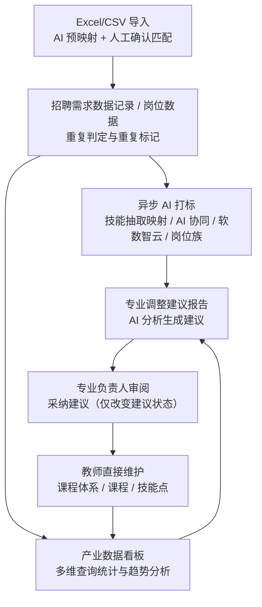

# 人才智库系统 需求规格说明书 (spec.md)

> 本文档定义人才智库系统的业务行为、范围边界与验收标准，是业务需求的唯一事实来源。
> 技术方案见 `plan.md`，执行拆解见 `tasks.md`。

## 文档元信息

| 项目 | 内容 |
| --- | --- |
| 状态 | 已确认定稿（2026-11-24 全部待确认项裁决完毕，业务方裁定转定稿；历史：结构化草案经业务方逐轮确认，口径以标准 spec 为准，见 C-17/C-18/C-19） |
| 作者 | Specification Facilitator（AI）起草，业务方逐轮确认 |
| 日期 | 2026-11-23（2026-11-24 修订） |
| 版本 | v2.5（变更：2026-11-26 用户交互裁决——①CF-05 账号登录口径同步：登录凭证=account_name（唯一）+密码，密码创建入口=系统设置→新建系统账户，工号/统一认证账号仅做展示（REQ-02 同步）；②数据质量评分口径=软件相关岗位占导入全部数据的占比（REQ-36）；③分析页 KPI"人才供需比"取消（供给数据无来源，T-15 供需比口径废止），改为岗位需求量同比/环比增速口径、岗位明细按岗位数量排序，趋势折线粒度：周期=季度按天、年度按月（REQ-39）；④背景与定位补充（2026-11-26）——建设目的=教学实验与专业动态调整（教学实验仅背景描述，不新增功能）、服务对象=软件工程专业（含 AI 协同开发方向）、平台定位="数据底座+AI 分析能力+教学资源"（年度服务不实现）、价值闭环五段。v2.6（变更：建设目标确认与 C-02 修订（用户 2026-11-26）——建设目标四条入档；**C-02 修订：新增至少 1 个人才需求预测模型**（岗位/技能/区域/时间趋势维度，输出趋势/排行/预警，可持续评估优化；预警=现有趋势增长提示+配额预警，新兴技能预警仍不实现），新增 REQ-72（细则待补充）；项目案例/实践资源确认为系统外交付物，项目资源裁剪不变；建设原则六条入档（§1：合规合法/成熟可靠/数据驱动/AI 赋能/教学适配/持续运营））。v2.7（变更：总体架构与报告导出裁决（用户 2026-11-26）——①§1 入档系统总体架构五层（用户展现/业务应用/AI 能力/数据资源/基础设施 + 标准规范与安全运维两体系贯穿），"可视化大屏/看板"=现有看板、"向量与语义分析"=大模型 API 语义理解（不引入向量库）；②**报告导出从裁剪拉回本期**（REQ-73、AC-89/90/91）：年度/分析报告、看板统计报告、专业调整建议报告，格式 PDF+Excel（Word/简报 PPT/成果台账/课程大纲导出仍裁剪），AC-32 同步修订；AC 总数 81→84）。v2.8（变更：部署与网络架构约束入档（用户 2026-11-26）——校内本地化部署、本期集中式（主备预留）、校园网访问、数据采集本期不实现（代理/白名单仅未来约束）、数据库定时备份+恢复演练、管理面与业务面分区最小端口暴露；§1 系统概况登记，技术落地见 plan §4.2.1）。v2.9（变更：数据架构与数据主线入档（用户 2026-11-26）——主线=多源合法采集/导入→清洗去重→结构化与标签化→入主题库与标签库→AI 抽取与预测分析→岗位/技能/区域/时间多维结果与可视化→支撑课程资源更新/专业调整建议/年度报告导出；全流程记录来源、采集/导入时间与处理链路（来源可追溯、质量可管理）；本期采集仍不实现；技术支撑（ES/ELK/Prometheus+Grafana/CI、恢复 XXL-Job）见 plan v3.3）。v2.10（变更：用户角色与权限设计（用户裁决 2026-11-26）——**六类角色**（新增安全管理员）并统一命名：系统管理员/安全管理员/审计员/专业负责人/教师/数据分析员（原"校领导与外部评审"归入审计员，原专业建设管理者/课程与教研教师/数据运营改名）；**三员分立 + 关键操作双人复核**（新增 REQ-74、AC-92）：账号/权限/密钥/参数/备份类高危操作复核生效、复核人≠提交人、留痕；权限点 18→**17 项**（裁剪课程更新审批/建议提交，新增关键操作复核）；表 7-7 四项裁剪功能维持裁剪；AC 总数 84→85）。v2.11（变更：指标2 产业数据库实质性要求（用户 2026-11-26）——①**数据采集部分拉回**：采集任务配置/定时更新/增量更新/模板与文件拉取/手工补录本期实现（REQ-75），配置化爬虫与第三方接口接入不实现；②**溯源字段**：每条数据记录来源渠道、采集/导入时间、原始链接或出处（REQ-03/AC-95）；③**清洗规则可配置 + 质量处理台账**（REQ-76/AC-94）；④企业作为**查询条件**（搜索/下钻可筛企业，C-04 三维全局筛选不变）；AC 总数 85→88）。v2.12（变更：分析页 KPI 卡口径（用户 2026-11-26）——4 张 KPI 卡重定义为：**岗位需求总量**（所有去重后岗位数量+同比/环比+微型折线）、技能标签热度、AI 协同岗位占比、数据覆盖企业；**KPI 卡微型折线粒度=季度按天/年度按月**（仅限 KPI 卡，REQ-29 趋势图维持 C-05）；平均招聘周期与独立增速卡移出 KPI 区；AC-41 同步）。v2.13（变更：技能标签热度卡口径（用户 2026-11-26）——柱状图改为**按月展示去重技能标签数量**（取代"提及次数/频次"）；**新增数量=标签首次出现时间落在本期**（季度比上季度、年度比上一年度）；紧缺=课程维护的技能标签未出现在筛选范围岗位数据中的数量；术语表/REQ-14/AC-18 同步）。v2.14（变更：AI 协同岗位占比卡口径（用户 2026-11-26）——占比=当期 AI 协同岗位数÷当期岗位需求总量；**PP=本期占比−上年同期占比（百分点差值，仅展示差值）**；进度条=协同岗位占比并显示协同岗位绝对数；判定口径补"工作中使用 AI 工具/AI 辅助能力，不限于 AI 算法研发岗"；术语表/REQ-30/AC-72 同步）。v2.15（变更：数据覆盖企业卡口径（用户 2026-11-26）——去重企业主体数 + 本季度新增（首次入库判定）+ 覆盖城市数（时间范围内企业分布城市去重）；**目标企业覆盖率分母改为 Excel 导入的【软数智云】目标企业清单**（分子=清单中已有数据企业数，取代 T-11 行业全量口径）；软数智云定义明确为软件/数据/智能/云计算类企业；术语表/REQ-31/AC-72 同步）。v2.16（变更：岗位需求趋势图口径（用户 2026-11-26）——折线=**月度有效职位数（存量）**；悬浮=对比上月新增岗位数+环比%；底部分类统计=各岗位族当期总量+**同比增速**；**保留 AI 推断预测年份**（C-07）；岗位族三类定义明确（软件研发/数据与 AI/测试运维 + 岗位举例，依据岗位标题+JD 语义自动归类）；术语表/REQ-11/REQ-29/AC-35 同步）。v2.17（变更：技能热度排行口径（用户 2026-11-26）——热度= f(需求频次权重+薪资溢价权重+需求增速权重)，三项输入定义明确（频次=当期关键词出现次数；薪资溢价=技能岗位均值÷全岗位均值−1；增速=同比），**权重 Nacos 可配**；进度条满分 100；**"新晋"=本期首次出现且进入榜单**；新增 AC-96（AC 总数 89）；REQ-32/术语表同步）。v2.18（变更：区域岗位需求对比口径（用户 2026-11-26）——城市 **TOP6 动态取前**（周期内岗位数）；【本地】标签=当前账号所在城市（在榜时高亮）；底部结论="极差 X 倍（**倍数=最大值÷最小值**）· 最大城市为需求核心"（需求核心动态生成）；新增 AC-97（AC 总数 90）；REQ-33 同步）。v2.19（变更：AI 协同岗位结构卡口径（用户 2026-11-26）——卡片改名**「AI 协同岗位结构」**；**占比=当期 AI 协同岗位数 ÷ 当期软件相关岗位数**（分母=三个岗位族全部有效职位，v2.19 取代 v2.14"岗位需求总量"分母）；环形图中心=总占比，**子类固定 2 类**：AI 应用开发（含 AI 算法研发岗）/ AI 辅助测试·运维，图例=各子类占全部软件岗位比例（两子类之和=总占比）；底部同比提升=PP（本期占比−上年同期占比）；**取消进度条与协同岗位绝对数**；术语表/REQ-30/REQ-39/AC-41/AC-72 同步）。v2.20（变更：看板岗位需求明细口径（用户 2026-11-26）——模块改名**「岗位需求明细」**（原"重点岗位需求明细"），筛选范围内**全部岗位（按岗位名称聚合）按需求量降序分页展示**；同比=**该岗位需求量的同比增速**；**不做紧缺指数与状态（不保留占位）**；术语"重点岗位"废止；**仅看板范围生效，分析页 REQ-41 岗位需求明细仍保留紧缺指数与阈值筛选**；REQ-35/AC-37/SCN-11 同步）。v2.21（变更：数据覆盖与质量卡口径（用户 2026-11-26，需求文档最后一段）——**数据来源仅有导入**：覆盖区改为**导入渠道统计**（人工导入/采集任务/手工补录的批次与记录数），不展示外部数据源分类与覆盖率百分比；副标题=「数据来源：导入 · 最近导入 HH:mm」；**质量评分=软件相关岗位数÷导入全部数据条数×100%，展示为保留 1 位小数的百分比**（GAP-04 单指标不变）；最近导入任务与数据质量报告下载保留；术语表/REQ-36/AC-38 同步）。v2.22（变更：收尾口径冻结（用户 2026-11-26）——①**数据质量评分分母=正式表 job_record 全部记录数**（不含校验失败/废弃，含重复标记与未打标；分子=软件相关岗位/三个岗位族有效职位）（REQ-36/AC-38）；②**参数配置=系统内维护 Nacos 配置（Nacos OpenAPI 读写），不建 sys_param 通用表**；任务调度本期预留；备份恢复本期运维执行（系统内不建发起入口）（REQ-63/74）；③**模型 Key 配置复核通过后由审批侧编排 ai-service 生效；生效失败记操作日志+告警、复核单保持已复核不回退**（REQ-74/AC-92）；④**REQ-72 预测模型细化**：统计时序（移动平均/指数平滑/线性回归）、岗位需求总量+区域/行业/岗位族筛选、下一季度+下一年、回测 MAPE≤20%，新增 AC-98（AC 总数 90→91）；⑤**OPEN-03 冻结**：审计 90 天清理、其余不自动清理，可用性/容错按 INV-07 显式失败与重试、不承诺 SLA；⑥目标企业清单**全量替换**（REQ-31）；⑦**手工补录批次按日聚合**（同一天计 1 批次、记录数按条数，OPEN-DB-05 关闭）；⑧**任务调度/备份恢复保留为占位权限点**（17 项不变、本期无功能入口）；⑨**NFR-01 宣传口径保留待复核、不阻塞**）。v2.22.1（变更：**导入来源字段口径细化（用户 2026-11-27）**——①必填字段=**公司名称、岗位名称、工作城市、发布日期**；②**行业分类不由文件提供**：按企业已有行业匹配、匹配不到时在人工确认环节确认一次并回写企业；③**技能要求可选**，无则由 AI 从岗位描述抽取；④术语表/SCN-02/REQ-04/05/70/AC-05/81 同步）。v2.23.0（变更：**冗余表清理与口径收敛（用户 2026-11-27）**——①删除字段映射缓存表（映射缓存统一走 Redis）；②删除账号指定专业范围表，**数据范围收敛为全校/只读汇总/全系统三项**（取消"指定专业数据"）；③权限点与角色授权改为**系统内置固定配置**，删除权限点表与角色权限表，权限矩阵保持只读；④REQ-63/AC-75、§3 权限边界同步）。v2.24.0（变更：**按标准 AI 提示词对齐（用户 2026-11-27）**——①导入映射采用标准字段字典 15 项，新增年龄/语言/职位类型/专业/性别/招聘需求等原文保留字段；②必填字段改为公司名称/岗位名称/工作地点/发布日期；行业分类改为文件有则用、无则企业匹配/人工确认；技能要求不作为映射字段、由 AI 从岗位描述抽取；③建议类型统一为"课程内容"（取代"课程调整"）；建议 AI 输出去编号/状态/数据标签/置信度强制要求，按标准输出 type/priority/title/desc/accordingTo，其余由系统补充；④新增岗位增长占比、课程内容陈旧度口径）。v2.4（变更：账号创建字段裁决（用户 2026-11-24）——创建字段=姓名、工号/统一认证账号、所属部门、所在城市、角色、数据范围、权限说明，移除创建时的独立"账号/邮箱/下拉选择权限/状态"字段（账号标识=工号/统一认证账号；状态为维护期操作）；账号管理接口路径 /api/v1/admin/accounts（接口契约同步 plan.md v2.5）。v2.3（变更：ImportTask 状态机裁决（用户 2026-11-24）——任务状态统一建模改为五态：待处理/已处理/分析中/已完成/失败，取代七态；"开始数据校验"独立步骤取消，人工确认完成后系统自动执行校验入库；"待处理"超时 30 分钟无人处理直接删除；"废弃"仅保留为行级数据标记（INV-08）；同步修订 REQ-04/05/06、AC-55/79、术语表。v2.2（变更：OPEN-04/05/07 经用户交互裁决关闭——招聘需求与岗位 1:1 等同；匹配超时清理阈值 30 分钟；知识图谱覆盖率=被课程技能点关联的产业技能标签数 ÷ 产业技能标签总数（单向）；OPEN-03 中 NFR-02/03 确认沿用 T-03 数值，OPEN-03 仅余可用性/容错、数据保留待补充；标准 spec 剩余章节不再对齐、以本 spec 现版为准；NFR-01 宣传口径保持待复核；文档定稿（status: confirmed）。v2.1：按标准 spec 第三批图片内容对齐（C-19）——导入任务状态统一建模（等待导入/待校验/处理中/分析中/成功/已完成/废弃）；字段映射增加匹配置信度与 AI 建议文案；导入结果展示细化（ASM-09 本次导入批次口径、顶部四个统计标签、岗位分页列表字段、右侧四个质量指标含"标注进行中"处理）；新增导入规范（REQ-70）与字段识别说明（REQ-71，ASM-17）；REQ-55 对齐导入概览统计（含自动分析耗时/模型版本/队列优先级）；SCN-03 细化标签列表字段、合并标签流程、待处理事项与概览（ASM-03/ASM-10）；岗位族"不符合 3 类的不打标"；导入 NFR 拆分为 NFR-06 ~ NFR-11（对应标准 NFR-01~06），非导入部分 NFR 归入 OPEN-03 待补充；约束补充（技能热度权重配置文件配置等）；新增 R-06、ASM-03/09/10/17、OPEN-03、AC-73 ~ AC-88、标准 spec 编号对照表。v2.0：按标准 spec 第二批内容裁决——业务不变量改为 INV-01~10；六类角色（系统管理员与数据分析员分开，ASM-14 映射）；登录改为系统账号登录（不做单点/第三方，账号外部同步不实现）；本期范围按标准裁剪，裁剪项存档于"后续迭代需求"（JSON 导入、导入模板、看板导出/简报、新兴技能预警、课程大纲预览导出、生成更新建议、课程更新审批流、标签审核、账号审批、项目资源、统计/建议报告导出、数据源配置）；紧缺指数=供需差+薪资溢价（状态：紧缺/关注/平稳）；导入期 AI 打标为异步批量执行（INV-09）；采纳建议仅改状态不改课程数据（INV-05）；REQ 改表格化呈现；新增 OPEN-05/OPEN-07、ASM-01/12/14/16。v1.1：标准 spec 第一批口径（C-17）。v1.0：初版多轮收敛） |

---

## 1. 背景与目标

背景与定位（2026-11-26 业务方确认）：

- 建设目的：满足**教学实验与专业动态调整**需要（"教学实验"仅为建设目的描述，不新增教学实验功能与学生角色）。
- 服务对象：为**软件工程专业（含 AI 协同开发方向）**的专业方向调整、课程内容更新、知识技能点迭代和实践项目建设提供持续的数据支撑与决策依据。
- 平台定位：本项目不是单一的数据库或单一的预测工具，而是"**数据底座 ＋ AI 分析能力 ＋ 教学资源**"的教学科研支撑平台（业务方原文含"年度服务"，经确认**本期不实现年度服务功能**，仅保留定位表述）。
- 核心价值：以真实产业人才数据驱动专业建设，使人才培养与长三角软件产业岗位、技能需求保持动态同步。
- 价值闭环（高层）：**产业数据采集 → 岗位与技能分析 → 人才需求预测 → 课程与项目资源建设 → 分析报告输出**（"人才需求预测"口径经 v2.6 修订 C-02：新增独立预测模型，见建设目标 3）。

建设目标（2026-11-26 业务方确认）：

1. 汇聚企业、岗位、招聘需求、技能要求等数据，具备采集/导入、更新维护、多维查询统计、趋势分析、数据质量管理与来源追溯能力。
2. 构建 AI 协同岗位技能分析能力，实现岗位文本中技能、工具、工程能力的智能抽取、标签化管理与热度/趋势/关联分析。
3. 提供**至少 1 个人才需求预测模型**（C-02 修订），支持岗位、技能、区域、时间趋势等维度分析，输出趋势、排行与预警结果，并可持续评估优化（预警=现有趋势增长提示+配额预警；"新兴技能预警"仍不实现；模型已细化为统计时序预测，见 REQ-72/AC-98，v2.22）。
4. 交付 1 套 AI 协同课程体系及知识技能点、覆盖软件工程全环节的项目案例/实践资源，支撑专业年度动态调整（项目案例/实践资源为**系统外交付物**，系统内不新增项目资源功能，项目资源及其下载仍不实现）。

建设原则（2026-11-26 业务方确认）：**合规合法、成熟可靠、数据驱动、AI 赋能、教学适配、持续运营**。

- 合规合法：数据来源合法可追溯（C-06 修订：数据源为导入/采集任务来源标签，采集仅文件拉取无爬虫；导入批次、采集执行记录与审计留痕支撑追溯）。
- 成熟可靠：采用成熟 B/S 软件架构保障稳定（与 plan 技术方案一致：Vue 3 SPA + Nginx + Spring Cloud 微服务）。
- AI 赋能：以 AI 模型提升岗位技能分析与预测的智能化水平（含 REQ-72 人才需求预测模型）。
- 数据驱动 / 教学适配 / 持续运营：以真实产业数据驱动专业建设、适配教学需要、支撑持续运营（原则性要求，不新增功能）。

系统总体架构（2026-11-26 业务方确认，业务视角五层 + 两体系贯穿）：

| 层级 | 主要构成 | 作用 |
| --- | --- | --- |
| 用户展现层 | 浏览器 Web 门户、管理后台、可视化大屏/看板、报告导出 | 面向教师、专业负责人、管理员的统一访问与展示，支持主流浏览器免客户端访问（"可视化大屏/看板"=现有产业数据看板，不含独立投屏大屏；"报告导出"本期实现，见 REQ-73） |
| 业务应用层 | 产业数据库管理、岗位技能分析、人才需求预测、课程与项目资源、专业调整建议、年度报告、系统管理 | 承载全部业务功能（项目资源为系统外交付物，见建设目标 4） |
| AI 能力层 | 岗位文本抽取模型、技能标签引擎、人才需求预测模型、大模型服务/API、向量与语义分析、异步任务调度 | 提供智能抽取、预测辅助、报告生成等 AI 能力（"向量与语义分析"=大模型 API 语义理解，不引入向量数据库） |
| 数据资源层 | 企业/岗位/招聘/技能主题库、标签库、课程与知识库、预测结果库、元数据与数据质量/溯源库 | 统一数据存储、治理与来源追溯（物理落库见 plan 四库分域） |
| 基础设施层 | 校内本地化部署环境（服务器/操作系统/数据库/中间件）、网络与备份 | 在校内指定环境稳定运行（中间件本机容器，见 plan v2.8） |

- 架构风格：分层、松耦合的 B/S 架构，自下而上五层，并以**标准规范体系与安全运维体系**贯穿各层。
- 层级定位：**业务应用层为承载业务功能的核心层**；标准规范体系与安全运维体系为贯穿五层的支撑体系（分层业务架构图，2026-11-26）。

具体业务链路：

- 学校导入外部岗位数据（企业、岗位、招聘需求、技能要求），分析岗位趋势与技能需求结构。
- 利用分析结果判断学校课程是否满足外部岗位技能要求，并通过 AI 大模型生成专业调整建议，支撑课程优化。
- 形成业务闭环：**外部岗位数据 → 导入与智能标注 → 多维统计与趋势分析 → 专业调整建议 → 课程优化。**

数据架构与数据主线（2026-11-26 业务方确认）：

**多源合法采集/导入 → 清洗去重 → 结构化与标签化 → 入主题库与标签库 → AI 抽取与预测分析 → 形成岗位/技能/区域/时间多维结果与可视化 → 支撑课程资源更新、专业调整建议与年度报告导出。**

- 全流程记录**数据来源、采集时间与处理链路**，实现来源可追溯、质量可管理（追溯载体见 plan.md 数据溯源设计）。
- 本期采集为**部分实现**（2026-11-26 v2.11 裁决）：采集任务配置、定时/增量文件拉取与手工补录（REQ-75）；配置化爬虫与第三方接口接入不实现；数据入口以 Excel/CSV 人工导入为主，"多源合法采集"的完整能力作为未来扩展方向保留。

系统概况（用户构思）：

- 建设单位：南京工业职业技术大学・计算机与软件学院；署名含"人工智能学院・产业人才项目组"。
- 系统名称："产业数据库与人才需求预测系统"（正式名称，保留"预测"字样）；"产业人才智库"为品牌简称。
  含至少 1 个人才需求预测模型（C-02 已修订，2026-11-26，见建设目标 3）。
- 数据定位：聚焦长三角软件与信息技术产业，覆盖 27 城、约 28,416 家企业、约 1,246,800 条招聘记录，
  与系统内部数据实时联动（去重口径）。
- 部署与网络约束（2026-11-26 业务方确认）：采购人校内指定环境本地化部署，支持集中式或主备部署（**本期集中式落地，主备预留**）；浏览器经校园网访问；数据采集服务按学校网络与安全策略访问合法公开数据源（支持代理/白名单，**本期仅文件拉取、无爬虫与第三方接口接入**，REQ-75）；数据库定时备份并支持恢复演练；管理服务与业务访问分区，最小化端口暴露。技术选型遵循"成熟稳定、主流可控、便于校内运维、可国产化适配"，不限定品牌、优先复用学校已有同类中间件（以采购人环境与兼容性测评结果为准）。技术落地见 `plan.md#4.2.1`、`plan.md#1.1 技术选型`。

核心业务闭环：

---

## 2. 术语表 (Glossary)

| 术语 | 定义 |
| --- | --- |
| 企业（企业主体） | 岗位数据所归属的公司主体，统计时按公司名称去重 |
| 岗位 | 外部招聘的职位数据，含岗位名称、JD、薪资等信息 |
| 招聘需求 | 企业对外发布的用人需求，与岗位为 1:1 等同、两概念可互换（OPEN-04 已裁决关闭）；发布时间为看板数据时间归属依据 |
| 技能要求 | 岗位文本中要求的技能、工具、工程能力 |
| 课程体系 | 由专业名称、学年、版本号、备注标识的课程集合容器 |
| 课程 | 课程体系下的教学课程，含课程名称、课程编码、课程目录、开课学期、课程大纲（含学分、学时、课程负责人、课程定位与能力目标）；教师直接维护 |
| 课程分类 | 课程归属类别：专业核心课/专业方向课/实践课 |
| 技能点 | 课程下维护的知识技能点，关联标准技能标签（能力目标按布鲁姆认知层级校准） |
| 标准技能标签 | 系统维护的统一技能词表，数据分析员可新增/修改（新增即生效，无审核流程）；两维度：类型（技能/工具/工程能力）× 分类（独立分类字段） |
| 原始标签 | 导入数据自带的技能/工具等标签，必须原样保留 |
| 抽取标签 | AI 从岗位文本抽取的技能/工具/工程能力标签（异步批量执行），保留入库并自动映射标准技能标签 |
| 字段映射 | 导入文件字段到系统字段的对应关系（AI 预映射 + 人工确认匹配） |
| 字段映射缓存 | 历史映射匹配结果的缓存；再次导入时有缓存优先使用缓存，无缓存才用 AI 预映射 |
| 临时任务记录 | 新建导入上传文件后生成的任务记录，含任务编码（如 IMP-20261112-018）；任务状态统一建模：待处理/已处理/分析中/已完成/失败（v2.3 裁决）；"待处理"超时 30 分钟无人处理将被直接删除（OPEN-05 已裁决关闭） |
| 临时表 / 正式表 | 校验前数据所在的临时表与校验通过后数据所在的正式表 |
| 废弃 | 校验不通过数据在临时表中的状态标记；不得进入正式表与任何统计口径 |
| 重复标记 | 按"公司 + 岗位名称"文本匹配判定的重复数据标记；数据入库但不进入统计 |
| 必填字段 | 导入文件必须提供且必须映射的字段：**公司名称、岗位名称、工作地点、发布日期**（标准导入映射提示词 workLocation 口径，4 项）；**行业分类可选**（文件有则使用，无则按企业已有行业匹配、匹配不到时人工确认并回写企业）；**技能要求不作为映射字段**（由 AI 从岗位描述抽取） |
| 岗位族 | 岗位分类：**软件研发**（后端/前端/移动端等开发类岗位）/ **数据与 AI**（算法/大模型/数据开发/数据分析/AI 应用开发等）/ **测试运维**（测试/DevOps/运维/服务器与云运维等），固定 3 类，导入期依据**岗位标题 + JD 语义自动归类**并打标（v2.16 明确） |
| 有效职位 | 去重（无重复标记）且已打岗位族标签的岗位 |
| AI 协同岗位 | 导入期 AI 依据岗位标签与 JD 语义判定"是否为 AI 协同岗位"并打标的岗位（工作中需要使用 AI 工具/AI 辅助能力，**不限于 AI 算法研发岗**，v2.14 裁决）；**子类固定 2 类**（v2.19 裁决）：**AI 应用开发**（含 AI 算法研发岗）、**AI 辅助测试/运维**，子类由导入期 AI 打标同时输出（非协同岗位为空）；标记与子类一经生成不可人工修正（INV-04） |
| 软数智云 | 定向赛道企业类别：软件、数据、智能、云计算类企业（v2.15 明确）；导入期 AI 判定打标，标记不可人工修正（INV-04）；同时作为**目标企业覆盖率的分母清单口径**（数据运营 Excel 导入维护） |
| 软件相关岗位 | = 三个岗位族全部岗位（即有效职位） |
| 专业调整建议 | 基于课程技能标签与岗位信息、由 AI 大模型生成的课程/专业调整建议报告（手动触发、参数化生成，建议编号 ADJ-*） |
| 建议类型 | 专业方向 / 课程内容 / 知识技能点（按标准建议提示词口径，v2.24 统一为"课程内容"） |
| AI 大模型配置 | 大模型接入信息（名称、服务商、接入方式、API Base URL、API Key、状态、备注），可配置多个 |
| 核心任务 / 非核心任务 | 核心任务=导入校验等人工交互链路；非核心任务=后台批量 AI 任务（技能打标、同义词分析、建议报告生成）（ASM-12）；模型配额用尽时非核心任务暂停（INV-10） |
| 岗位文本 | 岗位描述文本（JD），是 AI 技能抽取的输入载体 |
| 岗位需求总量 | 所有去重后的岗位数量 |
| 产业技能标签 | 岗位数据中的技能要求（岗位侧标签），用于知识图谱对齐与课程覆盖率分析；与"标准技能标签"是两个不同概念（C-12 已裁决） |
| 知识图谱 | 课程技能点与产业技能标签（岗位技能要求）的对齐关系集合，以覆盖率衡量 |
| 知识图谱覆盖率 | 被课程技能点关联到的产业技能标签数 ÷ 产业技能标签总数（单向口径，OPEN-07 已裁决关闭） |
| 待更新技能点 | 被技能变化提醒标记为需更新的课程技能点，含高优先级标记（ASM-16） |
| 技能变化对课程更新提示 | 基于技能热度自动生成的课程更新提醒列表（"生成更新建议/发起更新"本期不实现） |
| 课程变更记录 / 版本变更记录 | 课程/课程体系的变更留痕 |
| 调整窗口 | 培养方案调整周期（含起止时间与评审阶段，如 2026-11-01 至 2026-12-15） |
| 评审进度 | 建议的多级评审流程（系初审→课程委员会→院学术委员会→校长办公会）的进度展示（展示性信息，C-11） |
| 模型置信度 | AI 建议的置信度百分比（可选）：标准建议提示词不强制输出，系统提供时随建议与依据展示 |
| 岗位增长占比 | 目标岗位数 ÷ 筛选范围内全部岗位数（结构占比），作为专业方向建议的依据 |
| 课程内容陈旧度 | 课程最近更新时间距今天数（无更新记录时取创建时间），作为课程内容建议的依据 |
| 调整影响评估 | 建议落地影响汇总：影响课程/学生/教师/新增资源、技能点对齐度与资源完备度进度 |
| 项目资源 | 课程配套的实践项目材料（本期不实现下载，见范围边界） |
| 年度报告 | 年度汇总报告（编号 RPT-*，版本如汇报版 V1.0/脱敏公开版），面向审计员 |
| 报告存档中心 | 历史报告归档管理入口（状态：已发布/评审中/已存档） |
| 建议执行率 | 已确认建议数 / 建议总数 |
| 课程更新完成率 | 完成更新课程数 / 更新目标课程数 |
| 年度建设成果台账 | 五类成果（专业方向/课程内容/知识技能点/实践项目/教学资源）的年度/累计汇总，系统自动汇总 |
| 年度关键结论 | 年度核心判断列表（含支撑指标与分析依据跳转） |
| 评审与发布 | 报告的多级流程：院内初审→校领导审阅→外部专家评审→发布归档（流程进度为展示性；外部专家在系统内只读查看报告并录入评审意见） |
| 产业数据看板 | 汇总岗位需求与技能标签统计、趋势的展示页面（本期 10 个统计模块） |
| 时间范围 | 看板统计范围，按季度或年度选择 |
| 时间归属 | 看板数据按招聘需求发布时间归属季度/年度/月/天 |
| 同比 | (本期数 − 同期数) / 同期数 × 100% |
| 环比 | (本期数 − 上期数) / 上期数 × 100% |
| 技能标签热度 | 去重后的技能标签数量及其变化；**新增=本期首次出现的标签数**（季度对比上季度、年度对比上一年度，v2.13 裁决）；柱状图按月展示**去重技能标签数量**（v2.13 裁决，取代"提及次数"口径） |
| 紧缺（课程有、岗位无） | 系统维护的课程技能标签中，未出现在筛选范围内岗位数据里的标签数量 |
| 紧缺（岗位要、课程无） | 筛选范围内岗位数据要求的技能标签中，课程技能标签未覆盖的数量 |
| 有效招聘记录 | 去重（排除重复标记）后的招聘记录 |
| 技能热度综合得分（技能热度指数） | 0-100 评分（进度条满分基准 100），**热度 = f(需求频次权重 + 薪资溢价权重 + 需求增速权重)**（C-09 已裁决，v2.17 细化输入口径）：**需求频次**=当期岗位信息中该技能关键词出现的次数；**薪资溢价**=要求该技能的岗位平均薪资 ÷ 筛选范围内全部岗位平均薪资 − 1；**需求增速**=该技能岗位需求的同比增速；三项权重在 Nacos 配置（可调、无需发版） |
| 平均招聘周期 | 岗位从发布到完成招聘的平均天数 |
| 人才供需比 | ~~人才供给与岗位需求的比例（如 1:2.4），"供给"=求职人数/可就业的候选人才（T-15 已裁决）~~ **v2.5 废止**：供给数据无来源，分析页 KPI 改为岗位需求量同比/环比增速口径（用户裁决 2026-11-26） |
| 重点岗位 | ~~需求量与紧缺指数综合排序的重点关注岗位集合~~ **v2.20 废止**：看板模块改名「岗位需求明细」，筛选范围内全部岗位按需求量排序，无"重点岗位"集合概念；分析页岗位需求明细仍保留紧缺指数（REQ-41） |
| 技能-岗位关联矩阵 | 技能×岗位的关联强度系数矩阵（0-1，关联强度与岗位覆盖度综合） |
| PP（百分点） | 占比类指标的同期差值：PP = 本期占比 − 上年同期占比（如 34.7%−28.5%=6.2pp）；与百分比同比不同（v2.14 裁决） |
| 关联洞察 | AI 基于关联矩阵产出的分析结论（最强组合、课程联动优化、弱关联提示） |
| 能力组合与能力层级 | 高关联技能组合及其分级（核心能力/进阶能力/专业能力），附建设建议 |
| 更新提示 | 技能课程覆盖状态提示（建议增补/基本匹配/课程补强/覆盖充分/优先新增/维持现状） |
| 分析引擎 | 承载自动分析的引擎，展示模型版本、分析样本数与运行状态（T-17） |
| 紧缺指数 | 岗位级 0-100 指数，基于供需差与薪资溢价计算；对应状态标签：紧缺/关注/平稳（C-18 修订，区别于紧缺双向指标） |
| 新兴技能预警 | 需求增速超过课程供给能力的技能预警（本期不实现，见范围边界） |
| 课程覆盖率 | 课程（技能点）对某技能的覆盖程度 |
| 数据源 / 数据质量评分 | **数据来源仅有导入**（v2.21 裁决）：数据覆盖=导入渠道统计（人工导入/采集任务/手工补录的批次与记录数），不展示外部数据源分类与覆盖率百分比；**质量评分=软件相关岗位数 ÷ 正式表（job_record）全部记录数×100%，展示为百分比并保留 1 位小数**（不含校验失败/废弃行，含重复标记与未打标记录；v2.22 裁决）；无爬虫/第三方接口（C-06） |
| 数据质量报告 | 可下载的数据质量分析报告 |
| 导入任务 | 一次数据导入的执行记录（编号 IMP-*），状态按统一任务状态模型（待处理/已处理/分析中/已完成/失败，v2.3 裁决） |
| 简报 | 看板一键生成的汇报材料（本期不实现，见范围边界） |
| 数据同步 | 数据按"季度更新"节奏同步，展示最近更新时间 |
| 采集任务 | 定时拉取模板/文件并导入的配置化任务（来源类型/地址/频率/增量策略），不含爬虫与接口接入（REQ-75） |
| 增量更新 | 按唯一键（发布日期/来源标识+公司+岗位）判重，仅新增未入库数据（REQ-75） |
| 处理台账 | 数据质量问题的处理记录（问题类型/数据量/处理动作/处理人/时间），可查询（REQ-76） |
| 三员分立 | 系统管理员、安全管理员、审计员三类角色权限互不重叠、互相制约（2026-11-26 裁决） |
| 双人复核 | 关键操作由提交人发起、另一名有复核权限者审核通过后生效；复核人不得为提交人本人（REQ-74） |

---

## 3. 用户与角色

登录方式：**系统账号登录 + 六类角色权限控制**；不做单点登录/第三方登录（C-18 已裁决，取代早期"统一认证"结论）。

**三员分立（2026-11-26 裁决）**：系统管理员、安全管理员、审计员三员分立，关键操作双人复核，避免权限过度集中（学校信息安全管理要求）。

| 角色 | 主要权限 | 数据范围 |
| --- | --- | --- |
| 系统管理员 | 用户与角色维护（姓名、工号、所属部门、所在城市、角色、权限、权限说明）、**参数配置（系统内维护 Nacos 配置，含复核）**、任务调度（本期预留）、**备份恢复（本期运维执行，系统内不建发起入口）**；**不参与业务数据审批**；高风险操作需双人复核 | 系统配置数据 |
| 安全管理员 | **安全策略与复核**：关键操作复核（账号创建/停用/密码重置、角色与权限变更、模型 Key 配置、参数配置）、安全配置检查；**备份恢复复核并入运维检查单**；不参与业务数据审批 | 系统安全配置数据 |
| 审计员 | 查看操作日志、登录审计、导出审计报表；**仅只读**（原"校领导与外部评审"归入本角色） | 全量日志（只读） |
| 专业负责人 | 查看全部分析与预测结果、审阅与确认专业调整建议（课程更新审批本期不实现，见 §4.2） | 本校及长三角区域数据 |
| 教师 | 查询岗位技能与趋势、维护课程体系/课程/技能点数据、下载课程资源（项目资源下载与提交更新建议本期不实现） | 本校数据及公开统计数据 |
| 数据分析员 | 数据导入、数据质量管理、技能标签体系维护、标签校正、报告编制（数据采集任务配置按 REQ-75 实现） | 授权范围内的原始与治理数据 |

- **角色命名（2026-11-26 裁决，取代 ASM-14 页面叫法）**：统一采用本表命名——系统管理员 / 安全管理员 / 审计员 / 专业负责人 / 教师 / 数据分析员；原"校领导与外部评审"归入审计员，"专业建设管理者"改为专业负责人，"课程与教研教师"改为教师，"数据运营"改为数据分析员。原五类角色职责不变，新增安全管理员一类（合计六类）。
- **关键操作双人复核（2026-11-26 裁决，v2.22 细化）**：账号创建/停用/密码重置、角色与权限变更、模型 Key 配置、参数配置等系统内高危操作，需提交复核（待复核）→ 安全管理员（或另一名系统管理员）复核通过后生效；**备份恢复本期由运维执行，复核留痕并入运维检查单**；复核与驳回均留痕。清单可扩展，复核人不得为提交人本人。
- 账号属性包含"所在城市"，用于看板中识别【本地】城市。
- 权限边界：审计员仅只读；系统管理员与安全管理员均不参与业务数据审批；专业调整建议的确认（采纳）归专业负责人；账号按 RBAC 模型管理，数据范围（全校/只读汇总/全系统）可单独授权，最小授权原则（v2.23：取消"指定专业数据"范围）。

---

## 4. 范围边界

### 4.1 In Scope

- 登录与账号管理、六类角色权限控制（三员分立）。
- 关键操作双人复核（REQ-74）：账号/权限/密钥/参数/备份类高危操作复核生效，复核留痕。
- 数据采集（部分，REQ-75）：采集任务配置、定时/增量更新、模板/文件拉取、手工补录；不含爬虫与第三方接口接入。
- 数据清洗规则与处理台账（REQ-76）：可配置清洗规则、质量处理台账可查。
- Excel/CSV 数据导入：新建导入（临时任务）、AI 预映射 + 人工确认匹配（含映射缓存复用）、数据校验入库
  （通过入正式表/不通过留临时表标废弃）、重复判定与重复标记。
- 导入期 AI 能力（异步批量执行）：技能/工具/工程能力抽取与标准标签映射、AI 协同岗位打标、
  软数智云企业打标、岗位族归类打标。
- 技能标签体系维护：标签列表（搜索/筛选/统计列）、新增/修改标准技能标签（含独立分类字段）、合并标签、
  标签体系概览、待处理事项（AI 同义词合并建议、低热度标签清理提醒）；新增即生效，无审核流程。
- 课程体系与知识技能点维护（课程体系 → 课程 → 技能点 → 关联技能标签）。
- 产业数据看板（10 个统计模块）。
- 专业调整建议报告（手动触发 AI 生成、采纳、查看依据）。
- 报告导出（REQ-73）：年度/分析报告、看板统计报告、专业调整建议报告，PDF + Excel（v2.7 裁决 2026-11-26）。
- 人才需求预测模型（至少 1 个，REQ-72）：**统计时序（移动平均/指数平滑/线性回归）**，输入=历史月度岗位需求（有效职位口径），支持区域/行业/岗位族筛选；输出下一季度与下一年预测值、趋势方向与增长提示；回测 MAPE≤20%（v2.22 细化）。
- AI 大模型配置与路由策略。
- 登录与操作日志、审计报表（审计员）。

### 4.2 Out of Scope（本期不做，后续迭代）

- "年度服务"仅为平台定位描述，本期不实现任何年度服务功能（2026-11-26 裁决）。
- 数据采集（**部分实现，2026-11-26 裁决**）：采集任务配置、定时更新、增量更新、模板/文件拉取导入、手工补录（见 REQ-75）；**配置化爬虫与第三方接口接入本期不实现**（后续迭代）。
- 看板"新兴技能预警"模块（本期不做）。
- 课程大纲预览与导出（本期不做）；课程更新提醒的"生成更新建议/发起更新"（本期暂不做）。
- 导入格式 JSON（暂不支持，仅 Excel/CSV）；下载导入模板（本期不做）。
- 课程更新审批流程与教师"课程更新建议"提交流程（本期不做，教师直接维护课程数据）。
- 标准技能标签审核流程（本期不做审核，标签新增/修改直接生效，"待审"状态不实现）。
- 账号审批流程（账号新增即生效启用，"待审批"不实现）；账号外部同步（"最近同步"）不实现。
- 项目资源及其下载。
- 单点登录/第三方登录。
- AI 提示词的界面化维护（提示词在代码层配置）。
- 报告导出的 **Word 格式**（v2.7 裁决：PDF + Excel 本期实现，见 REQ-73）；看板"一键生成简报（PPT）"仍不实现；成果台账导出、课程大纲导出仍不实现。

---

## 5. 业务不变量 (Business Invariants)

- INV-01：带重复标记的数据正常入库，但不得进入任何统计口径。
- INV-02：未打岗位族标签的岗位不计入"有效职位"及其相关趋势统计。
- INV-03：导入数据的原始标签必须保留；技能标签映射结果自动生效，无需人工审核。
- INV-04：AI 协同岗位标记一经生成不可人工修正；软数智云标记同规则（ASM-01）。
- INV-05："采纳建议"仅改变建议报告内该条建议的状态，不得修改任何课程体系/课程/技能点数据。
- INV-06：所有统计以去重（非重复标记）数据为基数；同比 =(本期数−同期数)/同期数×100%，环比 =(本期数−上期数)/上期数×100%。
- INV-07：系统不得静默失败。导入、AI 调用、统计计算的错误与异常必须显式暴露并保留诊断信息。
- INV-08：校验不通过的数据仅保留在临时表并标记废弃，不得进入正式表与任何统计口径。
- INV-09：所有需要 AI 语义分析的标注均为异步后台批量执行；标注完成前的数据不计入依赖标注结果的统计口径（如有效职位、岗位族分类、AI 协同占比）。
- INV-10：模型配额用尽（100%）时，非核心任务（后台批量 AI 任务）调用被暂停且显式提示；核心任务（导入校验等人工交互链路）不受影响。

注：原 BI-01~06 已并入 INV-01~10 或由 C-18 裁决修订（课程变更审批不变量随审批流移入后续迭代）。

---

## 6. 核心场景与功能需求

### SCN-01 登录与权限管理

**目标**：用户以受控账号登录系统，按角色获得对应功能权限。  
**触发条件**：用户访问系统。  
**关键流程**：用户输入账号密码登录 → 系统按角色呈现可访问功能 → 系统管理员在系统管理页面创建/维护账号。  
**异常场景**：登录凭据错误时显式提示失败，不得放行。

| REQ | 名称 | 目标与业务规则 |
| --- | --- | --- |
| REQ-01 | 账号登录 | 支持系统账号密码登录（支持"记住我"）；登录失败显式提示，不建立会话；停用账号登录被拒绝并显式提示。 |
| REQ-02 | 账号管理 | 系统管理员创建/维护账号（v2.5 裁决，同步 CF-05：登录凭证=account_name（唯一）+密码，密码在系统设置→新建系统账户时创建；创建字段：姓名、登录账号、初始密码、工号/统一认证账号（仅展示）、所属部门、所在城市、角色、数据范围、权限说明，不含"邮箱/下拉选择权限/状态"字段）；维护账号含状态（启用/停用）等；新增即生效启用（无审批）；停用账号立即禁止访问并清除会话；强制下线；密码重置（8 位以上含字母数字，修改后重新登录）。 |
| REQ-63 | 角色权限控制与权限矩阵 | 六类角色按职责隔离功能（系统管理员/安全管理员/审计员/专业负责人/教师/数据分析员，三员分立）；审计员仅只读；系统管理员与安全管理员不参与业务数据审批；只读展示权限矩阵（**17 项权限点 × 六类角色**的授权勾选视图，RBAC 最小授权原则；**权限点与角色授权为系统内置固定配置，不提供维护入口**，v2.23）；17 项权限点清单（v2.10 调整 2026-11-26，裁剪"课程更新审批/建议提交"）：账号管理、参数配置、任务调度、备份恢复、模型配置、数据导入、数据质量管理、标签维护、标签校正、建议审阅确认、资源下载、报告编制、报告审阅、评审意见、审计查看、审计导出、**关键操作复核**；其中**任务调度、备份恢复本期保留权限点但无功能入口**（任务调度预留、备份恢复仅运维，v2.22 裁决）；数据范围（**全校产业/专业数据、只读汇总/报告、全系统**三项，v2.23 取消"指定专业数据"）可单独授权，**账号角色与数据范围变更立即生效并留痕**。 |
| REQ-74 | 三员分立与关键操作双人复核 | 系统管理员、安全管理员、审计员三员分立，权限互不重叠、互相制约；**关键操作双人复核**：账号创建/停用/密码重置、角色与权限变更、模型 Key 配置、参数配置等系统内高危操作须提交复核（待复核）→ 安全管理员（或另一名系统管理员）复核通过后生效；复核人不得为提交人本人；**模型 Key 配置生效由复核侧编排（user-service 调 ai-service 内部接口）**；**生效动作失败显式记录操作日志并告警、人工重试，复核单保持"已复核"不回退**；**备份恢复本期由运维执行、不在系统内发起，复核留痕并入运维检查单**；复核通过/驳回均留痕（操作日志）。复核清单可扩展。 |
| REQ-64 | 账号概览统计与操作日志 | 概览展示系统账号总数/今日在线数、最近登录时间、各角色人数分布（角色分布）；系统操作日志记录账号、操作时间与操作内容，按时间倒序，仅保留最近 90 天，不可编辑与删除。 |
| REQ-28 | 登录页品牌 | 登录页展示系统品牌信息（标题、项目图标、定位文案、建设单位署名、"2026 产业人才智库"提示）；定位文案中的覆盖城市/企业/招聘记录数字与三个统计指标（岗位需求数、技能标签数、覆盖企业数）与系统内部数据实时联动，口径与看板一致（去重口径，企业按公司名称去重）。 |
| REQ-40 | 全局功能 | 搜索岗位/技能/企业；数据更新通知提醒；数据同步状态展示（最近更新时间、"季度更新"标签）。 |

### SCN-02 数据导入

**目标**：企业/岗位/招聘需求/技能要求数据（Excel/CSV）可靠入库，并完成异步智能标注。  
**触发条件**：数据分析员在"数据导入与分析"页面点击右上角"新建导入"，选择文件上传。  
**关键流程（细化）**：
a. 文件上传：选择 Excel/CSV 文件上传；上传完成后后端生成一条临时任务记录，状态"待处理"，并返回数据给前端人工确认。
b. AI 预映射：按文件表头使用 AI 预映射数据库字段；若存在字段映射缓存则优先使用缓存，无缓存才调用 AI（REQ-04）。
c. 人工确认匹配：前端展示任务编码、文件表头、第一行数据、预匹配结果，由人工确认/修正匹配关系。
d. 超时清理：任务生成后超过 30 分钟仍无人处理（"待处理"未获人工确认），直接删除临时任务及对应临时文件（OPEN-05 已裁决）。
e. 数据校验与入库：人工确认完成（状态"已处理"）后系统自动执行（v2.3 裁决，无需单独点击"开始数据校验"）：校验通过的数据入正式表；校验不通过的数据留在临时表，状态标记废弃（INV-08）。
f. 分析与完成：校验入库完成后进入异步 AI 打标（状态"分析中"）；AI 处理成功后状态改为"已完成"，处理失败状态改为"失败"（显式暴露、可重试）。
g. 重复判定：公司 + 岗位名称文本匹配，命中的数据正常入库并标记重复，不进入统计（INV-01）。
h. 异步 AI 打标：技能抽取与标准标签映射、AI 协同岗位打标、软数智云企业打标、岗位族归类打标，均由后台批量异步执行（INV-09）；原始标签保留、映射自动生效（INV-03）。
i. 任务记录：导入任务记录供"数据覆盖与质量"模块展示（REQ-55）。
j. 导入结果展示：导入成功后展示结果面板（顶部四个统计标签 + 岗位分页列表 + 右侧四个竖向质量指标），统计范围为本次导入批次（ASM-09），细则见 REQ-06。

**采集与补录入口（v2.11 裁决 2026-11-26，REQ-75）**：除人工上传外，支持①**采集任务配置**（配置数据源名称、来源类型=模板/文件拉取、目标路径/URL（仅文件下载，非爬虫）、执行频率=每日/每周/每月、增量策略）→ 由定时调度自动拉取文件并走同一导入链路；②**手工补录**（单条录入户/岗位/招聘需求数据，强制填写来源渠道与原始链接/出处）；③**定时与增量更新**（按采集任务频率自动执行；增量以发布日期/来源唯一键判重，不重复入库）。

**业务规则**：
- 文件格式为 Excel/CSV（本期不支持 JSON），列格式不固定，依赖字段映射兼容；CSV 使用 UTF-8 编码。
- 字段映射结果可缓存复用：同格式文件再次导入时优先使用缓存映射。
- AI 标注结果自动生效；AI 协同/软数智云标记不可人工修正（INV-04）。
- 必填字段：**公司名称、岗位名称、工作地点、发布日期**。行业分类可选：文件提供则使用，未提供则按公司名称匹配企业已有行业，匹配不到时在人工确认环节逐企业确认一次并回写（未确认不得完成映射/入库）；技能要求不作为导入映射字段，由 AI 从岗位描述抽取。标准导入映射字典的其余字段（年龄要求、语言要求、职位类型、专业要求、性别要求、招聘需求）按原文保留、非必填。
- 上传数据自动脱敏（仅保留岗位与技能分析所需字段）；支持按批次去重、可重复导入同一数据源。
- **溯源字段（v2.11）**：每条岗位数据记录来源渠道（source_channel）、采集/导入时间（collected_at）、原始链接或出处（source_url，可空但推荐填写）；溯源核对可查。

**异常场景**：
- 文件解析失败、必填字段无法映射且用户放弃匹配 → 导入失败并显式提示，不得静默结束，不产生部分入库。
- 人工匹配超时（"待处理"超 30 分钟无人处理）→ 临时任务与临时文件被直接删除，需重新发起导入。
- AI 调用失败（预映射或异步打标）→ 显式暴露并保留诊断信息（INV-07）；预映射失败转人工全量映射。

| REQ | 名称 | 目标与业务规则 |
| --- | --- | --- |
| REQ-03 | 文件上传与格式 | Excel/CSV（.xlsx/CSV-UTF-8）文件上传（单文件上限 3GB、分片上传断点续传、500MB 分批切割处理、处理时效不限、单任务串行排队，NFR-06 ~ NFR-11）；上传后生成临时任务记录；脱敏与按批次去重；**支持原始链接/出处列（source_url，溯源用）**；导入模板下载、JSON 格式本期不实现。 |
| REQ-04 | 字段映射 | AI 预映射 + 人工确认匹配；映射缓存优先（缓存字段直接复用缓存映射，无缓存字段才用 AI 预映射）；展示任务编码、文件表头、第一行数据、预匹配结果；各字段展示匹配置信度（%），置信度低/待确认字段显式提示并给出 AI 建议文案；支持"自动匹配剩余字段"；**映射确认页同时展示企业行业结果：文件已提供行业则直接采用；未提供时按公司名称匹配企业已有行业，未匹配企业需人工确认（确认后回写企业），未完成确认不得保存映射**；保存映射即人工确认完成（状态转"已处理"），系统自动执行数据校验；超时清理（"待处理"超 30 分钟无人处理直接删除，OPEN-05 已裁决）；预映射失败转人工全量映射。 |
| REQ-05 | 数据校验与入库 | 人工确认完成（状态"已处理"）后系统自动执行（v2.3 裁决）：完整性、重复、缺失、错误范围、异常状态一体化检查（重复判定按"公司 + 岗位名称"文本匹配）；**完整性按必填字段（公司名称、岗位名称、工作地点、发布日期）校验；行业分类优先取文件值，缺省取企业行业回填（企业行业未确认不得进入正式表）；技能要求允许为空（由 AI 从岗位描述抽取）；年龄/语言/职位类型/专业/性别/招聘需求等标准字典字段按原文保留、非必填**；通过入正式表、不通过留临时表标记废弃（INV-08）；支持抽样查看与导出异常记录；校验统计与质量指标的展示口径见 REQ-06 导入结果展示。 |
| REQ-06 | 任务记录与导入结果展示 | 任务记录：任务编号 IMP-*，状态按统一任务状态模型（待处理/已处理/分析中/已完成/失败，v2.3 裁决）流转，"待处理"超时 30 分钟无人处理将被直接删除（OPEN-05 已裁决）；数据版本记入审计日志；导入结果显式反馈（成功/失败/重复/缺失）。导入结果展示（统计范围=本次导入批次，ASM-09）：①顶部四个统计标签——总记录数（本次导入全部记录数）、有效记录数（校验通过且无重复标记）、重复记录数（命中"公司 + 岗位名称"重复判定）、缺失字段数量（存在必填字段缺失的记录数，按记录计非字段值个数）；②岗位分页列表——字段：岗位名称、城市、月薪、原始技能标签、校验是否通过；③右侧四个竖向质量指标——必填字段完整率（必填字段全部有值的记录数 ÷ 总记录数）、重复职位识别数量（与顶部"重复记录数"同值）、异常薪资范围数量（月薪缺失或非数值的记录数，本期不设薪资区间阈值）、技能标签归一化完整度（已映射标准技能标签的原始技能标签数（去重）÷ 本次导入原始技能标签总数（去重）；依赖异步打标结果，打标未完成时按 INV-09 不展示数值、显式展示"标注进行中"）。 |
| REQ-55 | 导入任务管理（含导入概览统计） | 概览统计：本周导入任务数（按状态分组：已完成/分析中/待处理）、今日处理记录（含去重后有效记录数）、自动分析耗时（含模型版本、队列优先级）；最近导入任务列表（文件、时间、记录数、状态）与任务搜索；记录每次导入任务（含状态），供"数据覆盖与质量"模块展示最近导入的任务。 |
| REQ-56 | 导入期异步 AI 打标 | 技能/工具/工程能力抽取与标准标签映射、AI 协同岗位打标、软数智云企业打标、岗位族归类打标，后台批量异步执行（INV-09）；原始标签保留、映射自动生效（INV-03）；产出分析指标（识别技能标签及新增、岗位类别及新增、分析置信度）；标注完成前的数据不计入依赖标注结果的统计。 |
| REQ-57 | 数据质量管理 | 数据分析员可编辑记录、删除记录、取消/重新标记重复标记；取消重复标记的数据重新进入统计；维护操作记入操作日志；**质量处理台账**：缺失/重复/异常检测结果按批次记录问题类型、数据量、处理动作、处理人与时间，可查询（REQ-76）。 |
| REQ-75 | 数据采集任务与手工补录 | 数据分析员可配置采集任务：任务名称、来源渠道、来源类型（模板/文件拉取，**不含爬虫与第三方接口接入**）、目标地址（文件下载 URL 或服务器目录）、执行频率（每日/每周/每月）、增量策略、启用状态；定时调度自动拉取文件并走导入链路（字段映射→人工确认→校验入库）；支持手工补录单条数据（强制填写来源渠道与原始链接/出处）；执行记录可查（成功/失败/导入量，失败显式可重试）；提供数据源合法性与合规使用说明展示。 |
| REQ-76 | 数据清洗规则与处理台账 | 清洗规则可配置（内置规则类型：去空、去重、异常值处理、格式归一；规则启用状态与参数可维护，无需界面代码发布）；质量处理台账记录每次处理批次的问题类型、数据量、处理动作、处理人、时间，支持按批次/时间查询；规则变更与台账写入均留痕。 |
| REQ-70 | 导入规范 | 展示导入规范：文件格式与编码（Excel/CSV，CSV 使用 UTF-8；JSON 暂不支持）、必填字段（**公司名称、岗位名称、工作地点、发布日期**）、**标准字段字典（15 项：公司名称、岗位名称、行业、薪资、工作地点、工作年限、年龄要求、语言要求、职位类型、学历要求、专业要求、性别要求、发布日期、岗位描述、招聘需求）**、行业说明（文件有则用，无则按企业已有行业匹配/人工确认）、技能字段建议（**不作为映射字段，由 AI 从岗位描述抽取**）、数据合规（禁止上传个人联系方式、简历原文等敏感信息）；提供"查看字段映射说明"入口。 |
| REQ-71 | 字段识别说明 | 展示字段识别率指标：岗位名称识别、技能实体抽取、城市标准化；高风险字段显式提示人工确认（ASM-17）。 |

### SCN-03 标准技能标签维护与映射

**目标**：维护统一的标准技能标签体系（作为抽取映射与课程技能点关联的基准），并将原始标签/抽取标签映射到标准标签。  
**触发条件**：数据分析员进入系统管理页面的技能标签体系维护；AI 抽取完成后自动映射。  
**业务规则**：标签新增/修改/合并后统计口径随之反映（ASM-03）；标签分类与岗位族相互独立；标签列表热度指数、同比与看板技能热度同口径（ASM-10）。

| REQ | 名称 | 目标与业务规则 |
| --- | --- | --- |
| REQ-07 | 标准技能标签维护 | 标签列表（标签编码、名称、分类、关联岗位数、热度指数、同比、状态），支持按名称/编码搜索、按分类/状态筛选；数据分析员可新增/修改标准技能标签（名称、编码、独立分类字段、启用/停用状态），保存即生效，无审核流程；合并标签：列表多选语义相同的标签 → 执行合并并指定保留标签 → 被合并标签的映射关系统一指向保留标签；待处理事项：①AI 同义词合并建议（AI 异步分析标签语义给出合并建议，用户采纳后进入合并标签流程）、②低热度标签清理提醒（连续 3 季度热度指数低于配置阈值）；标签体系概览（各分类标签项数与占比）；标签变更版本记录，变更同步影响岗位匹配、技能热度计算与课程对齐（ASM-03），需谨慎操作并留痕。 |
| REQ-08 | 标签映射与校正 | 原始标签（导入自带）与抽取标签（AI 产出）保留入库并自动映射到标准技能标签（INV-03）；未映射成功的显式标记"未映射"，由数据分析员标签校正，校正结果为准并保留校正记录。 |

### SCN-04 AI 岗位技能抽取

**目标**：从岗位文本中智能抽取技能、工具、工程能力。  
**触发条件**：导入期异步批量执行（SCN-02 REQ-56，INV-09）。

| REQ | 名称 | 目标与业务规则 |
| --- | --- | --- |
| REQ-09 | AI 技能抽取 | AI 大模型对岗位文本抽取技能、工具、工程能力三类抽取标签；异步批量执行。 |
| REQ-10 | AI 调用失败处理 | AI 调用失败（超时/服务不可用）时显式失败、可重试、保留诊断信息（INV-07），不产出不完整结果。 |

### SCN-05 岗位族归类

**目标**：将岗位归入岗位族，支撑看板按岗位族筛选与"有效职位"口径。  
**触发条件**：导入期异步批量执行（SCN-02 REQ-56）。

| REQ | 名称 | 目标与业务规则 |
| --- | --- | --- |
| REQ-11 | 岗位族归类打标 | AI 异步批量将岗位归入岗位族（固定 3 类）并打标、自动生效；**归类依据岗位标题 + JD 语义自动判定（v2.16 明确）**：软件研发（后端/前端/移动端等开发类）、数据与 AI（算法/大模型/数据开发/数据分析/AI 应用开发等）、测试运维（测试/DevOps/运维/服务器与云运维等）；不符合 3 类的不打岗位族标签且不计入有效职位（INV-02）；岗位族支持人工校正（INV-04 仅约束 AI 协同/软数智云标记），校正后以人工结果为准。 |

### SCN-06 产业数据看板（多维查询统计与趋势分析）

**目标**：按周期与多维筛选查看岗位需求、技能标签、AI 协同岗位、数据覆盖的统计汇总与趋势，支撑课程内容调整决策。  
**触发条件**：登录成功后默认进入看板；选择分析周期与筛选条件后查看。  
**关键流程**：选择分析周期（季度/年度）→ 应用筛选（区域/行业/岗位族）→ 查看指标卡与图表 → 下钻/导出。

| REQ | 名称 | 目标与业务规则 |
| --- | --- | --- |
| REQ-12 | 分析周期与筛选 | 周期按季度或年度选择；数据按招聘需求发布时间归属；筛选支持区域（长三角全域/省/市）、行业、岗位族三维组合与"应用筛选"；企业为数据字段与查询条件（C-04）；页面标注数据口径（去重职位数）与当前视图。 |
| REQ-13 | 岗位需求总量卡片 | 去重后的岗位数量、同比 =(本期数−同期数)/同期数×100%、环比 =(本期数−上期数)/上期数×100%、微型趋势折线（与 REQ-29 趋势口径一致）；同比/环比无法计算时显式标注"无法计算"，不得显示 0%。 |
| REQ-14 | 技能标签热度卡片 | 去重后的技能标签数量、较上期新增数量（季度比上季度、年度比上一年度；**新增=标签首次出现时间落在本期**，v2.13 裁决）与紧缺项数（紧缺=系统中维护的课程技能标签未出现在筛选范围内岗位数据中的标签数量）；柱状图按月展示**去重技能标签数量**（v2.13 裁决）。 |
| REQ-15 | 紧缺双向指标 | 紧缺（课程有、岗位无）与紧缺（岗位要、课程无）双向展示，口径见术语表。 |
| REQ-29 | 岗位需求趋势图 | 按岗位族（固定 3 类：软件研发/数据与 AI/测试运维）多折线展示 **月度有效职位数（存量口径：当月去重有效职位总数，v2.16 裁决）**；横轴=月份、纵轴=有效职位数；**悬浮标签=该月份对比上月份的新增岗位数与环比%**；月视图近 12 月（按月）、年视图近 3 年（按年，**保留 AI 推断预测年份**，C-07）；含趋势增长提示与**底部分类统计（各岗位族当期岗位总量 + 同比增速）**；AI 推断失败显式标注该年份不可用。 |
| REQ-30 | AI 协同岗位结构 | **卡片名=AI 协同岗位结构**（v2.19 裁决）；**占比 = 当期 AI 协同岗位数量 ÷ 当期软件相关岗位数量**（分母=三个岗位族全部有效职位，见术语表"软件相关岗位"；v2.19 取代 v2.14"岗位需求总量"分母）；环形图中心展示 AI 协同岗位总占比（如 34.7%），**子类固定 2 类**：AI 应用开发（含 AI 算法研发岗）、AI 辅助测试/运维，图例展示各子类占全部软件岗位的比例（如 27.1% + 7.6% = 34.7%），环形图其余部分为非 AI 协同岗位；底部**同比提升=PP 差值**（PP=本期占比−上年同期占比，单位百分点，如 +6.2 个百分点，仅展示差值不展示百分比变化）；**不展示进度条与协同岗位绝对数**（v2.19 取代 v2.14 形态）；子类由导入期 AI 打标同时输出并落库（非协同岗位为空），与标记同受 INV-04 约束；判定口径：导入期 AI 依据岗位标签与 JD 语义识别判定——工作中需要使用 AI 工具/AI 辅助能力的岗位，不限于 AI 算法研发岗；标记不可人工修正（INV-04）。 |
| REQ-31 | 数据覆盖企业卡片 | **去重后的企业主体数量**（按公司名称去重）、**本季度新增企业数（首次入库判定：本季度首次入库的去重企业数，年度对比上一年度）**、**覆盖城市数**（时间范围内企业分布城市去重计数）、**目标企业覆盖率（v2.15 裁决，取代 T-11 行业全量口径）**：分母 = 数据运营以 **Excel 导入维护的【软数智云】目标企业清单**总数，分子 = 清单中且已有导入数据的企业数，覆盖率 = 分子 ÷ 分母（如 92.8%）；**清单导入维护=全量替换（v2.22 裁决，历史版本不留存）**；卡片展示【软·数·智·云】定向赛道标签与"覆盖 N 城 · X% 目标企业"；基准清单缺失时显式"基准缺失"。 |
| REQ-32 | 技能热度排行 | **综合排序**：按技能热度综合得分（需求频次/薪资溢价/需求增速三项加权，权重 Nacos 可配）展示 Top N 技能，含排名、技能名称、增长率、**综合得分与满分 100 进度条**；**"新晋"标签**（v2.17 裁决）=该技能标签本期首次出现（首次入库）且进入榜单；支持"查看全部"跳转岗位与技能分析（SCN-11）。 |
| REQ-33 | 区域岗位需求对比 | **按岗位数量 TOP6 城市动态取前**展示横向条形图（单位：个，周期内有效职位数）；**若出现当前账号所在城市，该城市显示【本地】标签**（高亮）；**底部结论=“极差 X 倍 · {岗位数最多城市}为需求核心”**（**倍数=最大值÷最小值**，v2.18 裁决；需求核心城市随数据动态生成）；支持城市下钻跳转岗位与技能分析。 |
| REQ-35 | 岗位需求明细 | **模块名=岗位需求明细**（v2.20 裁决，原"重点岗位需求明细"改名）；筛选范围内**全部岗位（按岗位名称聚合）按需求量降序分页展示**；列=岗位名称、需求量、同比（**该岗位需求量的同比增速** =(本期该岗位需求量−上年同期)/上年同期×100%，无法计算显式标注"无法计算"）、核心技能要求；**不展示紧缺指数与状态列（不保留占位）**；支持"进入岗位分析"跳转。 |
| REQ-36 | 数据覆盖与质量卡 | **数据来源仅有导入**（v2.21 裁决）：副标题=「数据来源：导入 · 最近导入 HH:mm」；覆盖区=**导入渠道统计**（人工导入 / 采集任务 / 手工补录各自的批次数与记录数；**手工补录按日聚合为批次**：同一天计 1 个批次、记录数按条数，v2.22 细化），**不展示外部数据源分类与覆盖率百分比**；数据质量评分=**软件相关岗位数 ÷ 正式表（job_record）全部记录数×100%**（不含校验失败/废弃行，含重复标记与未打标记录；v2.22 裁决），展示为保留 1 位小数的百分比；最近导入任务及状态（文件、状态，含"查看全部"入口）；支持下载数据质量报告（C-06）。 |
| REQ-38 | 默认视图 | 登录成功后默认进入产业数据看板。 |

**业务规则**：所有统计以去重（非重复标记）数据为基数（INV-06）；有效职位=去重且已打岗位族标签的岗位（INV-02）；依赖标注结果的统计待标注完成后计入（INV-09）。

### SCN-07 课程体系 / 课程 / 技能点维护

**目标**：维护学校教学侧的课程体系结构及其技能覆盖，跟踪产业技能变化对课程内容的更新提醒。  
**触发条件**：教师直接维护课程数据（C-18 已裁决：本期无审批流程）。  
**关键流程**：新建/切换课程体系 → 维护课程目录与课程 → 维护知识技能点与技能标签关联 → 查看更新提示。

| REQ | 名称 | 目标与业务规则 |
| --- | --- | --- |
| REQ-16 | 课程体系维护 | 新建与维护课程体系（专业名称必填、学年、版本号必填、备注）；新课程体系默认从空目录开始，生成独立版本变更记录；支持按学年+版本筛选切换查看。 |
| REQ-17 | 课程维护 | 在课程体系下新建与维护课程（课程名称必填、课程编码必填、课程目录、开课学期、学分、学时、课程负责人、课程定位与能力目标、课程大纲按教学单元组织）；直接维护生效（本期无审核发布流程）；生成课程变更记录；按目录分组展示（专业核心课/专业方向课/实践课程），支持按名称/编码搜索。 |
| REQ-18 | 知识技能点维护 | 对课程新建知识技能点（技能点编码必填、所属模块、名称必填、能力目标按布鲁姆认知层级校准、关联技能标签多个）；保存后自动参与知识图谱与产业技能标签的对齐（C-12）。 |
| REQ-52 | 课程体系概览 | 课程体系信息（专业、学年、版本、覆盖方向、最近更新）、指标卡（课程总数及分类、知识技能点数及本版新增、待更新技能点数及高优先级数）、知识图谱覆盖率（=被课程技能点关联到的产业技能标签数 ÷ 产业技能标签总数，OPEN-07 已裁决）。 |
| REQ-53 | 标签同步 | 同步产业技能标签（将岗位侧技能要求标签同步至课程侧供对齐使用）。 |
| REQ-54 | 技能变化对课程更新提示 | 基于技能热度自动生成更新提醒列表（技能增长率、课程覆盖情况、具体更新建议），标记待更新技能点（含高优先级标记，ASM-16）；"生成更新建议/发起更新"本期不实现。 |

### SCN-08 专业调整建议生成与确认

**目标**：基于产业分析结果与课程技能标签，AI 生成专业动态调整建议，供专业负责人审阅确认。  
**触发条件**：专业负责人点击"生成新建议"；调整窗口期内进行评审（评审进度为展示性信息）。  
**关键流程**：选择参数生成 → AI 多因子加权分析产出建议清单 → 查看依据 → 评审进度展示 → 采纳建议（仅改变建议状态，INV-05）。

| REQ | 名称 | 目标与业务规则 |
| --- | --- | --- |
| REQ-19 | 生成建议（手动触发） | 参数含目标课程体系（学年+版本）、分析依据周期、建议范围（专业方向/课程内容/知识技能点，复选）、补充说明；生成前提示预计建议条数、耗时与样本量。 |
| REQ-20 | AI 建议生成 | AI 大模型依据课程技能标签与岗位信息多因子加权分析生成建议清单。标准提示词输出每条含：类型（专业方向/课程内容/知识技能点）、优先级、标题、描述、依据说明（accordingTo）；建议编号 ADJ-*、状态、数据标签与模型置信度由系统生成或可选补充（提示词不强制输出）。 |
| REQ-21 | 采纳建议 | 专业负责人审阅并逐条"采纳建议"；采纳仅改变该条建议状态（INV-05），不修改任何课程体系/课程/技能点数据；未采纳的建议仅归档参考。 |
| REQ-47 | 建议清单展示 | 统计卡（建议总数、三类分布）与按类型 Tab 筛选（全部/专业方向/课程内容/知识技能点）；每条含状态（待确认/已确认）、责任单位、目标年级、影响范围；支持加载全部。 |
| REQ-48 | 查看依据 | 展示依据说明（accordingTo）与数据依据；数据标签、模型置信度如系统已补充则展示；"完整分析依据"跳转岗位与技能分析（SCN-11）。 |
| REQ-49 | 调整窗口与评审进度 | 展示调整窗口（起止时间与当前评审阶段）与多级评审进度（各级状态、时间、负责人、待确认数）；进度为展示性信息（C-11）；窗口与评审阶段由系统管理员/数据分析员配置（T-18）。 |
| REQ-50 | 调整影响评估 | 影响课程数、覆盖学生数、参与教师数、新增资源数与对齐度进度（课程目标与技能点对齐、教学资源完备度）；"查看汇总"跳转报告与成果（SCN-10）。 |

**业务规则**：AI 结论为建议，不直接变更课程数据（INV-05）；建议类型为专业方向/课程内容/知识技能点三类。  
**异常场景**：AI 分析失败显式报错可重试（INV-07）；所选范围内无岗位数据时显式提示"无可分析数据"。

### SCN-10 审计、报告与成果

**目标**：系统操作可审计；分析结论以年度报告/成果形式输出，面向审计员。  
**触发条件**：审计员查看审计信息；数据分析员编制报告；用户查看报告与成果。

| REQ | 名称 | 目标与业务规则 |
| --- | --- | --- |
| REQ-24 | 操作日志与登录审计 | 记录操作日志与登录审计，审计员可查看。 |
| REQ-25 | 审计报表导出 | 审计员可导出审计报表，全程只读。 |
| REQ-26 | 报告编制 | 数据分析员编制分析报告（年度汇总报告、季度岗位与技能热度分析报告、专业动态调整建议报告、课程体系与技能图谱白皮书等），含编号（RPT-*）、版本（汇报版/脱敏公开版）、简介、覆盖周期、页数、生成时间；报告导出见 REQ-73（PDF/Excel 本期实现，v2.7 裁决；Word 不实现）。 |
| REQ-27 | 课程资源下载 | 教师下载课程资源（项目资源及其下载本期不实现）。 |
| REQ-58 | 报告库与存档 | 报告列表（名称、格式、大小、状态：已发布/评审中/已存档）、在线阅读（封面、目录、摘要、指标卡）、报告存档中心；下载 PDF 本期不实现。 |
| REQ-59 | 年度统计卡与关键结论 | 调整建议执行率、课程更新完成率、实践项目成果（含新增数与资源完备度）；年度关键结论列表含支撑指标与"查看分析依据"跳转（SCN-11）。 |
| REQ-60 | 近三年建设成效 | 分组柱状图（更新课程数、新增实践项目数、技能点覆盖率）与累计汇总。 |
| REQ-61 | 报告评审与发布进度 | 院内汇总与初审 → 校领导审阅 → 外部专家评审（专家人数、意见截止、评审人查看情况）→ 成果发布与归档；外部专家在系统内只读查看报告并录入评审意见（T-21），流程进度为展示性信息。 |
| REQ-62 | 年度建设成果台账 | 按成果类别（专业方向/课程内容/知识技能点/实践项目/教学资源）展示成果名称、本年完成、累计成果、责任单位、完成进度、状态，系统自动汇总；导出成果台账/汇总报告本期不实现。 |

**异常场景**：审计员尝试任何修改操作时拒绝并显式提示无权限；报告生成失败显式报错可重试（INV-07）。

### SCN-11 岗位与技能分析（看板下钻）

**目标**：对岗位结构、技能热度与技能-岗位能力关联逐层下钻分析，为专业方向与课程内容调整提供依据。  
**触发条件**：从看板跳转（技能热度排行"查看全部"、区域城市下钻、岗位需求明细"进入岗位分析"），或从导航菜单直接进入。  
**关键流程**：筛选（城市/岗位族/周期）→ 查看 KPI 卡 → 切换四个分析 Tab（含需求预测）→ 下钻/导出/预测。

| REQ | 名称 | 目标与业务规则 |
| --- | --- | --- |
| REQ-39 | 分析页框架 | 筛选（城市、岗位族、周期，支持应用/重置）与 **4 张 KPI 指标卡（v2.12 裁决 2026-11-26）**：①**岗位需求总量**（所有去重后的岗位数量，含同比/环比与微型趋势折线）、②**技能标签热度**（热度均值/升降标签数）、③**AI 协同岗位结构**（AI 协同岗位占全部软件岗位比例、固定 2 子类结构、同比提升 PP）、④**数据覆盖企业**（去重企业数/覆盖率）；口径说明含有效样本数；岗位类明细按岗位数量排序；**KPI 卡微型折线粒度：周期=季度按天、年度按月**（仅适用于 KPI 卡微型线，REQ-29 趋势图维持 C-05 月视图近 12 月/年视图近 3 年）；同比 =(本期−同期)/同期×100%、环比 =(本期−上期)/上期×100%（INV-06），无法计算时显式标注"无法计算"；"人才供需比"卡取消（v2.5 裁决，供给数据无来源）。 |
| REQ-41 | 岗位需求结构 | 季度有效岗位数（柱）与平均月薪（折线）组合图；城市需求分布 TOP6（条形、占比、最高需求/最高增速城市）；岗位需求明细表（岗位名称、需求量、同比、平均月薪、核心技能、紧缺指数及其状态标签），支持紧缺指数阈值筛选、岗位与技能双向下钻。 |
| REQ-42 | 技能热度趋势 | 核心技能热度变化折线（技能热度指数 0-100，C-09 口径）、热度均值与上升/下降技能数统计；技能热度明细与课程覆盖表（热度指数、同比变化、关联岗位数、主要岗位、课程覆盖率、更新提示）。 |
| REQ-43 | 技能-岗位关联 | 技能-岗位关联矩阵（0-1 系数）；关联洞察（最强技能组合、课程联动优化、弱关联提示）；高关联能力组合清单（能力组合、主要岗位、关联度、岗位覆盖、能力层级、建设建议）。 |
| REQ-44 | 关联洞察转建议 | 将关联洞察一键转为专业调整建议（知识技能点类），进入建议清单与评审流（T-16）。 |
| REQ-45 | 分析导出 | 导出分析集、导出岗位明细、导出技能清单。 |
| REQ-46 | 分析引擎信息 | 展示模型版本、本次分析样本数、运行状态（T-17）。 |
| REQ-72 | 人才需求预测模型 | 提供至少 1 个人才需求预测模型（C-02 修订 2026-11-26，建设目标 3；**v2.22 细化**）：**统计时序模型**（移动平均/指数平滑/线性回归，可组合），输入=历史月度岗位需求（去重有效职位口径），支持区域/行业/岗位族筛选；输出=**下一季度与下一年**岗位需求预测值、趋势方向（上升/下降/平稳）与趋势增长提示（预警=趋势增长提示+配额预警）；**回测 MAPE ≤ 20%**，可持续评估优化；预测结果与模型版本/生成时间落 data_db；数据不足时显式"数据不足"不伪造。 |
| REQ-73 | 报告导出 | 支持导出为 **PDF + Excel** 两种格式（v2.7 裁决 2026-11-26，Word 不实现）：①年度/分析报告（REQ-26 报告库中的报告，导出报告正文/指标内容）；②看板统计报告（REQ-37 导出看板，按当前筛选条件导出统计结果）；③专业调整建议报告（REQ-51，建议清单与依据）。导出内容须与页面所见口径一致（INV-06 去重与时间归属），只读角色可导出但无修改入口。 |

**业务规则**：分析口径与看板一致（去重、时间归属）；页面标注"分析结果仅供专业建设参考"。  
**异常场景**：无数据的分析维度显式提示"无数据"；AI 分析失败显式标注分析状态（INV-07）。  
（示例数据中的日期、数字、技能/岗位名称仅作示意，不构成需求约束。）

### SCN-13 AI 大模型配置

**目标**：配置分析、抽取、报告生成等场景使用的模型与调用参数。  
**触发条件**：系统管理员配置模型。

| REQ | 名称 | 目标与业务规则 |
| --- | --- | --- |
| REQ-67 | 模型接入管理 | 新增模型（模型名称、服务商、接入方式 API/本地推理、Base URL、API Key 密文存储保存后不可查看、备注），保存后灰度流量验证；模型启停、调用量统计。 |
| REQ-68 | 模型路由策略 | 主模型/备用模型、触发条件（连续失败 N 次/超时/错误率）、策略启停；主模型异常自动回落备用模型，恢复后自动切回并在操作日志留痕。 |
| REQ-69 | 用量配额与预警 | 按模型设置月度 token 配额与预警阈值（如 80%）、通知方式（站内消息/邮件）；达阈值提醒管理员，达 100% 暂停非核心任务调用（INV-10），核心任务不受影响。 |

### 后续迭代需求（本期不实现，存档）

| 原 REQ | 名称 | 摘要 | 裁决依据 |
| --- | --- | --- | --- |
| REQ-22 | 课程更新建议提交 | 教师提交课程更新建议 | 范围裁剪（C-18）：本期教师直接维护课程数据 |
| REQ-23 | 课程更新审批 | 专业负责人审批课程更新后变更生效 | 范围裁剪（C-18） |
| REQ-34 | 新兴技能预警 | 看板预警模块（预警级别/课程覆盖率/增长率/补充建议） | 范围裁剪（C-18） |
| REQ-37 | 看板导出与简报 | 导出看板、一键生成简报（PPT/PDF） | **部分拉回（v2.7 裁决 2026-11-26）**：导出看板（PDF+Excel）本期实现（REQ-73）；一键生成简报（PPT）仍裁剪 |
| REQ-51 | 建议清单导出 | 导出建议清单 | **已拉回（v2.7 裁决 2026-11-26）**：专业调整建议报告导出 PDF+Excel（REQ-73） |
| REQ-53（部分） | 课程大纲预览与导出 | 预览课程大纲、导出课程大纲 | 范围裁剪（C-18） |
| REQ-54（部分） | 生成更新建议/发起更新 | 课程更新提醒的生成更新任务动作（T-19） | 范围裁剪（C-18） |
| REQ-26（部分） | 报告导出 | 报告生成/下载 PDF/Word/Excel | **部分拉回（v2.7 裁决 2026-11-26）**：PDF+Excel 实现（REQ-73）；Word 仍裁剪 |
| REQ-27（部分） | 项目资源及其下载 | 课程配套实践项目材料下载 | 范围裁剪（C-18） |
| REQ-58（部分） | 报告下载 PDF | 在线阅读外的报告文件下载 | **已拉回（v2.7 裁决 2026-11-26）**：报告导出 PDF+Excel（REQ-73/AC-89） |
| REQ-62（部分） | 成果台账/汇总报告导出 | 导出成果台账、导出汇总报告 | 范围裁剪（C-18） |
| REQ-03（部分） | JSON 导入、导入模板下载 | 导入格式扩展与模板下载 | 范围裁剪（C-18） |
| REQ-07（部分） | 标签审核流程 | 新增标签待审核状态 | 范围裁剪（C-18）：新增即生效 |
| REQ-02（部分） | 账号审批与外部同步 | 账号待审批状态、统一认证/外部同步 | 范围裁剪（C-18）：新增即生效，系统账号登录 |
| — | 数据源配置 | 数据采集接入（API/爬虫）与自动同步 | C-14/C-18 修订：配置化爬虫/接口接入不实现；**采集任务+文件拉取+手工补录已实现（REQ-75）** |

---

## 7. 验收标准 (Acceptance Criteria)

| 编号 | 关联 | Given / When / Then |
| --- | --- | --- |
| AC-01 | REQ-01 | Given 用户账号存在且凭据正确 / When 登录 / Then 进入系统并呈现其角色对应的功能 |
| AC-02 | REQ-01 | Given 用户输入错误凭据 / When 登录 / Then 显式提示凭据错误且不建立会话 |
| AC-03 | REQ-02, REQ-63 | Given 系统管理员为某用户分配"数据分析员"角色 / When 该用户登录 / Then 其权限与数据分析员职责一致，且六类角色功能隔离生效 |
| AC-04 | REQ-03, REQ-04 | Given 一份格式不固定的 Excel/CSV 岗位数据文件 / When AI 预映射（或缓存命中）完成字段映射 / Then 数据按映射关系完成导入 |
| AC-05 | REQ-04 | Given AI 无法映射某字段或文件未提供行业 / When 用户手动确认匹配/确认企业行业并保存映射 / Then 导入完成；文件已提供行业时直接采用，未提供时企业行业回写；若用户取消匹配，导入终止且不产生部分入库 |
| AC-06 | REQ-05 | Given 导入数据中存在"公司 + 岗位名称"文本匹配判定的重复记录 / When 数据校验与导入完成 / Then 重复记录入库且被标记重复，且不出现在任何统计结果中（INV-01） |
| AC-07 | REQ-03, REQ-05 | Given 文件解析失败或必填字段无法映射且用户放弃匹配 / When 发起导入 / Then 显式报错并说明原因，不产生部分入库 |
| AC-55 | REQ-06 | Given 一次导入任务 / When 逐步推进导入流程 / Then 临时任务记录生成并按统一任务状态模型流转至"已完成"（超时清理生效），导入完成后结果面板（顶部统计标签+岗位分页列表+右侧质量指标）可见，数据版本记入审计日志 |
| AC-56 | REQ-05 | Given 数据校验完成 / When 查看校验结果 / Then 总记录数/有效记录数/重复记录数/缺失字段数量统计与质量指标可见；校验不通过数据留临时表标记废弃、不进入正式表与统计（INV-08） |
| AC-57 | REQ-56 | Given 异步 AI 打标执行完成 / When 查看分析结果 / Then 技能抽取与映射、AI 协同岗位打标、软数智云企业打标、岗位族归类打标结果与分析指标可见；标注完成前的数据不计入相关统计（INV-09） |
| AC-58 | REQ-55 | Given 存在多个导入任务 / When 查看导入任务管理区 / Then 本周任务统计、今日处理记录、最近导入任务列表与搜索结果与实际一致 |
| AC-59 | REQ-57 | Given 数据分析员对某记录取消重复标记 / When 维护生效 / Then 该记录重新进入统计结果；编辑/删除/重复标记维护均记入操作日志 |
| AC-08 | REQ-07 | Given 数据分析员新建一个"工具"类标准技能标签 / When 保存 / Then 标签即刻生效并可被映射与检索（无审核流程）；修改/合并标签后统计口径随之反映（ASM-03） |
| AC-09 | REQ-08 | Given 岗位文本抽取完成 / When 自动映射执行 / Then 原始标签与抽取标签保留入库且映射到标准技能标签自动生效（INV-03） |
| AC-10 | REQ-08 | Given 存在未映射成功的原始标签/抽取标签 / When 数据分析员执行标签校正 / Then 校正结果生效且保留校正记录 |
| AC-11 | REQ-09 | Given 一段岗位文本 / When AI 抽取完成 / Then 产出技能、工具、工程能力三类抽取标签并保留 |
| AC-12 | REQ-10 | Given AI 大模型服务不可用 / When 发起抽取或分析 / Then 显式报错并可重新发起，保留诊断信息，不产出不完整结果（INV-07） |
| AC-13 | REQ-11 | Given AI 将某岗位归入岗位族（固定 3 类）/ When 数据分析员人工校正为另一岗位族 / Then 以校正后的岗位族为准；未打标岗位不计入有效职位（INV-02） |
| AC-14 | REQ-12 | Given 用户在看板选择年度并筛选某省 + 某行业 + 某岗位族 / When 查询 / Then 所有指标与图表按该组合条件联动刷新 |
| AC-15 | REQ-13 | Given 时间范围为 26 年 Q3（数据按招聘需求发布时间归属）/ When 查看岗位需求总量 / Then 显示去重后岗位数、对 25 年 Q3 的同比、对 26 年 Q2 的环比（INV-06） |
| AC-16 | REQ-13 | Given 时间范围为年度 / When 查看岗位需求总量 / Then 同比对比上一年度、环比对比上一期 |
| AC-17 | REQ-13 | Given 同期（或上期）无数据 / When 计算同比（或环比）/ Then 显式标注"无法计算"，不显示 0% 或虚假数值 |
| AC-18 | REQ-14 | Given 时间范围为季度 / When 查看技能标签热度 / Then 显示去重标签数、与上季度相比的新增标签数（首次出现判定）、紧缺项数（课程标签未出现在筛选范围岗位数据中），柱状图按月展示去重技能标签数量 |
| AC-19 | REQ-15 | Given 看板已按筛选条件出数 / When 查看紧缺指标 / Then "课程有、岗位无"与"岗位要、课程无"两个数量分别展示 |
| AC-20 | INV-01 | Given 数据中存在重复标记记录 / When 查看看板任意指标 / Then 所有指标均已排除重复标记数据 |
| AC-21 | REQ-16 | Given 用户新建课程体系并填写专业名称、学年、版本号、备注 / When 保存 / Then 课程体系创建成功（空目录）并生成版本变更记录，可按学年+版本切换查看 |
| AC-22 | REQ-17 | Given 某课程体系 / When 在其下新建课程并填写名称、编码、目录、开课学期、学分、学时、负责人、大纲等 / Then 课程创建成功并直接生效（本期无审批），生成课程变更记录 |
| AC-23 | REQ-18 | Given 某课程 / When 新建知识技能点（编码、所属模块、能力目标、关联多个技能标签）/ Then 技能点建立且参与知识图谱对齐，并可被专业调整建议分析引用 |
| AC-52 | REQ-52 | Given 课程体系已有课程与技能点 / When 查看概览 / Then 课程总数（分类）、技能点数、待更新技能点数与知识图谱覆盖率（被课程技能点关联的产业技能标签数 ÷ 产业技能标签总数，OPEN-07 已裁决）与实际数据一致 |
| AC-53 | REQ-53 | Given 用户点击"同步产业技能标签" / When 完成 / Then 标签同步生效（课程大纲预览与导出本期不实现） |
| AC-54 | REQ-54 | Given 技能热度发生变化 / When 查看技能变化对课程更新提示 / Then 展示逐条提示（技能增长率、课程覆盖情况、具体更新建议）并标记待更新技能点（"生成更新建议/发起更新"本期不实现） |
| AC-24 | REQ-19 | Given 专业负责人选择目标课程体系（学年+版本）、分析依据周期、建议范围、补充说明 / When 手动触发生成 / Then 专业调整建议任务发起并产出建议清单，生成前可见预计条数、耗时与样本量 |
| AC-25 | REQ-20 | Given 建议清单生成完成 / When 查看 / Then 每条建议含编号、类型、优先级、标题、描述与依据说明；编号与状态由系统生成，数据标签与模型置信度为可选补充；依据可追溯到岗位与课程技能标签 |
| AC-26 | REQ-21 | Given 专业负责人对某条建议执行"采纳建议" / When 确认完成 / Then 该条建议状态变为已确认，且不修改任何课程体系/课程/技能点数据（INV-05）；未采纳的建议仅归档不流转 |
| AC-30 | REQ-24, REQ-25 | Given 审计员登录 / When 查看并导出操作日志与审计报表 / Then 可正常查看导出，且系统不提供任何修改入口 |
| AC-31 | REQ-63 | Given 系统管理员登录 / When 浏览全部功能 / Then 不存在业务数据审批入口 |
| AC-32 | REQ-26, REQ-27, REQ-73 | Given 数据分析员编制报告、教师下载课程资源 / When 执行操作 / Then 报告编制与课程资源下载可用；报告导出 PDF/Excel 可用（Word 不提供），项目资源下载本期不实现 |
| AC-60 | REQ-58 | Given 报告库中有多份报告 / When 查看报告库 / Then 列表含名称、格式、状态；在线阅读展示封面/目录/摘要/指标卡（下载 PDF 本期不实现） |
| AC-61 | REQ-59 | Given 年度数据已汇总 / When 查看报告与成果首页 / Then 建议执行率、课程更新完成率、实践项目成果统计卡与年度关键结论与实际数据一致，可跳转分析依据 |
| AC-62 | REQ-60 | Given 近三年均有建设数据 / When 查看建设成效 / Then 分组柱状图与累计汇总（更新课程/实践项目/技能点覆盖率）与实际一致 |
| AC-63 | REQ-61 | Given 报告处于外部评审阶段 / When 查看评审与发布进度 / Then 四级流程状态、时间、评审人可见，外部专家可只读查看报告并录入评审意见 |
| AC-64 | REQ-62 | Given 年度成果已产生 / When 查看成果台账 / Then 五类成果的本年/累计/责任单位/进度/状态与实际一致（导出功能本期不实现） |
| AC-65 | REQ-02 | Given 管理员新增账号并分配角色与数据范围 / When 创建 / Then 账号即刻生效启用；停用后立即禁止访问且会话被清除 |
| AC-66 | REQ-64 | Given 系统发生各类操作 / When 查看操作日志 / Then 账号、时间、内容按倒序可见，仅保留 90 天，且无法编辑与删除 |
| AC-67 | REQ-07 | Given 标签出现同义词（如"LLM"与"大模型"）/ When 执行合并 / Then 标签合并生效并记录版本，岗位匹配、热度计算与课程对齐同步更新 |
| AC-69 | REQ-67 | Given 管理员新增模型接入 / When 保存 / Then 模型进入灰度验证，API Key 密文存储后不可再查看 |
| AC-70 | REQ-68 | Given 主模型连续失败达到触发条件 / When 路由策略启用 / Then 自动回落备用模型，主模型恢复后自动切回，切换过程在操作日志留痕 |
| AC-71 | REQ-69 | Given 某模型配额用量达到 100% / When 触发 / Then 非核心任务调用被暂停且显式提示，核心任务不受影响（INV-10）；达预警阈值按所选方式提醒管理员 |
| AC-72 | REQ-30, REQ-31 | Given 筛选范围内存在岗位数据 / When 查看 AI 协同岗位结构卡与数据覆盖企业卡 / Then AI 协同岗位占比=当期协同岗位数÷当期软件相关岗位数（三个岗位族全部有效职位）；环形图中心展示总占比，图例为固定 2 子类（AI 应用开发[含 AI 算法研发岗] / AI 辅助测试·运维）占全部软件岗位的比例且两子类之和=总占比；同比提升=本期占比−上年同期占比（百分点差值）；环形图与子类数据按导入期 AI 打标统计（子类由打标同时输出，INV-04 不可修正）；企业卡=去重企业主体数+本季度新增（首次入库）+覆盖城市数+目标企业覆盖率（清单中已有数据企业数÷Excel【软数智云】目标清单总数；清单导入=全量替换，v2.22），与数据一致 |
| AC-33 | REQ-28 | Given 用户访问登录页 / When 系统内数据发生变化（导入、标记重复等）/ Then 登录页三个统计指标与定位文案中的企业数、招聘记录数随之实时更新，数值符合系统内去重口径 |
| AC-34 | REQ-38, REQ-12 | Given 用户登录成功 / When 进入系统 / Then 默认进入产业数据看板；切换分析周期后指标与图表联动刷新 |
| AC-35 | REQ-29 | Given 看板已应用筛选 / When 查看岗位需求趋势 / Then 按岗位族（固定 3 类）多折线展示月度有效职位数（存量），月视图为近 12 月按月、年视图为近 3 年按年（预测年份由 AI 推断并标注，失败显式不可用）；悬浮显示对比上月新增岗位数与环比%；底部三卡显示各岗位族当期总量与同比增速 |
| AC-37 | REQ-35 | Given 筛选范围内存在岗位数据 / When 查看岗位需求明细 / Then 全部聚合岗位按需求量降序分页展示，含岗位名称、需求量、核心技能要求；同比=该岗位需求量的同比增速（无法计算显式标注）；页面不出现紧缺指数与状态列 |
| AC-38 | REQ-36 | Given 存在导入任务 / When 查看数据覆盖与质量卡 / Then 副标题显示数据来源=导入与最近导入时间；覆盖区按人工导入/采集任务/手工补录统计批次与记录数（手工补录按日聚合：同一天计 1 个批次，记录数按条数），页面不出现外部数据源分类与覆盖率百分比；质量评分=软件相关岗位数÷正式表全部记录数×100%（分母不含校验失败/废弃，含重复标记与未打标；保留 1 位小数的百分比）；最近导入任务状态可见；点击下载数据质量报告后报告可获得 |
| AC-40 | REQ-32, REQ-33, REQ-39 | Given 用户点击技能排行"查看全部"、城市下钻或"进入岗位分析" / When 跳转 / Then 进入岗位与技能分析页面并展示对应明细分析 |
| AC-96 | REQ-32 | Given 筛选范围内存在岗位数据 / When 查看技能热度排行 / Then 按综合得分（频次/薪资溢价/增速加权，权重可配）降序展示 Top N，进度条满分 100；"新晋"仅在技能本期首次出现且入榜时显示；得分与增长率与实际数据一致 |
| AC-97 | REQ-33 | Given 筛选范围内存在多城市岗位数据 / When 查看区域岗位需求对比 / Then 展示岗位数 TOP6 城市横向条形（含数值与单位）；当前账号所在城市（若在榜）显示【本地】标签；底部展示"极差 X 倍（最大值÷最小值）· 最大城市为需求核心"，数值与实际一致 |
| AC-98 | REQ-72 | Given 历史岗位需求数据满足模型最小样本要求 / When 运行预测模型并选择区域/行业/岗位族 / Then 输出下一季度与下一年预测值、趋势方向与增长提示；回测 MAPE ≤20%；数据不足时显式"数据不足"不伪造；结果标注模型版本与生成时间 |
| AC-41 | REQ-39 | Given 用户在岗位与技能分析选择城市/岗位族/周期 / When 应用筛选 / Then 4 张 KPI 卡（岗位需求总量/技能标签热度/AI 协同岗位结构/数据覆盖企业）与各 Tab 内容按条件联动刷新，KPI 卡微型折线按周期粒度（季度按天/年度按月）展示，重置后恢复默认条件 |
| AC-42 | REQ-41 | Given 岗位需求结构 Tab / When 查看 / Then 展示薪酬走势组合图、城市分布 TOP6 与岗位需求明细（含平均月薪、紧缺指数），可按紧缺指数阈值筛选并岗位/技能双向下钻 |
| AC-43 | REQ-42 | Given 技能热度趋势 Tab / When 查看 / Then 展示技能热度折线、上升/下降技能统计与技能明细表（含课程覆盖率与更新提示） |
| AC-44 | REQ-43 | Given 技能-岗位关联 Tab / When 查看 / Then 展示 0-1 关联矩阵、关联洞察与高关联能力组合清单（含能力层级与建设建议） |
| AC-45 | REQ-44 | Given 关联洞察已生成 / When 点击"将关联洞察转为课程建议" / Then 生成一条知识技能点类专业调整建议并进入建议清单 |
| AC-46 | REQ-45, REQ-46 | Given 用户执行导出（分析集/岗位明细/技能清单）/ When 完成 / Then 对应文件可获得；分析引擎信息（模型版本、样本数、状态）可见 |
| AC-47 | REQ-47 | Given 建议清单已生成 / When 按类型 Tab 筛选（专业方向/课程内容/知识技能点）/ Then 仅展示对应类型建议；统计卡与清单状态（待确认/已确认）与实际一致 |
| AC-48 | REQ-48 | Given 某条建议 / When 点击"查看依据" / Then 展示依据说明与数据依据；数据标签、模型置信度如系统已补充则展示；可跳转岗位与技能分析查看完整分析依据 |
| AC-49 | REQ-49 | Given 处于调整窗口期 / When 查看周期说明与评审进度 / Then 展示窗口起止、当前评审阶段与各级评审状态、时间、负责人 |
| AC-50 | REQ-50 | Given 建议清单已生成 / When 查看调整影响评估 / Then 展示影响课程/学生/教师/新增资源数量与对齐度进度；"查看汇总"可跳转报告与成果 |
| AC-73 | REQ-02 | Given 系统管理员创建账号并设置所在城市 / When 账号创建成功 / Then 账号即刻启用（无待审批），所在城市作为看板【本地】城市的判定依据（标准 AC-03） |
| AC-74 | REQ-63 | Given 教师角色账号 / When 登录系统 / Then 可见课程体系维护与查询功能，不可见系统管理与数据导入功能（标准 AC-04） |
| AC-75 | REQ-63 | Given 系统已定义 17 项权限点与六类角色 / When 系统管理员查看权限矩阵 / Then 展示各权限点 × 各角色的授权勾选视图（只读，遵循最小授权）（标准 AC-55）；任务调度、备份恢复两项保留为占位权限点、本期无功能入口；权限点与角色授权为系统内置固定配置，无维护入口 |
| AC-76 | REQ-64 | Given 系统存在多个账号及登录活动 / When 查看账号概览统计 / Then 展示账号总数/今日在线数、各账号最近登录时间、各角色人数分布且合计等于账号总数（标准 AC-56） |
| AC-77 | REQ-04 | Given 文件字段存在映射缓存且另有未缓存字段 / When 执行预映射 / Then 缓存字段直接复用缓存映射，其余字段由 AI 预映射；人工可确认/修正匹配关系（标准 AC-07） |
| AC-78 | REQ-04 | Given 字段"工作地点"预映射且置信度 89% / When 查看映射界面 / Then 展示该字段置信度与已映射状态；置信度低/待确认字段显式提示并给出 AI 建议文案（标准 AC-61） |
| AC-79 | REQ-06 | Given 导入任务处于"分析中"状态 / When 查看任务记录 / Then 状态按统一任务状态模型展示（待处理/已处理/分析中/已完成/失败，v2.3 裁决）（标准 AC-62） |
| AC-80 | REQ-06 | Given 一次导入完成 / When 查看导入结果面板 / Then 顶部四个统计标签（总记录数/有效记录数/重复记录数/缺失字段数量）、岗位分页列表（岗位名称、城市、月薪、原始技能标签、校验是否通过）与右侧四个质量指标（必填字段完整率/重复职位识别数量/异常薪资范围数量/技能标签归一化完整度）可见且口径为本次导入批次（ASM-09）；异步打标未完成时技能标签归一化完整度显式展示"标注进行中"而不展示数值（INV-09） |
| AC-81 | REQ-70 | Given 数据分析员进入导入页面 / When 查看导入规范 / Then 展示格式与编码、必填字段清单（公司名称、岗位名称、工作地点、发布日期）、标准字段字典（15 项）、行业分类说明（文件有则用，无则企业匹配/人工确认）、技能字段说明（由 AI 从岗位描述抽取）与数据合规提醒（标准 AC-63，v2.24） |
| AC-82 | REQ-71 | Given 系统完成字段识别 / When 查看字段识别说明 / Then 展示岗位名称识别、技能实体抽取、城市标准化三个识别率指标，高风险字段显式提示人工确认（ASM-17）（标准 AC-64） |
| AC-83 | REQ-55 | Given 本周存在多个导入任务与今日处理记录 / When 查看导入概览统计 / Then 展示本周任务数（按状态分组：已完成/分析中/待处理）、今日处理记录与去重后有效记录数、自动分析耗时（含模型版本与队列优先级）（标准 AC-65） |
| AC-84 | REQ-56 | Given 异步打标过程中 AI 大模型调用失败 / When 处理该批次 / Then 失败被显式暴露并保留诊断信息，对应标注结果不得伪造为成功（INV-07）（标准 AC-17） |
| AC-85 | INV-09, REQ-56 | Given 数据已入正式表但异步打标尚未完成 / When 计算看板统计 / Then 该数据计入岗位需求总量，但不计入有效职位、岗位族分类及 AI 协同占比等依赖标注结果的统计（INV-09）（标准 AC-18） |
| AC-86 | NFR-07, NFR-08 | Given 单个文件超过 3GB（配置值）/ When 上传 / Then 系统显式拒绝并提示超限；Given 文件在限内 / When 上传中断 / Then 断点续传或自动重试后完成上传（标准 AC-66） |
| AC-87 | NFR-09 | Given 上传 600MB 文件（超过 500MB 分批阈值）/ When 导入处理 / Then 后台切割分批读取、解析、处理、入库，且全程任务状态可见（标准 AC-67） |
| AC-88 | NFR-11 | Given 已有一个导入任务处理中 / When 发起第二个导入任务 / Then 第二个任务进入排队等待，同一时刻仅 1 个任务被处理（标准 AC-68） |
| AC-89 | REQ-73 | Given 数据分析员在报告库选择一份年度/分析报告 / When 导出 PDF 或 Excel / Then 文件可获得且内容与报告正文/指标一致（Word 格式不提供） |
| AC-90 | REQ-73 | Given 用户在看板应用筛选条件 / When 导出统计报告（PDF 或 Excel）/ Then 导出内容与当前筛选下的统计口径一致（INV-06 去重与时间归属），文件可获得 |
| AC-91 | REQ-73 | Given 用户查看专业调整建议清单 / When 导出建议报告（PDF 或 Excel）/ Then 导出内容含建议清单与依据、与页面一致；只读角色可导出但无修改入口 |
| AC-92 | REQ-74 | Given 系统管理员对一个账号执行密码重置（关键操作）/ When 提交复核 / Then 该操作进入待复核状态未生效；另一名系统管理员或安全管理员复核通过后生效，复核人=提交人本人时被拒绝；复核与驳回均记入操作日志 |
| AC-93 | REQ-75 | Given 已配置采集任务（每日执行）/ When 到达调度时间 / Then 系统自动拉取文件并走导入链路；增量更新按唯一键判重不重复入库；执行记录显示成功/失败与导入量，失败显式可重试 |
| AC-94 | REQ-76 | Given 数据分析员启用/调整清洗规则 / When 下次导入执行 / Then 规则生效且质量处理台账记录问题类型/数据量/处理动作/处理人/时间，可按批次查询 |
| AC-95 | REQ-03, REQ-75 | Given 一条岗位数据（导入或手工补录）/ When 查看数据溯源 / Then 显示来源渠道、采集/导入时间、原始链接或出处，可核对 |

---

## 8. 非功能需求 (NFR)

| 编号 | 项目 | 内容 | 状态 |
| --- | --- | --- | --- |
| NFR-01 | 数据量级 | 招聘记录约 124 万条、企业约 2.8 万家、覆盖 27 城（宣传口径，待实时复核） | 基本确认 |
| NFR-02 | 并发用户数 | ≤50 并发（T-03 已裁决；OPEN-03 关闭确认沿用） | 已确认 |
| NFR-03 | 看板响应时效 | 看板筛选与图表加载 ≤3 秒（T-03 已裁决；OPEN-03 关闭确认沿用） | 已确认 |
| NFR-04 | AI 分析响应时效 | 自动分析/建议生成/报告编制为异步任务：入队执行，界面显式展示进度与完成/失败状态，不设固定秒级时限（失败行为受 INV-07 约束） | 已确认 |
| NFR-05 | 可用性/容错、数据保留 | **已确认（2026-11-26 冻结，v2.22）**：可用性/容错按 INV-07 显式失败与重试，不额外承诺 SLA；数据保留=审计日志/登录审计/AI 调用诊断 90 天清理，其余业务数据不设自动清理 | 已确认 |
| NFR-06 | 兼容性（标准 NFR-06） | 文件格式 .xlsx（Excel 2007+）与 CSV（UTF-8）；浏览器 Chrome/Edge 最新两个大版本 | 已确认 |
| NFR-07 | 导入文件上限（标准 NFR-01） | 单个导入文件大小上限 3GB，阈值在配置文件可配置；超限上传被显式拒绝并提示 | 已确认 |
| NFR-08 | 上传可靠性（标准 NFR-02） | 上传采用分片上传，支持断点续传或上传失败自动重试 | 已确认 |
| NFR-09 | 大文件分批（标准 NFR-03） | 文件超过 500MB（配置文件可配置）时，后台对大文件切割分批读取、解析、处理、入库，全程任务状态可见 | 已确认 |
| NFR-10 | 导入处理时效（标准 NFR-04） | 数据校验入库与异步打标不限制处理时效（异步结果通过任务状态与结果面板可见） | 已确认 |
| NFR-11 | 导入任务串行（标准 NFR-05） | 导入任务单任务串行：同一时刻仅处理 1 个导入任务，其余排队 | 已确认 |

注：NFR-06 ~ NFR-11 为数据导入（SCN-02）的非功能需求（业务方裁定，2026-11-23；括注为标准 spec NFR 编号）。
非数据导入部分的可用性/容错、数据保留已关闭（v2.22 冻结：INV-07 显式失败与重试、审计 90 天清理、其余不自动清理）；NFR-02/NFR-03 已确认沿用 T-03 数值（OPEN-03 裁决，2026-11-24）；
显式失败要求见 INV-07（属业务规则约束，非技术方案）。

---

## 9. 外部依赖与约束

- AI 大模型服务：岗位技能抽取（SCN-04）、岗位族归类（SCN-05）、导入期 AI 打标（SCN-02）、
  专业调整建议分析（SCN-08）、趋势图预测年份推断（SCN-06，C-07）
  依赖外部大模型能力（字段预映射、异步打标、建议生成均依赖）；调用受路由策略（主备）控制（SCN-13），
  供应商与选型由系统内配置管理（SCN-13：多服务商接入、主备路由、配额预警）。
  依赖失败行为受 INV-07 约束。
- 登录：系统账号登录（账号 + 密码），无单点登录/第三方登录依赖（C-18）。
- Excel/CSV 源数据：格式不固定，依赖 AI 预映射 + 人工确认匹配 + 映射缓存复用（SCN-02）。
- 自动数据源接入（配置化爬虫/第三方接口接入）：本期不纳入（C-14/C-18 修订），列为后续迭代方向；**采集任务配置 + 定时/增量文件拉取 + 手工补录本期实现（v2.11 裁决，REQ-75）**。

约束：

- AI 提示词在代码层配置，不提供界面维护。
- 所有 AI 语义分析场景均为异步后台批量执行（INV-09）。
- 技能热度权重在配置文件中配置，不提供界面维护。
- 不做单点登录/第三方登录（C-18）。
- 数据采集（部分）：采集任务配置 + 定时/增量文件拉取 + 手工补录已实现（REQ-75）；配置化爬虫与第三方接口接入不实现（C-14 修订）。

---

## 10. 风险、假设与未决项

### 假设（含标准 spec 引用的 ASM 项，保留原编号）

| 编号 | 假设 | 依据 |
| --- | --- | --- |
| A-01 | "去重"= 统计时排除"重复数据标记"的记录 | INV-06 |
| A-02 | 未映射成功的原始标签/抽取标签由数据分析员"标签校正"处理 | 角色职责 |
| ASM-01 | 软数智云标记规则同 AI 协同标记（一经生成不可人工修正） | INV-04 |
| ASM-12 | 核心任务=导入校验等人工交互链路；非核心任务=后台批量 AI 任务 | INV-10 |
| ASM-14 | 角色名称已对齐页面叫法，原称映射见"用户与角色"章节 | 角色表 |
| ASM-16 | 待更新技能点含高优先级标记 | SCN-07 REQ-54 |
| ASM-03 | 标签新增/修改/合并后统计口径随之反映 | SCN-03 业务规则（标准 spec） |
| ASM-09 | 导入结果展示的统计范围 = 本次导入批次 | REQ-06（标准 spec） |
| ASM-10 | 标签列表热度指数、同比与看板技能热度同口径 | SCN-03 业务规则（标准 spec） |
| ASM-17 | 字段识别中的高风险字段显式提示人工确认 | REQ-71（标准 spec） |

### 冲突（保留双方说法，未静默覆盖）

| 编号 | 冲突 | 说法 A | 说法 B | 处理 |
| --- | --- | --- | --- | --- |
| C-01 | 分析维度不一致 | 第 3 轮：区域/企业/岗位/技能/时间 | 第 4 轮看板：区域/行业/岗位族 | **已裁决（用户）**：企业为看板第四筛选维度，后被 C-04 修订 |
| C-02 | 系统命名与范围的张力 | 系统名称含"预测" | 不做预测模型 | **已修订（用户 2026-11-26）**：新增至少 1 个人才需求预测模型（建设目标 3），支持岗位/技能/区域/时间趋势维度，输出趋势、排行与预警（预警=趋势增长提示+配额预警，新兴技能预警仍不实现），可持续评估优化；原"功能不含预测模型"口径废止 |
| C-03 | 角色体系不一致 | 六角色权限体系 | 四类界面视角 | **已裁决（用户）**：后经 C-13/C-18 修订 |
| C-04 | 看板筛选维度不一致 | 企业为第四筛选维度 | 新构思仅区域/行业/岗位族 | **已裁决（用户）**：仅三维筛选，企业为数据字段与查询条件 |
| C-05 | 趋势图时间口径不一致 | 季度按天、年度按月 | 近 12 月/近 3 年切换 | **已裁决（用户）**：月视图近 12 月按月；年视图近 3 年按年（含 AI 预测年份） |
| C-06 | 数据源管理与"仅人工导入"的张力 | 12 个数据源接入 | 无自动采集 | **已修订（2026-11-26）**：来源=人工导入 + 采集任务（文件拉取）+ 手工补录；配置化爬虫与第三方接口接入不实现（REQ-75） |
| C-07 | 预测年份与范围的张力 | 趋势图含预测年份 | 不含预测模型 | **已裁决（用户）**：预测年份由 AI 大模型推断，归入 AI 能力 |
| C-08 | 紧缺指数分级不一致 | 三档（紧缺/关注/平稳） | 五档需求判断 | **已裁决（用户）**：五档统一，后经 C-18 修订为标准口径三档 |
| C-09 | 技能热度得分口径不一致 | 需求频次+薪资溢价+增长率 | 需求频次+薪资溢价+岗位覆盖度 | **已裁决（用户）**：统一为需求频次+薪资溢价+增长率 |
| C-10 | 专业调整建议粒度与范围 | 技能点级 | 三类粒度 | **已裁决（用户）**：三类粒度（命名后经 C-17 修订） |
| C-11 | 评审/审批模型不一致 | 专业负责人单级确认 | 四级评审 | **已裁决（用户）**：系统内确认由专业负责人执行；四级评审为展示性信息 |
| C-12 | 技能标签称谓不一致 | 标准技能标签 | 产业技能标签 | **已裁决（用户）**：两概念并存 |
| C-13 | 角色体系不一致 | 六角色（含安全管理员） | 四类角色 | **已裁决（用户）**：四类为准，后经 C-18 修订为五类，2026-11-26 起为六类（新增安全管理员，三员分立） |
| C-14 | 数据来源范围不一致 | 仅人工导入 | 数据源自动接入 | **已修订（2026-11-26）**：采集部分实现——采集任务配置+定时/增量文件拉取+手工补录（REQ-75）；爬虫与第三方接口接入不实现 |
| C-16 | 技能标签分类体系不一致 | 三类（技能/工具/工程能力） | 领域分类 | **已裁决（用户）**：两维度并存 |
| C-17 | 标准 spec 第一批口径与既有裁决冲突 | 判重整行一致、岗位族不限类别、建议类型含"课程内容"、原始标签=AI 产出、导入 ≤200MB 等 | 标准 spec（图片）：判重=公司+岗位名称、岗位族固定 3 类、建议类型统一"课程调整"、原始标签=导入自带、导入 NFR 3GB 等；标准建议提示词（2026-11-27）：建议类型使用"课程内容" | **已裁决（2026-11-27 更新）**：建议类型以标准建议提示词为准，统一为"课程内容"（v2.24）；其余仍按图片标准 |
| C-18 | 标准 spec 第二批内容与既有结论冲突 | 本 spec 既有：统一认证登录（C-13 四类角色）；本期含简报/导出/JSON/导入模板/课程更新审批流/标签审核/账号审批/项目资源/新兴技能预警；紧缺指数=三因子五档（C-08/T-12）；"自动分析"手动触发；采纳建议转课程更新事项；课程状态机（草稿/审核发布/已发布） | 标准 spec：系统账号登录+六类角色（ASM-14）；本期不做清单（范围边界 4.2）；紧缺指数=供需差+薪资溢价、状态紧缺/关注/平稳；导入期 AI 打标异步批量执行（INV-09）；采纳建议仅改状态（INV-05）；标签新增即生效无审核；课程直接维护 | **已裁决（用户 2026-11-24）**：按图片为准——范围裁剪存档于"后续迭代需求"，登录与角色按图片；C-08/C-13/T-12/T-13/T-19 等对应结论废止或修订 |
| C-19 | 标准 spec 第三批内容与既有表述差异 | 本 spec v2.0 既有：任务状态两态（等待导入→已完成）；岗位族 AI 无法归类"标记待归类、人工处理"；导入 NFR 聚合为 NFR-07；浏览器兼容"暂无明确要求"；NFR-02/03/05 已确认（T-03） | 标准 spec：任务状态统一建模七态（等待导入/待校验/处理中/分析中/成功/已完成/废弃）；不符合 3 类的不打标（不计入有效职位）；导入 NFR 拆分为 NFR-01~06（含 Chrome/Edge 最新两个大版本）；非导入部分 NFR 曾归入 OPEN-03（**已于 v2.22 冻结关闭**）；新增导入规范/字段识别说明/导入概览统计/导入结果展示细则/字段置信度/标签合并流程等口径 | **已裁决（用户 2026-11-24，图片为准）**：按图片修订（v2.1）；NFR-02/03/05 曾暂归 OPEN-03，现按 v2.22 冻结口径（INV-07 显式失败与重试、不承诺 SLA） |

### 未决项（OPEN，保留标准 spec 编号）

| 编号 | 未决内容 | 影响范围 |
| --- | --- | --- |
| OPEN-03 | ~~非数据导入部分的可用性/容错、数据保留等 NFR（并发与响应时效已裁决沿用 T-03）~~ **已关闭（2026-11-26 v2.22）**：冻结现有口径——可用性/容错按 INV-07 显式失败与重试、不承诺 SLA；审计 90 天清理、其余数据不自动清理 | NFR-05（已确认） |

已关闭项记录：T-01~T-21 全部经用户裁决关闭（结论并入正文；其中 T-02、T-10、T-12、T-13、T-19 的
口径结论已按 C-17/C-18 修订或废止，详见冲突表）。
OPEN-04（招聘需求与岗位基数关系）、OPEN-05（匹配超时阈值）、OPEN-07（知识图谱覆盖率口径）
已于 2026-11-24 经用户交互裁决关闭：OPEN-04=1:1 等同；OPEN-05=30 分钟；OPEN-07=被课程技能点关联的
产业技能标签数 ÷ 产业技能标签总数（单向）；OPEN-03 中 NFR-02/NFR-03 确认沿用 T-03 数值。

### 风险

| 编号 | 风险 | 缓解 |
| --- | --- | --- |
| R-01 | AI 抽取/归类质量影响统计口径与建议质量 | 人工校正机制（SCN-03/SCN-05，AI 协同/软数智云标记除外） |
| R-02 | 导入期 AI 能力（字段预映射/技能抽取/协同岗位/软数智云/岗位族）均依赖外部模型，调用失败可能影响导入主流程与标注完整性（标准 RISK-01） | 显式失败 + 可重试（INV-07），不阻塞看板与课程维护；预映射失败转人工全量映射 |
| R-03 | 源数据格式高度不固定 + AI 预映射存在误映射风险，映射缓存若被错误复用会放大误映射（标准 RISK-02） | AI 预映射 + 缓存 + 人工确认匹配兜底（REQ-04），导入结果显式反馈（REQ-06） |
| R-04 | 紧缺（岗位要、课程无）指标依赖技能点与标准技能标签关联的完整性 | REQ-18 关联维护 + AC-23 验证 |
| R-05 | 异步打标存在时间窗口，窗口期内统计口径（有效职位、AI 协同占比等）与最终值不一致（标准 RISK-04） | 界面显式标注标注进度/状态，统计口径说明提示（INV-09） |
| R-06 | 专业调整建议质量依赖提示词与数据质量，AI 给出的数量值可能与清单明细不一致（标准 RISK-03） | 建议含依据来源与模型置信度供核对（REQ-48）；人工审阅确认（INV-05：采纳仅改状态） |

---

## 11. 追溯关系矩阵

### SCN → REQ

| SCN | REQ |
| --- | --- |
| SCN-01 | REQ-01, REQ-02, REQ-28, REQ-40, REQ-63, REQ-64 |
| SCN-02 | REQ-03, REQ-04, REQ-05, REQ-06, REQ-55, REQ-56, REQ-57, REQ-70, REQ-71 |
| SCN-03 | REQ-07, REQ-08 |
| SCN-04 | REQ-09, REQ-10 |
| SCN-05 | REQ-11 |
| SCN-06 | REQ-12 ~ REQ-15, REQ-29 ~ REQ-33, REQ-35, REQ-36, REQ-38 |
| SCN-07 | REQ-16, REQ-17, REQ-18, REQ-52 ~ REQ-54 |
| SCN-08 | REQ-19, REQ-20, REQ-21, REQ-47 ~ REQ-50 |
| SCN-10 | REQ-24 ~ REQ-27, REQ-58 ~ REQ-62 |
| SCN-11 | REQ-39, REQ-41 ~ REQ-46 |
| SCN-13 | REQ-67, REQ-68, REQ-69 |
| 后续迭代 | REQ-22, REQ-23, REQ-34, REQ-37, REQ-51（及各 REQ 的裁剪部分） |

### REQ → AC

| REQ | AC |
| --- | --- |
| REQ-01 | AC-01, AC-02 |
| REQ-02 | AC-03, AC-65, AC-73 |
| REQ-63 | AC-03, AC-31, AC-74, AC-75 |
| REQ-64 | AC-66, AC-76 |
| REQ-28 | AC-33 |
| REQ-03 | AC-04, AC-07, AC-86, AC-87, AC-88 |
| REQ-04 | AC-04, AC-05, AC-77, AC-78 |
| REQ-05 | AC-06, AC-20, AC-56 |
| REQ-06 | AC-55, AC-79, AC-80 |
| REQ-55 | AC-58, AC-83 |
| REQ-56 | AC-57, AC-84, AC-85 |
| REQ-57 | AC-59 |
| REQ-70 | AC-81 |
| REQ-71 | AC-82 |
| REQ-07 | AC-08, AC-67 |
| REQ-08 | AC-09, AC-10 |
| REQ-09 | AC-11 |
| REQ-10 | AC-12 |
| REQ-11 | AC-13 |
| REQ-12 | AC-14, AC-34 |
| REQ-13 | AC-15, AC-16, AC-17 |
| REQ-14 | AC-18 |
| REQ-15 | AC-19 |
| REQ-29 | AC-35 |
| REQ-30, REQ-31 | AC-72 |
| REQ-32, REQ-33, REQ-39 | AC-40, AC-96, AC-97 |
| REQ-39 | AC-41 |
| REQ-41 | AC-42 |
| REQ-42 | AC-43 |
| REQ-43 | AC-44 |
| REQ-44 | AC-45 |
| REQ-45, REQ-46 | AC-46 |
| REQ-35 | AC-37 |
| REQ-36 | AC-38 |
| REQ-38 | AC-34 |
| REQ-16 | AC-21 |
| REQ-17 | AC-22 |
| REQ-18 | AC-23 |
| REQ-52 | AC-52 |
| REQ-53 | AC-53 |
| REQ-54 | AC-54 |
| REQ-19 | AC-24 |
| REQ-20 | AC-25 |
| REQ-21 | AC-26 |
| REQ-47 | AC-47 |
| REQ-48 | AC-48 |
| REQ-49 | AC-49 |
| REQ-50 | AC-50 |
| REQ-24, REQ-25 | AC-30 |
| REQ-26, REQ-27 | AC-32 |
| REQ-58 | AC-60 |
| REQ-59 | AC-61 |
| REQ-60 | AC-62 |
| REQ-61 | AC-63 |
| REQ-62 | AC-64 |
| REQ-67 | AC-69 |
| REQ-68 | AC-70 |
| REQ-69 | AC-71 |
| REQ-72 | AC-98 |
| REQ-73 | AC-89, AC-90, AC-91 |
| REQ-74 | AC-92 |
| REQ-75 | AC-93, AC-95 |
| REQ-76 | AC-94 |
| REQ-26, REQ-37（导出部分）, REQ-51, REQ-58（部分） | AC-89, AC-90, AC-91 |

### REQ / SCN → 风险 / 假设 / 冲突 / 未决项

| 关联来源 | 风险 / 假设 / 冲突 / 未决项 |
| --- | --- |
| REQ-03 ~ REQ-06, REQ-55 ~ REQ-57 / SCN-02 | A-01, R-03, R-05, C-17（已裁决）, C-18（已裁决）, C-19（已裁决）, OPEN-05（已关闭）, ASM-09 |
| REQ-07 / SCN-03 | A-02 |
| REQ-08 / SCN-03 | R-01, INV-03 |
| REQ-09, REQ-10 / SCN-04 | R-01, R-02 |
| REQ-11 / SCN-05 | R-01, INV-02 |
| REQ-12 ~ REQ-15 / SCN-06 | C-01（已裁决）, C-04（已裁决）, R-04, OPEN-04（已关闭） |
| REQ-26, REQ-27 / SCN-10 | C-18（已裁决） |
| REQ-58 ~ REQ-62 / SCN-10 | C-18（已裁决） |
| REQ-29 ~ REQ-33, REQ-35, REQ-36 / SCN-06 | C-05（已裁决）, C-06（已裁决）, C-07（已裁决）, C-08（已裁决）, C-17（已裁决） |
| REQ-39, REQ-41 ~ REQ-46 / SCN-11 | C-09（已裁决） |
| REQ-40 / SCN-01 | C-03（已裁决） |
| REQ-16 ~ REQ-18, REQ-52 ~ REQ-54 / SCN-07 | C-12（已裁决）, C-18（已裁决）, ASM-16, OPEN-07（已关闭） |
| REQ-19 ~ REQ-21, REQ-47 ~ REQ-50 / SCN-08 | C-10（已裁决）, C-11（已裁决）, C-18（已裁决）, INV-05, R-06 |
| REQ-28 / SCN-01 | C-02（已裁决） |
| 全局 | NFR-06 ~ NFR-11, INV-06, INV-07, INV-09, INV-10, ASM-12, OPEN-03（已关闭） |

### 标准 spec 编号对照

本 spec 保留既有编号以维持既有追溯关系；标准 spec（业务方基准版本）编号对照如下（括注见各条目）。

| 标准 spec | 本 spec | 说明 |
| --- | --- | --- |
| REQ-01 账号登录 | REQ-01 | |
| REQ-02 账号管理 | REQ-02 | |
| REQ-03 角色权限 | REQ-63 | |
| REQ-04 导入任务与校验入库 | REQ-03, REQ-06 | 含统一任务状态模型 |
| REQ-05 字段映射 | REQ-04 | 含置信度与 AI 建议文案 |
| REQ-06 重复判定与重复标记 | REQ-05, REQ-57, INV-01 | |
| REQ-07 技能智能抽取与标签映射 | REQ-08, REQ-09, REQ-56 | |
| REQ-08 AI 协同岗位打标 | REQ-56 | |
| REQ-09 软数智云企业打标 | REQ-56 | |
| REQ-10 岗位族归类打标 | REQ-11, REQ-56 | |
| REQ-11 导入任务记录 | REQ-55, REQ-36 | |
| REQ-12 标准技能标签维护 | REQ-07 | |
| REQ-33 导入结果展示 | REQ-06 | 细则口径已并入 |
| REQ-39 权限矩阵 | REQ-63 | |
| REQ-40 账号概览统计 | REQ-64 | |
| REQ-44 导入规范 | REQ-70 | |
| REQ-45 字段识别说明 | REQ-71 | |
| REQ-46 导入概览统计 | REQ-55 | |
| 标准 NFR-01 ~ NFR-06 | NFR-07 ~ NFR-11, NFR-06 | 括注见 NFR 表 |
| 标准 RISK-01 ~ RISK-04 | R-02, R-03, R-06, R-05 | 括注见风险表 |
| 标准 AC-03/04/07/17/18/55/56/61~68 等 | AC-73 ~ AC-88 等 | 括注见 AC 表 |

标准 spec 剩余章节（SCN-04 ~ SCN-08 的 REQ、其余 AC）不再提供对齐图片，业务方裁定（2026-11-24）以本 spec 现版为准；标准编号差异由本对照表记录。
